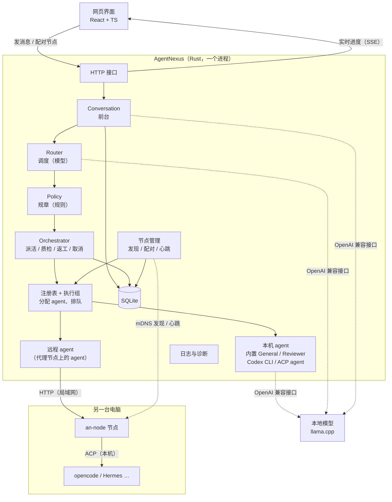
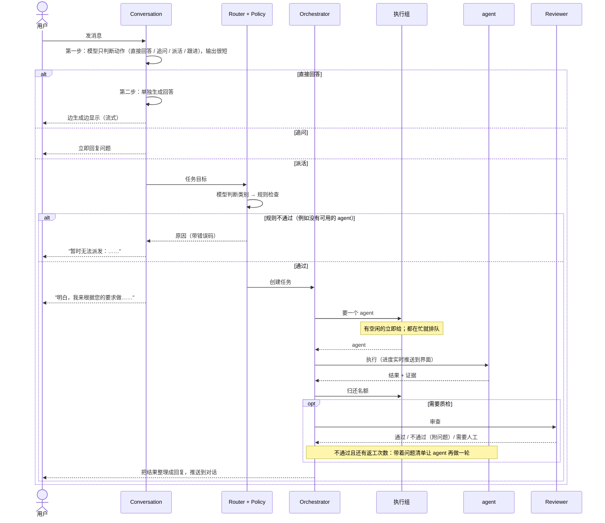
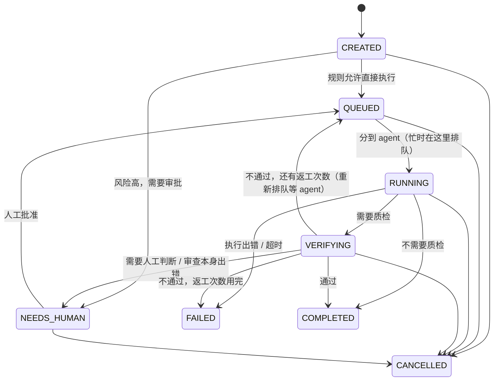
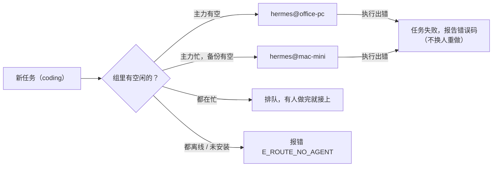
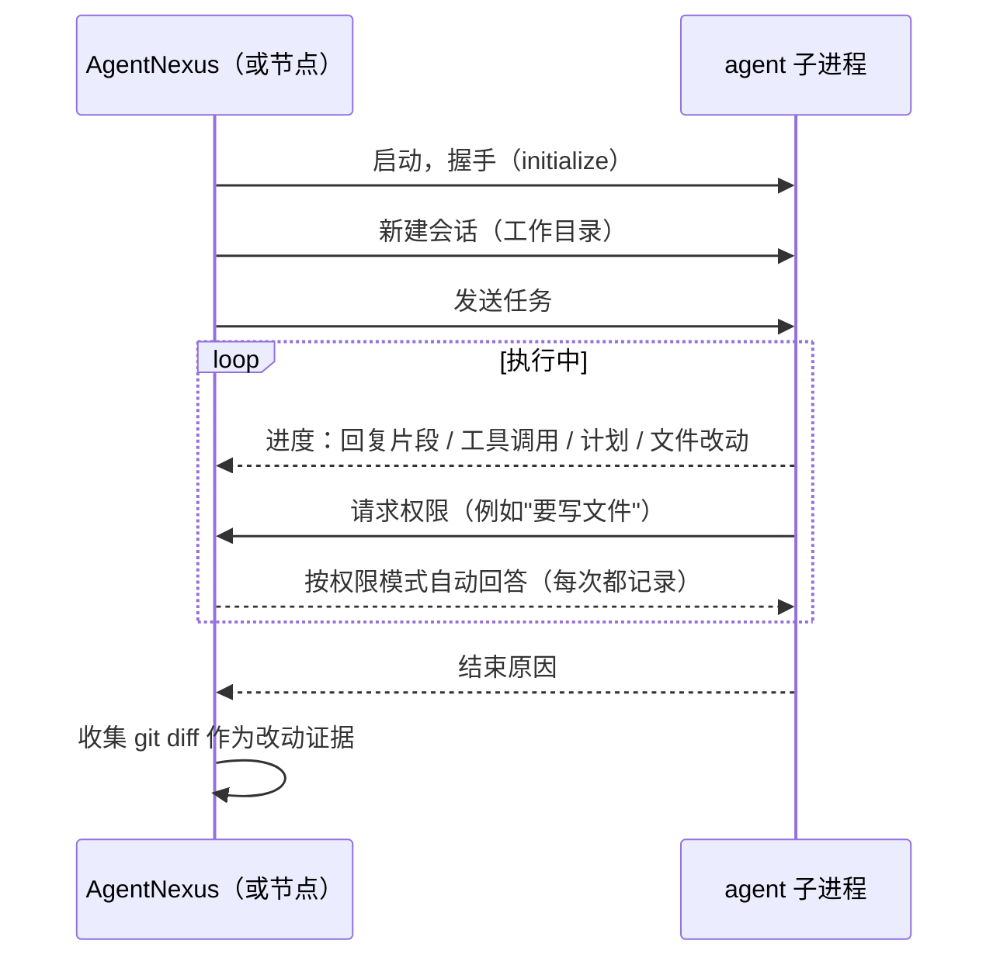
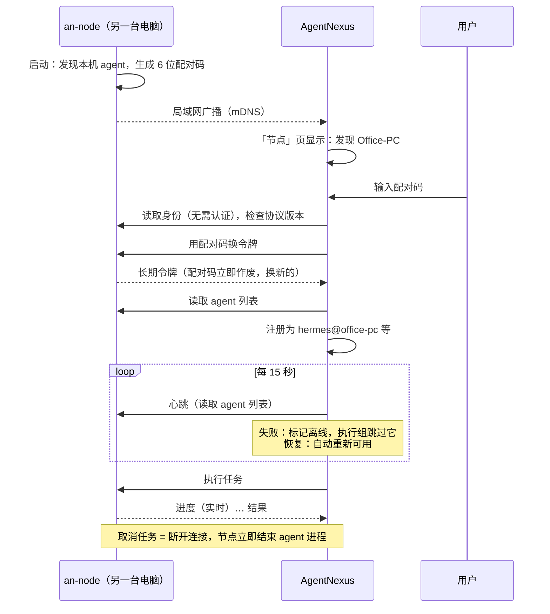
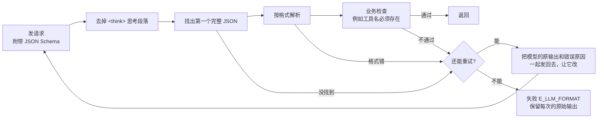
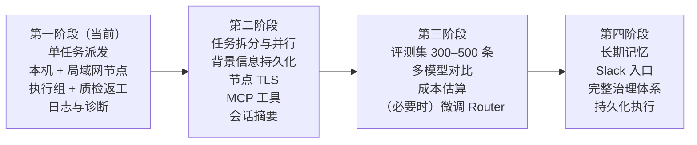

# AgentNexus MVP 设计文档

MCP 能力目录与 General 轻量 Harness 的新增设计、协议和阶段边界见 [mcp/DESIGN.md](mcp/DESIGN.md)，实施进度见 [mcp/PLAN.md](mcp/PLAN.md)。该设计保留既有 AgentAdapter、任务状态与执行组；不依赖 MOM 公告板实施。

| 项目 | 内容 |
|---|---|
| 版本 | v0.4：判断与回答分两步 + 流式回答；提示词按优先级重写；审查模式可配置；路由评测集 v2 |
| 日期 | 2026-11-05 |
| 状态 | 已实现，全部自动化测试通过；尚未接真实模型、真实 Codex / opencode / Hermes 验证 |

这份文档先用大白话讲清楚"系统是什么、怎么用"，再讲"每一块怎么实现"。只想了解全貌的话，读第 1–3 节就够了。

---

## 目录

1. [一页看懂](#1-一页看懂)
2. [设计原则](#2-设计原则)
3. [怎么用](#3-怎么用)
4. [整体结构](#4-整体结构)
5. [一个请求的完整旅程](#5-一个请求的完整旅程)
6. [任务状态](#6-任务状态)
7. [执行者：agent 与执行组](#7-执行者agent-与执行组)
8. [节点：用其他电脑上的 agent](#8-节点用其他电脑上的-agent)
9. [模型调用：让小模型稳定输出](#9-模型调用让小模型稳定输出)
10. [日志与排查](#10-日志与排查)
11. [数据与接口](#11-数据与接口)
12. [配置一览](#12-配置一览)
13. [安全](#13-安全)
14. [测试](#14-测试)
15. [已知限制](#15-已知限制)
16. [后续计划](#16-后续计划)
17. [参考来源](#17-参考来源)

---

## 1. 一页看懂

把 AgentNexus 想象成一个小团队：

| 团队里的角色 | 系统里的组件 | 做什么 |
|---|---|---|
| 前台 | **Conversation** | 跟你对话。简单问题直接答；说不清楚就追问；需要干活就交给调度；干完了把结果讲给你听 |
| 调度员 | **Router** | 判断这件事属于哪一类：一般事务（general）、写代码（coding）、审查（reviewer） |
| 规章制度 | **Policy** | 固定规则，不靠模型判断：有没有人能做？风险高要不要先审批？做完要不要质检？ |
| 干活的人 | **agent** | 真正执行的程序：内置的、本机的 Codex / opencode / Hermes，或者**另一台电脑**上的 agent |
| 小组 | **执行组** | 同一类工作可以安排几个同类型的 agent：一个主力，其余待命，忙不过来时分担 |
| 质检 | **Reviewer** | 独立检查结果，只给意见，最后的状态由规则决定 |
| 分公司 | **节点** | 装在另一台电脑上的小程序（`an-node`），让那台电脑上的 agent 也能接活 |
| 工作日志 | **日志与诊断** | 每一步都有记录，出了问题能按编号查到原因 |

一句话：**你只跟前台说话；后面谁来做、在哪台电脑上做、做得对不对，系统按规则安排，并且全程有记录。**

### MVP 要验证的问题

| # | 问题 | 怎么验证 |
|---|---|---|
| G1 | 本地小模型能不能稳定地判断"要不要派活、派给谁" | 结构化输出 + 自动重试 + 评测工具 `an-eval` |
| G2 | 一套接口能不能同时接内置 agent、本机外部 agent、其他电脑上的 agent | 统一的 `AgentAdapter` 接口 |
| G3 | "agent 说做完了"和"真的做对了"能不能分开 | Policy 决定是否质检，Reviewer 独立审查，不通过就返工 |
| G4 | 用户只面对一个入口，后台进度看得见 | Conversation 统一交付，任务进度实时推送到界面 |
| G5 | Rust 后端 + TS 前端是否可行 | 已实现，前后端类型自动同步 |
| G6 | 新手接入新 agent 是否足够简单 | 本机自动发现；其他电脑运行一条命令 + 输入配对码 |
| G7 | 出了问题能不能快速、自动地定位 | 统一事件名和错误码的 JSON 日志 + 诊断接口 |

### 这一版不做

任务拆分与并行子任务、长期记忆、服务重启后续跑、多用户与登录、Slack 入口、跨互联网的节点连接、模型微调。配置式 MCP 工具接入见独立 MCP 设计；动态安装与二进制产物仍未实现。

---

## 2. 设计原则

1. **模型负责理解，程序负责决定。** 模型给出的判断（比如风险高低）只是建议；能不能执行、要不要审批、要不要质检，由固定规则决定。
2. **用户只面对一个入口。** 执行的 agent 只把结果交回来，从不直接跟用户说话（"Agents as Tools"）。
3. **出错就报错，不悄悄换人。** agent 执行失败时如实告诉用户（带错误码），不会自动找别的 agent 重做。原因：失败的任务可能已经改了一半文件，换人重做可能把事情弄得更糟，也会掩盖问题。
4. **只用明确指定的人。** 执行组的成员必须在配置里写明，而且必须是同一类型。系统不会根据"能力描述"自己去找别的 agent 顶上。
5. **本机的事在本机做。** 另一台电脑上的 agent，由那台电脑上的节点负责启动、限制权限、收集改动证据，AgentNexus 只收结果。
6. **所有状态由 AgentNexus 自己保存。** 任务、结果、事件都写进数据库，不依赖任何 agent 的内存。
7. **每一步都可追查。** 日志里每条记录都有固定的事件名，出问题时带错误码，并关联到具体的会话、任务、agent、节点。

### 参考了哪些开源框架

参考《来自工业界的多 Agent 框架最全细节对比》（2025-08-28）中的 7 个框架，只借鉴做法，不引入框架本身（它们以 Python 为主）：

| 来源 | 借鉴了什么 | 在本项目中 |
|---|---|---|
| OpenAI Agents SDK | 主 agent 保留对话控制权，其他 agent 当工具用 | Conversation 统一交付 |
| LangGraph | 状态持久化 | 任务状态全部写数据库 |
| Pydantic AI | 强制结构化输出 + 出错重试 | 所有模型决策都是 JSON，不合格就带着错误原因重试 |
| CrewAI / Agno | 角色 + 能力描述 | 能力卡片 `AgentCard` |
| AutoGen | 多 agent 群聊 | **不借鉴**：成本高、难控制 |

---

## 3. 怎么用

### 3.1 只用这台电脑

```bash
cp config.example.toml config.toml        # 改一下本地模型地址
cd web && npm install && npm run build && cd ..
cargo run --release --bin agentnexus
```

打开 http://127.0.0.1:8787 。本机装了 opencode / Hermes / pi-acp 的话，启动时会被**自动发现**，左下角能看到。

### 3.2 用另一台电脑上的 agent（节点）

假设 Hermes 装在另一台电脑上（macOS、Linux、Windows 都可以）：

1. **在那台电脑上**运行节点程序：
   ```bash
   an-node
   ```
   它会显示：
   ```
   AgentNexus 节点已启动
    名称：Office-PC（node-b82c…）
    地址：http://192.168.1.23:7788
    agent：
      ✓ hermes（Hermes Agent，角色 general，并发 1）
    配对码：757 563（10 分钟内有效，在 AgentNexus 的「节点」页输入）
   ```
2. **在 AgentNexus 界面**打开右侧「节点」页。同一局域网里的节点会自动出现；输入配对码，点「配对」。
3. 完成。那台电脑上的 Hermes 会以 `hermes@office-pc` 的名字出现在 agent 列表里。

如果网络不允许自动发现（有些公司网络会屏蔽），在「节点」页的「按地址添加」里填地址和配对码即可。

### 3.3 安排执行组（可选）

想让两台电脑上的 Hermes 一起分担 general 类工作：

```toml
[agents.assign]
general = ["hermes@office-pc", "hermes@mac-mini"]
```

第一个是主力，第二个待命。主力正在忙（达到它的并发上限）时，新任务交给待命的；都在忙就排队。详见第 7 节。

### 3.4 出问题了怎么办

1. 打开界面右侧「诊断」页：能看到模型是否连通、每个执行组的成员和状态、最近的问题和错误码。
2. 点「复制诊断信息」，把内容贴给 AI 或开发者。
3. 需要更多细节时，看 `logs/agentnexus.jsonl.<日期>`（节点的在 `~/.agentnexus-node/logs/`），按任务编号过滤即可还原完整过程。详见第 10 节。

---

## 4. 整体结构

### 4.1 组件图



### 4.2 谁负责什么

| 问题 | 负责的组件 | 用不用模型 |
|---|---|---|
| 这句话要不要派活？说清楚了吗？ | Conversation | 用 |
| 这件事属于哪一类？ | Router | 用 |
| 能不能做、要不要审批、要不要质检？ | Policy | 不用 |
| 具体由哪个 agent 做、忙了怎么办？ | 注册表 + 执行组 | 不用 |
| 派活、收结果、组织质检和返工、取消 | Orchestrator | 不用 |
| 真正干活 | agent | 视 agent 而定 |
| 结果对不对？ | Reviewer 给意见，规则定状态 | 用 / 不用 |
| 把结果讲给用户 | Composer（Conversation 的一部分） | 用（失败时退回固定模板） |

### 4.3 代码结构

```
crates/
  core/      公共数据结构、错误码、节点协议（不依赖任何具体实现）
  observe/   日志与诊断（AgentNexus 和节点共用）
  llm/       模型调用：结构化输出、重试
  agents/    各种 agent：内置 General / Reviewer、Codex、ACP、远程（节点）
  runtime/   Conversation、Router、Policy、Orchestrator、注册表与执行组、节点管理、数据库
  node/      节点程序 an-node
  server/    AgentNexus 主程序、HTTP 接口；评测工具 an-eval；模拟 agent an-mock-acp
web/         网页界面
evals/       路由评测集
```

依赖方向只能从上往下：`server → runtime → agents → llm → core`；`node → agents`；`observe` 被 server 和 node 共用。

### 4.4 四个程序

| 程序 | 运行在 | 作用 |
|---|---|---|
| `agentnexus` | 你的主电脑 | 主程序：界面、对话、调度、执行 |
| `an-node` | 任何想贡献 agent 的电脑 | 节点 |
| `an-eval` | 开发者 | 批量测试小模型的路由准确率 |
| `an-mock-acp` | 测试 / 新手体验 | 模拟的 ACP agent，不需要安装任何东西 |

---

## 5. 一个请求的完整旅程



几个要点：

- **判断和回答分两步。** 第一步只输出动作（几十个字），所以很快；确定要直接回答后，第二步再生成回答，并且边生成边显示。以前两者在一次调用里完成，模型要把整段回答写完才能判断结束，用户要等几十秒。
- **对话请求只等决策，不等执行。** 派活后立刻回复"已开始处理"，结果做完后再推送过来。
- **任务执行中用户又发消息**：前台会判断这是对某个进行中任务的"补充要求"还是"取消"。补充要求的做法是：取消旧任务，把要求合并后重新派发。
- **名额在质检前归还**，让排队的任务尽早开始。
- **需要审批的任务**（风险达到 `approval_risk`）创建后停在"待人工"，在任务面板点"批准执行"后才开始。

---

## 6. 任务状态



| 状态 | 含义 |
|---|---|
| CREATED | 刚创建 |
| QUEUED | 等待执行；执行组都在忙时停在这里排队 |
| RUNNING | 已分到 agent、正在执行（返工先回到 QUEUED，分到 agent 后再到这里） |
| VERIFYING | 质检中 |
| NEEDS_HUMAN | 等人工：审批，或审查认为需要人判断 |
| COMPLETED | 完成（通过质检，或不需要质检） |
| FAILED | 失败。原因会带错误码，例如 `[E_ACP_HANDSHAKE] …` |
| CANCELLED | 已取消 |

COMPLETED、FAILED、CANCELLED 是终点，进入后不会再变。

**状态守卫**：每次状态变化都写明"允许从哪些状态来"，由数据库的一条带条件 UPDATE 完成（`Store::transition_task` / `finish_task` / `approve_task`）。所以：
- 取消和完成同时发生时，谁先写进数据库谁算数：已完成的任务取消不了，交付照常；已取消的任务不再写结果、不再交付；
- 同一个任务被同时批准多次，只有一次生效，只执行一遍；
- 写库和推送状态事件在同一把锁里完成，前端收到的状态顺序与数据库一致。
被拒绝的状态变化记一条 `task.status_conflict`（WARN）。

**超时**（`task_timeout_secs`）：从第一次分到 agent 开始计时，排队等 agent 的时间不算；返工时的排队计入。

服务重启时，还没结束的任务（CREATED / QUEUED / RUNNING / VERIFYING）会被标记为 FAILED，这一版不做续跑。

---

## 7. 执行者：agent 与执行组

### 7.1 agent 的种类

| 种类（kind） | 例子 | 运行在 | 说明 |
|---|---|---|---|
| `builtin` | General、Reviewer | AgentNexus 内部 | General 用本地模型 + 5 个工具（时间、计算器、列文件、读文件、写文件），文件只能在工作目录内读写 |
| `cli` | Codex | 本机 | 以命令行方式调用 `codex exec`，参数可配置 |
| `acp` | opencode、Hermes、pi-acp | 本机 | 通过 ACP（Agent Client Protocol）标准协议接入，一个适配器接所有 |
| `node` | `hermes@office-pc` | 另一台电脑 | 通过节点执行，见第 8 节 |

每个 agent 都有一张**能力卡片**：

| 字段 | 含义 | 例子 |
|---|---|---|
| `id` | 唯一名称，执行组配置用它 | `opencode`、`hermes@office-pc` |
| `kind` | 种类 | `acp` |
| `agent_type` | 类型，只有同类型才能进同一个执行组 | `hermes` |
| `role` | 能做哪类事 | `coding` |
| `location` | 在哪台电脑 | `本机`、`Office-PC` |
| `max_concurrent` | 同时最多做几件事 | `1` |
| `enabled` / `disabled_reason` | 现在能不能用；不能用的原因 | `找不到命令 opencode` |

### 7.2 本机 agent 的自动发现

启动时按预设查找命令，找到就注册，不需要任何配置：

| 预设 | 命令 | 角色 |
|---|---|---|
| `opencode` | `opencode acp` | coding |
| `hermes` | `hermes acp` | general |
| `pi` | `pi-acp`（第三方适配器，较不成熟） | coding |

查找范围：PATH，以及 `~/.npm-global/bin`、`~/.local/bin`、`~/.opencode/bin`、`~/.bun/bin`、`~/.cargo/bin`、`~/.hermes/bin`、`/opt/homebrew/bin`、`/usr/local/bin`。只检查文件是否存在，**不会运行它**。

接入其他 ACP agent 只需三行配置（`id`、`command`、`role`），见第 12 节。

### 7.3 执行组

**执行组 = 某类工作由哪几个 agent 来做。**

```toml
[agents.assign]
coding = "opencode"                                   # 只用一个
general = ["hermes@office-pc", "hermes@mac-mini"]     # 一个主力 + 一个备份
```

规则：

| # | 规则 | 为什么 |
|---|---|---|
| 1 | 成员必须在配置里**明确写出**；系统不会自己找 | 谁在干活应该是确定的、可预期的 |
| 2 | 成员必须**同一类型**（`agent_type` 相同）、**同一角色**，否则报 `E_POOL_CONFIG` | 不同类型的 agent 能力、模型、权限都可能不同，混在一起结果不可预期 |
| 3 | 分配时按顺序找**第一个有空闲名额**的成员 | 主力优先，忙不过来时备份分担 |
| 4 | 全都忙时**排队等待**，有人做完立即接上（事件里显示"排队等待"，日志 `W_POOL_WAIT`） | 处理并发，而不是报错 |
| 5 | **离线**或**未安装**的成员直接跳过 | 备份本来就是为了应对"主力不在" |
| 6 | 执行**出错就报错**，不会换给备份重做 | 见原则 3 |
| 7 | 全部成员都不可用时报 `E_ROUTE_NO_AGENT`，并列出每个成员的原因 | 让用户知道该修什么 |

没有配置执行组的角色：使用该角色**第一个可用**的 agent，顺序是：内置 → Codex → 本机 ACP（自定义的在前，自动发现的在后）→ 节点。



**Router 总是在全部三类工作中选择。** 早期版本只让模型在"当前有人能做"的类别里选，结果是 coding 没人时，模型会把写代码的请求悄悄改派给 general。现在改为：模型只按任务本身判断类别，没有可用 agent 时由 Policy 明确报错。

### 7.4 ACP agent 的执行过程

ACP（Agent Client Protocol）是编辑器和 AI agent 之间的开放协议。AgentNexus 扮演"编辑器"的角色，把 agent 作为子进程启动，通过标准输入输出通信。



| 权限模式 `permission` | 行为 |
|---|---|
| `allow_all`（默认） | 全部允许。任务已经过了规则检查和人工审批，所以默认放行；每次都记录在证据里 |
| `read_only` | 只允许读取、搜索类操作 |
| `deny_all` | 全部拒绝 |

结果中的证据：执行者（`executed_by`）、结束原因、工具调用清单、每次权限请求的处理、git 改动统计。产物优先用 `git diff`；工作目录不是 git 仓库时，用 agent 自己报告的改动。

取消任务时，SDK 会结束 agent 的**整个进程组**（包括它启动的子进程），测试验证过没有残留。

实现使用 ACP 官方 Rust SDK `agent-client-protocol` 5.x。

### 7.5 Codex CLI

以命令行方式调用 `codex exec`，参数模板中的 `{prompt}`、`{workdir}`、`{last_message_file}` 会被替换。不同版本参数可能不同，请先运行 `codex exec --help` 核对。执行后收集 `git diff` 作为证据。

子进程放在独立的进程组里（`crates/agents/src/proc_group.rs`），它启动的 shell、npm、测试等孙进程会一起被清理：

| 场景 | 处理 |
|---|---|
| 正常退出 | 最多再读 0.5 秒剩余输出（孙进程可能还占着输出管道），然后 SIGKILL 组内残留进程 |
| 超时（`timeout_secs`） | 整个组先 SIGTERM，等 3 秒，再 SIGKILL |
| 取消 | 立即 SIGKILL 整个组 |

`web_search` / `web_fetch` 调用的搜索命令用同样的方式管理。每次清理记一条 `agent.process_group_killed`。

### 7.6 质检与返工

| 任务 | 是否质检 |
|---|---|
| coding | 一律质检 |
| general 且需要生成文档（L3 / L4） | 质检 |
| reviewer 自己的任务 | 不质检 |

审查结论：通过 → 完成；需要人工 → 待人工；不通过 → 带着问题清单返工（默认最多 1 轮），返工用完仍不通过 → 失败。审查本身出错时**不算通过**，进入"待人工"。

### 7.7 用户发起的审查请求（可配置）

上面的质检是系统**自动**做的。用户**主动**说"帮我审查这段 SQL""评估一下这个方案"时怎么处理，由 `[conversation] review_requests` 决定：

| 模式 | 对话里直接给出的短内容 | 对话里的长内容（约 30 行 / 1500 字以上） | 文件中的内容 | 代码仓库中的代码 |
|---|---|---|---|---|
| `reviewer`（默认） | 交给独立审查 | 交给独立审查 | general 读取后审查 | coding 审查 |
| `direct` | 前台直接回答 | 前台直接回答 | general 读取后审查 | coding 审查 |
| `auto` | 前台直接回答 | 交给独立审查 | general 读取后审查 | coding 审查 |

取舍：`reviewer` 有记录、有证据、由独立的一方完成，但每个简单请求都多一轮后台任务；`direct` 最快，但前台"自己审自己"；`auto` 折中。三种模式都可以用评测集对比（第 9.4 节）。

无论哪种模式，需要读取文件或仓库才能审查的请求都交给能读取它们的角色（Reviewer 本身不能读文件）。

---

## 8. 节点：用其他电脑上的 agent

### 8.1 为什么需要节点

ACP 是通过"启动子进程"来通信的，只能用**同一台电脑**上的 agent。用户的 agent 可能装在另一台电脑上，所以需要在那台电脑上运行一个小程序——**节点**（`an-node`）。

为什么不让 AgentNexus 直接远程连 agent，而要在中间加一个节点？

| 好处 | 说明 |
|---|---|
| 本机的事在本机做 | 自动发现 agent、工作目录、git 改动收集，都在 agent 所在的电脑上完成，路径和证据都是对的 |
| 安全边界在那台电脑上 | 权限规则、允许的工作目录由节点在本机执行 |
| 通用 | 节点上跑的是 opencode、Hermes 还是以后的新 agent，AgentNexus 这边都一样 |
| 不依赖 macOS | 自动发现用 mDNS 标准协议（纯 Rust 实现），macOS、Linux、Windows 都可以 |

### 8.2 工作方式



### 8.3 配对与安全

| 规则 | 说明 |
|---|---|
| 配对码 | 6 位数字，10 分钟有效，**用一次就作废**，节点会显示新的 |
| 输错保护 | 同一个配对码输错 5 次，节点自动换新码（防止暴力尝试） |
| 令牌 | 配对成功后发放的长期令牌，之后所有请求都要带上；保存在节点的 `~/.agentnexus-node/node.json`（只有当前用户可读）和 AgentNexus 的数据库 |
| 未配对的请求 | 一律拒绝（`E_NODE_AUTH`），只有"读取身份"接口不需要认证 |
| 并发保护 | 节点自己也会检查每个 agent 的并发上限，超出时拒绝（`E_NODE_BUSY`） |
| 解除配对 | 在「节点」页点"解除配对"，AgentNexus 删除令牌，该节点的 agent 立即不可用 |

⚠️ **局域网通信目前是明文 HTTP**：任务内容、代码改动在局域网内可能被他人看到。只在可信的网络（家里、公司内网）使用；跨网络请用 Tailscale 等私有网络，不要把节点暴露到互联网。见第 13 节。

### 8.4 节点上线与离线

- AgentNexus 启动时先从数据库读出已配对的节点，标记为离线；随后的心跳把它们更新为真实状态。
- 节点离线时，它的 agent 显示为不可用（原因"节点 X 离线"），执行组会跳过它们；正在执行的任务会因连接中断而失败（`E_NODE_UNREACHABLE`）。
- 节点恢复后，下一次心跳自动恢复可用，排队中的任务会被唤醒。
- 节点拒绝令牌（例如节点的数据被清掉了）时报 `E_NODE_AUTH`，需要重新配对。

### 8.5 节点的配置

全部可选，不写配置也能直接运行。命令行参数会覆盖配置文件：

```bash
an-node                                   # 全部默认
an-node node.toml                         # 使用配置文件
an-node --port 7799 --name 办公室电脑 --workdir ~/code/demo --no-advertise
```

| 配置项 | 默认值 | 说明 |
|---|---|---|
| `name` | 本机名 | 显示名称；会成为 agent id 的后缀（`hermes@办公室电脑`） |
| `bind` | `0.0.0.0` | 局域网使用需要它；只给本机用改成 `127.0.0.1` |
| `port` | `7788` | |
| `workdir` | `~/agentnexus-node/workspace` | agent 的默认工作目录，建议是 git 仓库 |
| `state_dir` | `~/.agentnexus-node` | 节点身份和令牌 |
| `advertise` | `true` | 是否在局域网广播 |
| `log_dir` | `~/.agentnexus-node/logs` | JSON 日志目录 |
| `[acp] auto_detect` | `true` | 自动发现本机 agent |
| `[[acp.agents]]` | 无 | 自定义 agent，写法与 AgentNexus 相同 |

### 8.6 节点接口

| 接口 | 认证 | 作用 |
|---|---|---|
| `GET /node/info` | 无 | 节点身份：id、名称、版本、协议版本、操作系统 |
| `POST /node/pair` | 配对码 | 换取令牌 |
| `GET /node/agents` | 令牌 | agent 列表（也用作心跳） |
| `POST /node/run` | 令牌 | 执行任务；响应是实时事件流：若干 `progress`，最后一个 `result` 或 `error` |
| `GET /node/diagnostics` | 令牌 | 节点的诊断信息 |

局域网广播的服务类型是 `_agentnexus._tcp.local.`，附带 `id`、`name`、`ver`、`proto`、`os` 信息。

---

## 9. 模型调用：让小模型稳定输出

### 9.1 结构化输出

所有需要模型做决定的地方（Conversation 判断、Router 分类、General 每一步、Reviewer 审查），都要求模型输出**固定格式的 JSON**。



| 做法 | 说明 |
|---|---|
| 三种格式约束方式 | `json_schema`（默认，较新的 llama.cpp 会据此限制输出）、`json_object`（llama.cpp 旧写法）、`prompt_only`（只靠提示词，兼容性最好） |
| 扁平的格式 | 所有字段都必填，不适用的填空字符串；比嵌套、可选字段更适合小模型 |
| 用枚举限制选项 | 角色、工具名都写成固定选项，模型无法编造不存在的 agent 或工具 |
| 出错反馈 | 把具体错误（"action=delegate 时 task_goal 不能为空"）发回给模型重试，默认最多重试 2 次 |
| 按角色选模型 | `[models]` 可以给 Conversation、Router、General、Reviewer 分别指定模型 |

### 9.2 前台的判断规则（提示词）

前台（Turn Controller）的提示词集中在 `crates/runtime/src/prompts.rs`。根据第一次本地评测（27B 模型，26 条）的错判分析，规则改成**按优先级排列、命中第一条即停止**：

| 优先级 | 动作 | 什么时候 |
|---|---|---|
| 1 | follow_up | 用户在补充、修改、取消某个进行中的任务 |
| 2 | delegate（必须） | 精确计算；当前日期时间；读写工作目录文件或生成并保存文档；改代码仓库；审查请求（视审查模式）——**即使模型自己会也不能直接回答** |
| 3 | clarify | 缺少无法自行确定的关键信息。路径、格式、测试命令等执行者能确定的细节不算 |
| 4 | respond | 其余：闲聊、常识、建议、在对话里给示例代码 |

另外两点：
- **把工具清单告诉前台**。以前只有 Router 能看到，前台不知道"现在几点"可以交给 `current_time`，只好反问时区；
- **说明系统有默认工作目录和代码仓库**，用户提到"项目""仓库""某个文件"时不必追问路径。

直接回答的提示词也在这个文件里：要求先给结论，不编造需要工具才能获得的信息（时间、文件内容、精确计算结果）。

### 9.3 流式回答与模型分工

- 回答通过推理服务的流式接口（`stream: true`）逐段生成，每段立即推送到界面（`assistant_delta` 事件，只推送不写数据库）；生成完后作为正常消息保存，消息 id 与片段的 `stream_id` 相同，界面无缝替换。
- 推理模型的 `<think>…</think>` 思考段在流式过程中就被过滤，包括标签被拆在两段之间的情况。
- 推理服务不支持流式时，自动退回一次性生成（日志 `conversation.reply_stream_failed`）。
- `[models]` 可以给"判断"（`conversation`）和"回答"（`reply`）分别指定模型：判断用小而快的模型，回答用质量更好的模型。

### 9.4 路由评测

`an-eval` 只跑"判断 + 路由"，不执行任务，用于对比不同模型、不同提示词。

| 评测集 | 条数 | 用途 |
|---|---|---|
| `evals/routing-v1.jsonl` | 26 | 第一次评测用的集合，保留用于和 27B 基线对比 |
| `evals/routing.jsonl`（v2） | 90 | 主评测集，由 `evals/make_dataset.py` 生成 |

v2 覆盖：闲聊常识建议（18）、追问（9）、计算与时间（9）、文件与文档（12）、改代码（12）、高风险（4）、审查请求（12，期望随审查模式变化）、跟进进行中的任务（8）、多轮对话（6）。样本可以带对话历史、进行中的任务，以及不同审查模式下的不同期望。

工具输出：整体通过率；动作、角色、类别、工具、风险、跟进任务的准确率；动作混淆矩阵；误判分类（多派、漏派、多问、少问、漏跟进、错跟进……）；按标签的通过率；判断和路由各自的延迟。每次运行生成逐条结果（含模型原始输出）和一份汇总 JSON，便于对比。

完整的评测步骤、报告模板和建议达标线见 `evals/EVAL_PROMPT.md`，可以直接交给本地 Claude 执行。

### 9.5 General Agent 的工具调用

General Agent 没有用推理服务自带的"函数调用"功能（不同小模型对它的支持差别很大），而是每一步都让模型输出 `{"action": "tool_call" | "final", "tool", "args", "answer"}`。

当路由同时要求 `web_search` 与 `write_file`（研究报告）时，不走上述逐步循环，改由代码控制固定流程（实现见 `crates/agents/src/report.rs`）：

1. **规划**：模型输出结构化大纲（标题、路径、各章 id/标题/范围/检索词）；章数 1–5，每章 1–2 个查询。
2. **检索**：代码按大纲并行调用 `web_search`，查询去重，全文最多 `report_max_searches` 次；结果编号为 `[S1]`…；全部失败则任务失败，不凭记忆写。
3. **写章**：每章一次模型调用，直接输出 Markdown；同时最多 `report_parallel` 路；失败重试 1 次后标为 missing。
4. **汇合**：代码按大纲顺序拼装成功章节，把 `[Sn]` 换成检索到的真实链接并剔除未知编号，生成参考资料列表；模型再写一次摘要与结论；过半章节成功才算完成，缺失章节写在交付说明里，不用其他章填补。

章节结果的信封字段与 9.6（`branch_id` / `status` / `missing` / `payload`）对齐，并行发生在 General 内部；编排器模板拆分仍按 9.6，研究报告暂不接入。取消任务时中止进行中的模型请求与检索子进程（`proc_group`）。

### 9.6 M4：模板拆分与输入输出 JSON

本节是 M4.3 的设计，尚未改代码。线上仍是一条消息一个动作。

能串行做完的留在一个 agent 里。只有几路都长、互不等待、串起来会超过一次任务能扛住的时间，才套模板并行。模型不现场编图。图是人手写的模板；能力卡片只声明节点上谁能做（`id`、角色、输入输出类型、并发、产物），不声明边。

Router 只做封闭选择题，不承担工序知识。输出保持扁平 JSON，字段都必填，不适用的填空字符串：

```json
{
  "template_id": "",
  "deliverable": "",
  "slots_ok": "no"
}
```

| 字段 | 取值 | 程序怎么用 |
|---|---|---|
| `template_id` | 已注册模板的 `id`，或空字符串 | 空字符串表示不拆，走现有的单动作 |
| `deliverable` | 该模板声明的交付物名称，或空字符串 | 必须与模板一致，否则拒绝拆分 |
| `slots_ok` | `yes` 或 `no` | `no`、模板未注册、或卡片对不上，整单退回一个 agent |

吃不准就不拆。拆错会并行跑出几路废结果。

模板本身也是 JSON。程序在加载时检查：无环、每个 `capability` 能在能力卡片里找到、分支数量不超过后台槽位、下游要的字段上游声明了。分支内部的先后写在 `serial_steps` 里，留给这一路的 agent，不拆成图上的节点。

```json
{
  "id": "quote",
  "deliverable": "报价单",
  "required_slots": ["序列号或型号", "交期"],
  "branches": [
    {
      "id": "damage",
      "capability": "general",
      "serial_steps": ["读测量值", "对照修复限度", "给出可修结论和工时"],
      "output_required": ["verdict", "hours"]
    },
    {
      "id": "parts",
      "capability": "general",
      "serial_steps": ["取原厂清单", "对库存和替代件", "算缺件金额"],
      "output_required": ["shortage_amount"]
    },
    {
      "id": "history",
      "capability": "general",
      "serial_steps": ["查本机维修", "查同型号返修", "给保修风险"],
      "output_required": ["warranty_risk"]
    }
  ],
  "join": { "capability": "general", "writes_file": true }
}
```

每一路返回同一个信封。`status` 不是 `ok` 时 `payload` 必须是空对象，汇总不得用别的路填补。

```json
{
  "branch_id": "damage",
  "status": "ok",
  "missing": "",
  "payload": { "verdict": "可修", "hours": "6" }
}
```

| 字段 | 规则 |
|---|---|
| `branch_id` | 必须等于模板里的分支 `id` |
| `status` | `ok`、`missing`、`failed` 三者之一 |
| `missing` | `ok` 时为空；否则写缺的是哪一项 |
| `payload` | `ok` 时必须带齐该分支的 `output_required`，且不得多出未声明的键；其他状态为 `{}` |

汇合的输入是各路信封组成的数组，键必须盖住全部 `branch_id`，缺席的一路记为 `status: "missing"`。`writes_file` 为真时，由汇合任务把文件落盘。Composer 只根据这份汇合结果回复用户：文件名、各路结论、缺了哪一路。它不重新取数，也不编造未出现的字段。

第一批只放三张模板，评测用现场原话，并放上「看起来专业但只有一台、数据已经在消息里」的反例。准确度只考核 `template_id`、`deliverable`、`slots_ok`。判错记在这一层，经现有纠错进入评测草稿；人不确认就不改线上模板。

| 模板 `id` | 何时并行 | 每路内部仍串行 | 交付物 |
|---|---|---|---|
| `quote` | 损伤、物料、历史三路互不等待，客户等当天修复价 | 测量后再对限度；物料号确定后再查替代件；本机故障类别确定后再统计同型号 | 报价单 |
| `stop_line` | 一批机台彼此无关，逐台串行会占满检验档期 | 同一台内：铭牌、检测、出厂参数、超差、处置 | 停线清单 |
| `release` | 试验、合规、客户条款三条线都没完不能发货 | 循环结束后才读曲线；批次号确定后才查材质证明；条款列出后才对现场记录 | 放行单 |

---

## 10. 日志与排查

### 10.1 三种输出

| 输出 | 给谁看 | 内容 |
|---|---|---|
| 控制台 | 人 | 简洁的运行信息 |
| **JSON 日志文件** | 程序、脚本、AI | 一行一条记录，字段固定；按天分文件：`logs/agentnexus.jsonl.2026-11-05`，节点在 `~/.agentnexus-node/logs/an-node.jsonl.*` |
| **诊断接口** | 人和程序 | `GET /api/diagnostics`（节点：`/node/diagnostics`）：最近 100 条问题、按错误码统计、执行组状态、节点状态、模型连通性。界面「诊断」页显示的就是它 |

内存中保留最近 500 条 WARN / ERROR，供诊断接口查询。

### 10.2 每条记录的固定字段

| 字段 | 含义 | 例子 |
|---|---|---|
| `event` | 发生了什么，格式"模块.动作" | `task.status`、`acp.permission` |
| `code` | 错误码（只在出问题时有）。`E_` 开头是错误，`W_` 开头是警告 | `E_ACP_HANDSHAKE` |
| `conv_id` | 会话 | |
| `task_id` | 任务。**AgentNexus 和节点用同一个 task_id**，跨电脑的问题也能串起来查 | |
| `agent_id` | agent | `hermes@office-pc` |
| `node_id` | 节点 | |
| `elapsed_ms` | 耗时 | |

### 10.3 事件清单

| 模块 | 事件 | 什么时候记录 |
|---|---|---|
| 启动 | `server.started`、`log.file`、`agent.registered`、`agent.detected`、`agent.not_installed`、`pool.resolved`、`pool.invalid`、`config.unknown_key`、`task.interrupted`、`llm.connected`、`llm.unreachable` | 启动时的状态和配置问题 |
| 对话 | `conversation.turn`、`conversation.reply`、`conversation.reply_stream_failed`、`conversation.reply_failed`、`conversation.config` | 每轮对话一条（决策、角色、任务、尝试次数、耗时）；直接回答的生成（是否流式、字数、耗时）；启动时的审查模式 |
| 模型 | `llm.request_failed`、`llm.format_retry`、`llm.structured_failed`、`llm.structured_ok`（debug 级别） | 请求失败、格式不合格重试、最终失败 |
| 规则 | `policy.reject` | 没有可用 agent，拒绝派发 |
| 准入 | `admission.preadmitted`、`admission.submitted`、`admission.clarified`、`admission.scored`、`admission.contracted`、`admission.approved`、`admission.activated`、`admission.rejected`、`admission.check`、`admission.warning`、`admission.downgraded`、`admission.revoked`、`admission.sampled` | agent 准入协议（E3）每次状态变化一条，带 `agent_id`；同名事件同时写入 `admission_events` 审计表 |
| 准入（编排器） | `admission.result_rejected`、`admission.tasks_aborted` | 凭证已作废时丢弃 agent 交回的结果（带 `task_id`、`epoch`）；撤权时中止该 agent 进行中的任务（带中止数与耗时） |
| 任务 | `task.status`、`task.status_conflict` | 每次状态变化一条（FAILED 为 ERROR 级别，NEEDS_HUMAN 为 WARN）；状态已被改掉、这次变化被拒绝时记 `task.status_conflict`（WARN，带期望状态和实际状态） |
| 执行组 | `pool.wait`、`pool.member_missing`（debug） | 都在忙需要排队；配置的成员还没连上 |
| 执行 | `task.no_agent`、`agent.run_start`、`agent.run_end`、`agent.run_failed`、`agent.process_group_killed` | 分配和执行；`agent.process_group_killed` 记录子进程组被清理（`reason`：cancelled / timeout / exited_with_leftovers） |
| ACP | `acp.permission`、`acp.finished`、`acp.handshake_failed`、`acp.runtime_error`、`acp.timeout` | |
| 质检 | `review.verdict`、`review.failed` | |
| 节点（AgentNexus 侧） | `discovery.found`、`discovery.removed`、`discovery.unavailable`、`node.paired`、`node.pair_failed`、`node.unpaired`、`node.online`、`node.offline`、`node.auth_failed`、`node.run_start`、`node.run_end` | 上线 / 离线只在状态变化时记录，避免刷屏 |
| 节点（节点侧） | `node.advertised`、`node.advertise_failed`、`node.code_rotated`、`node.paired`、`node.pair_failed`、`node.auth_failed`、`node.busy`、`node.run_start`、`node.run_end`、`node.run_failed`、`node.run_cancelled`、`node.state_save_failed` | |

补充事件（后端配置、调度与存储）：

| 模块 | 事件 | 什么时候记录 |
|---|---|---|
| 对话 | `conversation.queued` | 对话进入处理队列 |
| 存储 | `store.event_batch`、`store.read_slow` | 批量落库与超过阈值的读取 |
| 后端 | `llm.backend_probe`、`llm.backend_probe_failed`、`config.backends` | 后端探测和配置加载 |
| 模型 | `llm.call`、`llm.context_trim`、`llm.breaker`、`llm.retry`、`llm.truncated_retry`、`llm.ratelimit` | 调用结果、裁剪、熔断、重试和限速 |
| 槽位 | `llm.slot_acquire`、`llm.slot_release`、`llm.slots_mismatch` | 槽位申请、归还和配置不匹配 |

### 10.4 错误码清单

| 错误码 | 含义 | 常见原因 / 怎么办 |
|---|---|---|
| `E_LLM_UNREACHABLE` | 连不上模型服务 | llama.cpp 没启动，或 `[llm] base_url` 写错 |
| `E_LLM_HTTP` | 模型服务返回错误 | 常见于不支持当前的 `structured_mode`，换一种试试 |
| `E_LLM_FORMAT` | 重试后格式仍不合格 | 换更大的模型，或改用 `json_schema` 模式；看路由日志里的原始输出 |
| `W_LLM_FORMAT_RETRY` | 格式不合格，已自动重试 | 偶尔出现正常；频繁出现说明模型偏小 |
| `E_LLM_TIMEOUT` | 等模型超时（连接 / 首 token / token 间隔 / 总时长） | 看 `llm.call` 的 `outcome`：`timeout_first_token` 多半是排队或提示词太长，`timeout_idle` 是生成中途卡住 |
| `E_LLM_CONTEXT` | 请求超过模型上下文 | 提示词太长；上下文预算（pre-M3.4）会自动裁剪，仍出现请检查 `context_tokens` 配置 |
| `W_LLM_RATE_LIMITED` | 云端返回 429，按 `Retry-After` 退避重试 | 调低 `rpm` / `max_inflight` |
| `E_LLM_TRUNCATED` | 输出被 `max_tokens` 截断，放大一次仍不够 | 调大 `[llm].max_tokens`，或缩短要求输出的内容 |
| `E_LLM_STREAM` | 流式响应中途断开 | 服务端崩溃或网络中断；会自动重试 |
| `E_LLM_BREAKER` | 后端连续失败，熔断中，快速失败 | 先看前面几条失败原因；熔断 10 秒后自动试探恢复 |
| `E_LLM_BUSY` | 后端繁忙：排队等不到空闲槽位 / 并发许可 | 看诊断页的槽位占用；前台槽位不够就增加 `interactive_slots`，或换云端后端；排队期限用 `queue_secs` 调整 |
| `W_LLM_SLOTS_MISMATCH` | 配置的 `slots` 和 llama-server 实际槽位数（`-np`）不一致 | 改 `[backends.*] slots` 或重启 llama-server，使两边一致 |
| `W_LLM_CONTEXT_TRIM` | 提示词超过上下文预算，已裁剪（丢旧历史 / 长消息保留头尾） | 看 `llm.context_trim`：丢了几条、截断了几条；经常出现说明会话太长或 `context_tokens` 太小 |
| `W_LLM_RETRY` | 模型调用失败，已按退避重试 | 偶尔出现正常；频繁出现看 `llm.call` 的 `outcome` |
| `E_ROUTE_NO_AGENT` | 这类工作没有可用的 agent | 看错误信息里每个成员的原因：未安装、节点离线…… |
| `E_POOL_CONFIG` | 执行组配置错误 | 成员类型或角色不一致；或 `[agents.assign]` 角色名写错 |
| `W_POOL_WAIT` | 执行组都在忙，任务排队 | 经常出现说明需要加备份或调大并发 |
| `W_POOL_MEMBER_MISSING` | 配置的成员还不存在 | 节点还没连上，或 id 写错（「诊断」页有准确的 id） |
| `E_AGENT_NOT_INSTALLED` | agent 命令找不到 | 安装它，或修正 `command` |
| `E_AGENT_SPAWN` | agent 进程启动失败 | 权限、依赖问题 |
| `E_AGENT_TIMEOUT` | agent 超时 | 调大 `timeout_secs`，或拆小任务 |
| `E_AGENT_RUNTIME` | agent 执行出错（其他） | 看错误信息 |
| `E_ACP_HANDSHAKE` | ACP 握手失败 | 命令不是 ACP 模式（例如少了 `acp` 参数），或 agent 一启动就崩溃 |
| `E_ACP_RUNTIME` | ACP 执行中出错 | 看 agent 自己的日志 |
| `E_ACP_STOP` | agent 非正常结束 | 拒绝执行、超出 token 等，错误信息里有原因 |
| `E_REVIEW_FAILED` | 审查本身失败 | 通常是模型格式问题，任务会进入"待人工" |
| `E_TASK_TIMEOUT` | 任务超时（从第一次分到 agent 开始计时，排队不算） | 调大 `task_timeout_secs` |
| `E_ADMISSION_STATE` | 准入协议步骤顺序不对（例如未澄清就打分、Trusted 未审批就激活） | 按 S1→S7 顺序调用；Trusted 先人工审批 |
| `E_ADMISSION_INVALID` | 准入输入不合法（agent_id 格式、未知能力维度、分数超出 0–1、契约角色不对） | 按错误信息修正 Card 或分数 |
| `E_AGENT_REVOKED` | agent 已被撤权或凭证代际已作废，结果不被接受 | 查看 `admission_events`；需要恢复时重新走准入 |
| `E_NODE_UNREACHABLE` | 连不上节点 / 执行中断开 | 节点没运行、网络不通、防火墙挡了端口 |
| `E_NODE_AUTH` | 节点不认令牌 | 节点数据被清掉了，重新配对 |
| `E_NODE_PAIR` | 配对失败 | 配对码错误或过期，看节点上显示的最新配对码 |
| `E_NODE_BUSY` | 节点上的 agent 已满 | 多个 AgentNexus 共用一个节点时可能出现 |
| `E_NODE_AGENT_NOT_FOUND` | 节点上没有这个 agent | 节点重新配置过，等下一次心跳刷新 |
| `E_NODE_PROTOCOL` | 节点返回了看不懂的内容 | 版本不一致，升级两边 |
| `W_NODE_OFFLINE` | 节点离线 | |
| `W_DISCOVERY` | 局域网发现不可用 | 网络不支持组播，改用"按地址添加" |
| `W_CONFIG_UNKNOWN_KEY` | 配置里有不认识的字段，已忽略 | 多半是拼写错误或旧版本写法（例如旧的 `[agents.prefer]`） |
| `W_STORE_READ_SLOW` | 一次数据库读取超过 50ms | 看 `store.read_slow` 的 `op` 和 `ms`；事件写入已改成批量，若仍频繁出现再看磁盘 |

MCP 错误码见 [MCP 错误码表](mcp/DESIGN.md#错误码)，覆盖配置、连接、权限、协议、参数、工具执行与输出校验。

### 10.5 排查示例

```bash
# 某个任务的完整时间线（AgentNexus 和节点的日志都可以这样查）
jq -c 'select(.task_id == "task-xxxx") | [.timestamp, .event, .status, .code]' logs/agentnexus.jsonl.*

# 所有错误，按错误码统计
jq -r 'select(.code != null) | .code' logs/agentnexus.jsonl.* | sort | uniq -c | sort -rn

# 当前状态一览（与界面「诊断」页相同）
curl -s http://127.0.0.1:8787/api/diagnostics | jq
```

---

## 11. 数据与接口

### 11.1 数据库（SQLite）

| 表 | 内容 |
|---|---|
| `conversations` | 会话 |
| `messages` | 消息（可关联任务） |
| `tasks` | 任务：目标、角色、状态、路由、规则结论、结果、审查意见 |
| `events` | 任务事件（界面的时间线） |
| `route_logs` | 每轮对话的决策记录（含模型原始输出），用于调试和积累评测集 |
| `nodes` | 已配对的节点：地址、令牌、最后一次上报的 agent 列表 |

### 11.2 AgentNexus 接口

| 方法 | 路径 | 作用 |
|---|---|---|
| GET | `/api/health` | 模型连通性、agent 列表 |
| GET | `/api/agents` | agent 能力卡片 |
| GET / POST | `/api/conversations` | 会话列表 / 新建 |
| GET / POST | `/api/conversations/{id}/messages` | 消息列表 / 发消息 `{"text"}` |
| GET | `/api/tasks?conversation_id=` | 任务列表 |
| GET | `/api/tasks/{id}` | 任务详情 + 事件 |
| POST | `/api/tasks/{id}/cancel`、`/approve` | 取消 / 批准 |
| GET | `/api/route-logs` | 路由日志 |
| GET | `/api/events?conversation_id=` | 实时事件流（SSE） |
| GET | `/api/nodes` | 发现的节点 + 已配对节点 |
| POST | `/api/nodes/pair` | 配对 `{"address", "code"}`；地址可以只写 IP，会自动补成 `http://IP:7788` |
| DELETE | `/api/nodes/{id}` | 解除配对 |
| GET | `/api/diagnostics` | 诊断 |

错误统一返回 `{"error": "说明"}`，说明里带错误码。

### 11.3 界面

右侧四个页签：

| 页签 | 内容 |
|---|---|
| 任务 | 任务卡片：路由、规则结论、事件时间线、结果、产物、证据、审查意见；取消 / 批准按钮 |
| 节点 | 已配对节点（在线状态、agent、解除配对）；局域网中发现的节点（输入配对码）；按地址添加 |
| 诊断 | 模型、执行组、问题统计、最近问题；"复制诊断信息"按钮 |
| 路由日志 | 每轮对话的决策和模型原始输出 |

左下角列出所有 agent：名称、角色、种类（内置 / CLI / ACP / 节点），不可用的悬停可看原因。

---

## 12. 配置一览

`config.toml`（模板 `config.example.toml`）。除 `[llm]` 外都有默认值。**配置里出现不认识的字段时，启动日志会警告**（`W_CONFIG_UNKNOWN_KEY`），避免写错了却不知道。

| 段 | 配置项 | 默认值 | 说明 |
|---|---|---|---|
| `[server]` | `bind` / `db_path` / `static_dir` | `127.0.0.1:8787` / `data/agentnexus.db` / `web/dist` | |
| `[llm]` | `base_url`、`model` | 必填 | 例如 `http://127.0.0.1:8098/v1` |
| | `structured_mode` | `json_schema` | 见第 9 节 |
| | `max_retries` / `timeout_secs` / `temperature` | 2 / 180 / 0.2 | |
| `[models]` | `conversation` / `reply` / `router` / `general` / `reviewer` | 空 | 按角色指定模型；`reply` 不填时与 `conversation` 相同 |
| `[conversation]` | `review_requests` | `reviewer` | 用户审查请求的处理方式：`reviewer` / `direct` / `auto`，见 7.7 节 |
| | `stream_replies` | true | 直接回答时边生成边显示 |
| `[agents.general]` | `max_steps` / `max_concurrent` / `workspace_dir` | 6 / 4 / `workspace/files` | |
| `[agents.general]` | `report_max_searches` / `report_parallel` | 6 / 3 | 研究报告（见 9.5）：检索去重后上限；同时写作的章节数 |
| `[agents.reviewer]` | `enabled` | true | 关闭后所有任务跳过质检 |
| `[agents.coding]` | `command` / `args` / `workdir` / `timeout_secs` / `max_concurrent` | `codex` / 见模板 / `workspace/code` / 900 / 1 | Codex CLI |
| `[agents.assign]` | `<角色> = "id"` 或 `["id", …]` | 空 | 执行组，见第 7.3 节 |
| `[acp]` | `auto_detect` | true | 自动发现本机 agent |
| `[[acp.agents]]` | `id`、`command`、`role` | 必填 | 自定义 ACP agent 的最少配置 |
| | `args` / `env` / `name` | 空 / 空 / 等于 id | |
| | `agent_type` | 命令的文件名 | 例如 `~/bin/hermes` → `hermes` |
| | `max_concurrent` / `timeout_secs` / `permission` | 1 / 1800 / `allow_all` | |
| | `workdir` | 按角色 | coding 用代码目录，其他用文件目录 |
| `[nodes]` | `discovery` / `refresh_secs` | true / 15 | |
| `[logging]` | `dir` / `level` | `logs` / `info` | `dir` 留空表示不写文件；环境变量 `RUST_LOG` 优先 |
| `[orchestrator]` | `max_review_rounds` / `history_messages` / `task_timeout_secs` / `approval_risk` | 1 / 12 / 1800 / `high` | |

---

## 13. 安全

| 风险 | 已有措施 | 还没解决的 |
|---|---|---|
| 模型编造不存在的 agent / 工具 | 选项写死成枚举 + 业务检查 | — |
| 文件工具越界 | 只能访问工作目录，拒绝绝对路径和 `..` 越界 | 没检查符号链接 |
| 高风险操作自动执行 | 风险达到 `approval_risk` 必须人工批准 | 风险等级来自模型判断，可能低估 |
| 结果有错 | coding 和写文档的任务强制质检；审查出错不算通过 | Reviewer 也是模型，可能误判 |
| agent 做危险操作 | 权限请求按模式应答并全部记录；工作目录由我们指定 | 默认 `allow_all`；agent 不经请求直接操作时拦不住（取决于 agent 自己的沙箱） |
| 换人导致权限、数据去向变化 | 执行组只允许明确指定的同类型 agent；出错不换人 | — |
| 未授权使用节点 | 配对码（一次性、10 分钟、输错 5 次换码）+ 令牌 | 令牌在节点上以明文保存（文件仅当前用户可读） |
| **局域网窃听** | 默认只在局域网使用 | **通信是明文 HTTP**；跨网络请用 Tailscale 等私有网络 |
| 节点被发现 | — | 局域网里任何人都能看到节点的名称和地址（看不到 agent，也用不了） |
| 提示词注入 | — | 未防护，只在可信环境使用 |
| 未授权访问 AgentNexus | 默认只监听 127.0.0.1 | 没有登录，不要暴露到网络 |

---

## 14. 测试

| 层级 | 覆盖内容 |
|---|---|
| core | 状态序列化、中文安全截断；导出 TS 类型 |
| observe | WARN / ERROR 被记录、字段提取、按错误码统计、容量限制 |
| llm | 思考段落清理、**流式过程中的思考段过滤（含标签被拆开）**、从杂乱输出中提取 JSON |
| agents | 计算器、路径越界防护、命令查找、ACP 权限三种模式、预设有效性、节点名转 id、错误码映射 |
| runtime | 提示词：工具清单、默认仓库说明、三种审查模式的规则；执行组：默认选择、类型不一致报错、角色不一致报错、**主力忙时用备份、都忙时排队、释放后接上**、节点刷新不影响执行中的名额；配置：一个或多个成员、角色名写错报错、**不认识的字段被找出来**、模板可解析；地址补全 |
| node | 配对码格式、默认配置 |

端到端测试（假的模型服务 + 真实 HTTP + 模拟 agent）：

| 场景 | 验证点 |
|---|---|
| 基础流程 | 直接回答（两步：判断 + 流式生成；片段推送到界面、思考段被过滤、片段 id 与最终消息一致）、格式错误自动重试、派给 General（写文件 + 质检）、Codex（用 sh 脚本模拟）+ git diff、高风险审批、执行中取消、SSE、路由日志 |
| ACP | 模拟 ACP agent：权限请求、写文件、git diff 证据、结束原因、质检；执行中取消且无残留进程 |
| **出错不换人** | 执行组指定的 agent 握手失败 → 任务失败并带 `E_ACP_HANDSHAKE`；同时存在的其他 agent 没有被使用 |
| **节点** | 未配对请求被拒（`E_NODE_AUTH`）；错误配对码被拒（`E_NODE_PAIR`）；配对成功；任务经节点执行，改动和 git diff 在节点那边；**3 个任务 2 个 agent：两个同时做，第三个排队，两个备份都被用上**；经节点执行的任务取消后名额正确归还；解除配对后报 `E_ROUTE_NO_AGENT`；诊断接口反映执行组状态 |
| 局域网发现 | 节点广播 → AgentNexus 在 1 秒内发现（依赖网络支持组播，默认跳过，需要时手动运行） |
| 评测工具 | 误判分类、审查模式下期望的覆盖规则；在 v2 全部 90 条样本上完整跑通（用假模型，只验证工具本身） |

另外用浏览器手动走过完整流程：自动发现 → 输入配对码 → 经节点执行 → 诊断页。

**还没验证**：真实 llama.cpp 的格式约束兼容性、真实小模型的路由准确率、真实 Codex / opencode / Hermes / pi-acp、多台真实电脑之间的局域网环境。

---

## 15. 已知限制

| # | 限制 | 影响 | 计划 |
|---|---|---|---|
| 1 | 补充要求 = 取消旧任务后重新派发 | 已完成的部分被丢弃 | 任务拆分后只重做受影响的部分 |
| 2 | 任务的背景信息只存在内存里 | 服务重启后，等待审批的任务批准时没有背景信息 | 写入数据库 |
| 3 | 服务重启时未完成的任务直接失败 | 不能续跑 | 参考 Temporal / LangGraph 的持久化执行 |
| 4 | 因审查进入"待人工"的任务没有"人工判定通过 / 不通过"的入口 | 只能取消或重发 | 增加人工验收接口 |
| 5 | 上下文只取最近的消息 | 长对话会丢早期内容 | 会话摘要 |
| 6 | 发消息时仍要等第一步判断完成 | 判断只输出动作，通常很快；但派活时还要等 Router 分类 | 两步已拆开、回答已流式；Router 可配更小的模型 |
| 7 | 单进程、SQLite | 不能多实例 | Postgres + 消息队列 |
| 8 | 没有登录、没有多用户 | 只能本机使用 | 用户体系 |
| 9 | 节点通信是明文 HTTP，令牌明文保存 | 局域网内可被窃听 | TLS（自签证书 + 配对时校验指纹）、令牌加密 |
| 10 | ACP 没有代理文件和终端操作 | 无法审计 agent 自己做的文件操作 | 实现 ACP 的文件 / 终端能力 |
| 11 | 外部 agent 用它们自己的模型配置 | 不会自动用 `[llm]` 里的本地模型 | 文档说明；以后可通过环境变量传递 |
| 12 | 每个 ACP 任务都新开一个 agent 进程 | 不保留跨任务的 agent 上下文，启动有开销 | 进程池 / 会话复用 |
| 13 | 执行组只按配置分配 | 不能按单个任务指定 agent，也不能多 agent 并行对比 | 按任务指定 / 对比模式 |
| 14 | 节点只执行 ACP agent | 节点上的 Codex 等命令行工具要通过 ACP 适配器接入 | 节点支持 CLI agent |
| 15 | 节点只支持局域网 | 跨互联网需要自己搭私有网络 | 中继服务 |
| 16 | 用户在前一条消息处理完之前不能再发 | 界面限制 | 允许排队发送 |
| 17 | 评测集只评"判断 + 路由"，不评回答质量 | 直接回答、独立审查的质量需要人工看 | 增加"模型当评委"的回答质量评测 |
| 18 | Reviewer 不能读文件 | 文件、仓库的审查交给 general / coding，而不是独立的 Reviewer | 给 Reviewer 只读的文件工具 |
| 19 | Windows 上命令行 agent 没有进程组 | 取消 / 超时只结束直接子进程，孙进程可能残留 | 用 Job Object |

---

## 16. 后续计划



| 想做的事 | 改哪里 |
|---|---|
| 接新的 ACP agent | 配置 `[[acp.agents]]` 三行；常用的加进 `agents/src/acp.rs` 的预设 |
| 让其他电脑的 agent 可用 | 那台电脑运行 `an-node`，界面配对 |
| 接不支持 ACP 的 agent | 实现 `AgentAdapter` 接口并在 `runtime/src/lib.rs` 注册 |
| 加工具 / 接 MCP | 实现 `Tool` 接口并注册到 `ToolRegistry` |
| 改审批 / 质检规则 | `runtime/src/policy.rs` |
| 改执行组的分配规则 | `runtime/src/registry.rs` |
| 加新的错误码 | `core/src/lib.rs` 的 `codes`，并更新本文第 10.4 节 |

---

## 17. 参考来源

- Bryan，《来自工业界的多 Agent 框架最全细节对比》，2025-08-28：https://hustyichi.github.io/2025/08/28/multi-agent/
- OpenAI Agents SDK 多 agent 编排（Handoff 与 Agents as Tools）：https://openai.github.io/openai-agents-js/guides/multi-agent
- Agent Client Protocol：https://agentclientprotocol.com （传输方式：https://agentclientprotocol.com/protocol/transports ）
- ACP 官方 Rust SDK：https://github.com/agentclientprotocol/rust-sdk
- OpenCode ACP：https://opencode.ai/docs/acp
- Hermes Agent ACP：https://hermes-agent.nousresearch.com/docs/user-guide/features/acp
- pi RPC 模式：https://pi.dev/docs/latest/cli-integration ；第三方 pi-acp：https://pi.dev/packages/@geohar/pi-acp
- mdns-sd（纯 Rust 的 mDNS 实现）：https://github.com/keepsimple1/mdns-sd
- tracing-appender（日志文件按天滚动）：https://github.com/tokio-rs/tracing
- AgentNexus 前期设计讨论记录
