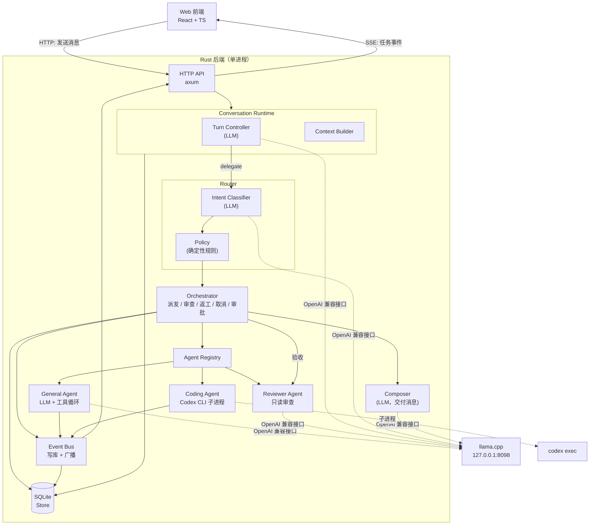
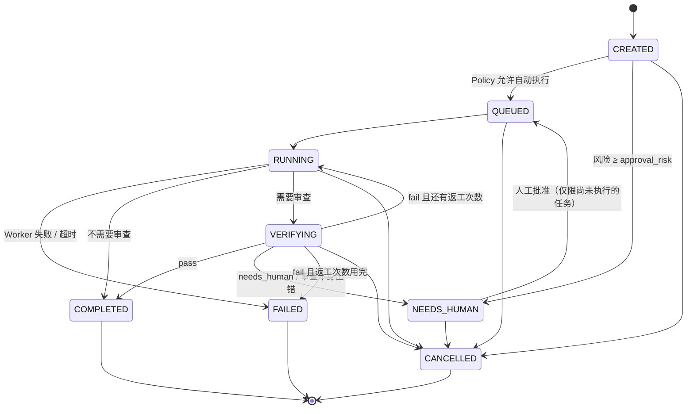
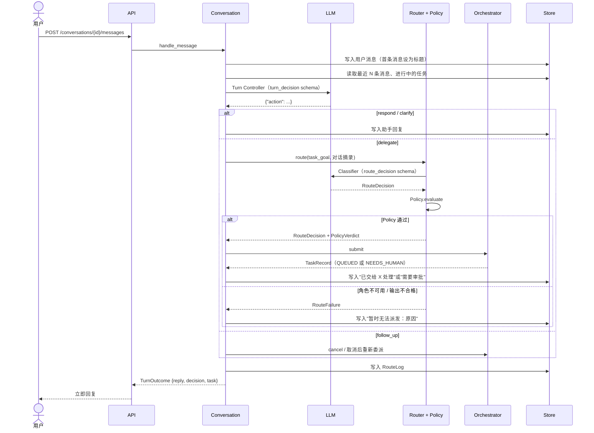
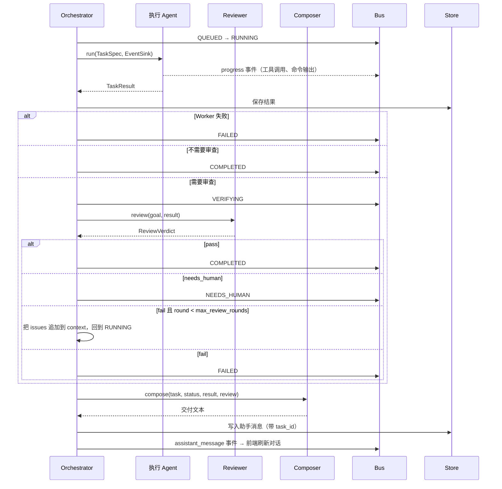
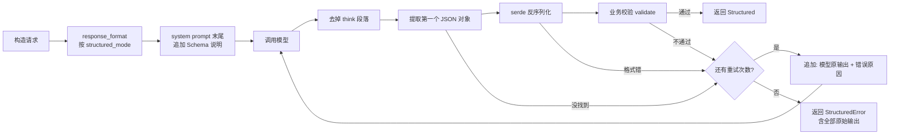
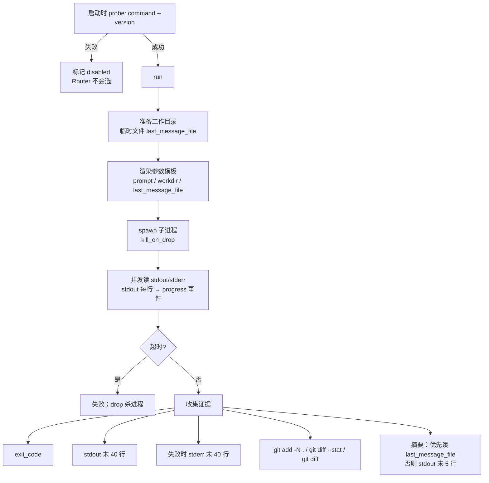
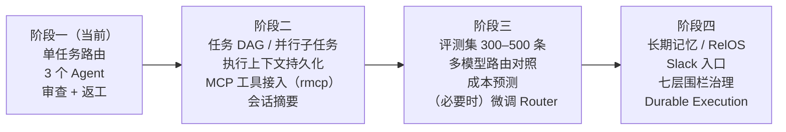

# AgentNexus MVP 设计文档

| 项目 | 内容 |
|---|---|
| 版本 | v0.1（对应提交 `AgentNexus MVP: Conversation + Router + ...`） |
| 日期 | 2026-11-04 |
| 状态 | 骨架已实现，全部测试通过；尚未接真实模型 / 真实 Codex 验证 |
| 范围 | Conversation Agent + Router + General / Coding / Reviewer 三个执行 Agent |

---

## 目录

1. [背景与目标](#1-背景与目标)
2. [设计原则](#2-设计原则)
3. [总体架构](#3-总体架构)
4. [核心数据模型](#4-核心数据模型)
5. [任务状态机](#5-任务状态机)
6. [关键流程](#6-关键流程)
7. [组件详细设计](#7-组件详细设计)
8. [存储与事件](#8-存储与事件)
9. [HTTP 接口](#9-http-接口)
10. [配置说明](#10-配置说明)
11. [前端设计](#11-前端设计)
12. [可观测性与评测](#12-可观测性与评测)
13. [安全与治理](#13-安全与治理)
14. [测试策略](#14-测试策略)
15. [已知限制](#15-已知限制)
16. [演进路线](#16-演进路线)
17. [附录：参考来源](#17-附录参考来源)

---

## 1. 背景与目标

### 1.1 背景

AgentNexus 的长期目标是一个"组织级智能工作平台"：用户通过一个对话入口提出需求，后台由多个 Agent（以及外部 Harness，如 Codex CLI）协作完成，任务、权限、证据和验收由平台统一管理。

前期讨论得出的核心判断：

- **自研调度和治理，不自研通用 Agent 框架**：Router、任务状态、Agent 注册表、Policy 由 AgentNexus 自己掌握；具体执行优先复用成熟 Harness。
- **Agent 按"执行角色"划分，而不是按业务名称划分**：文档生成、数据分析等先作为 General Agent 的工具/技能，不单独建 Agent。
- **Conversation 和 Router 必须分开**：前者对用户负责，后者对调度负责。

### 1.2 MVP 目标

用最小的代码量验证以下几点：

| # | 要验证的问题 | 对应实现 |
|---|---|---|
| G1 | 本地小模型能否稳定完成"要不要委派 → 派给谁"的结构化决策 | Turn Controller + Router + 结构化输出 + `an-eval` 评测工具 |
| G2 | 一个统一的 `AgentAdapter` 抽象能否同时接入内置 Agent 和外部 Harness | General（内置）/ Coding（Codex 子进程）/ Reviewer（内置） |
| G3 | "Worker 完成 ≠ 验收通过"能否落到流程里 | Policy 决定是否审查 + Reviewer 独立审查 + 返工 |
| G4 | 用户始终只面对一个入口，后台进度可见 | Conversation 统一交付 + SSE 事件流 + 任务面板 |
| G5 | 技术栈可行性：Rust 后端 + TS 前端 | axum + SQLite + React/Vite，前后端类型自动同步 |

### 1.3 非目标（MVP 不做）

任务 DAG 与并行子任务、长期记忆（RelOS）、MCP 工具接入、断点续跑（Durable Execution）、多用户与鉴权、Slack 入口、模型微调。

---

## 2. 设计原则

### 2.1 五条原则

1. **模型负责理解，程序负责决策，Harness 负责执行，治理层负责约束和验收。**
   模型的输出（包括风险等级）只是"建议"；是否自动执行、是否需要审查由确定性规则决定。
2. **Agents as Tools，而不是 Handoff。**
   Conversation 始终持有对话控制权，执行 Agent 只返回结构化结果，从不直接面对用户。
3. **结构化输出优先。**
   所有决策点（Turn、Route、General 每一步、Review）都是 JSON Schema 约束下的结构化输出，并经过业务校验；不合格时把错误反馈给模型重试。
4. **任务状态由 AgentNexus 掌握。**
   状态、结果、证据、事件全部落库，不依赖任何 Harness 的内存。
5. **可替换。**
   模型（OpenAI 兼容接口，可按角色配置）、Harness（`AgentAdapter` trait）、存储（`Store` 封装）都可以独立替换。

### 2.2 对开源框架的借鉴

参考了《来自工业界的多 Agent 框架最全细节对比》（hustyichi.github.io，2025-08-28）中对比的框架，只借鉴模式，不引入框架本身（这些框架以 Python 为主，没有 Rust 对应实现）：

| 来源 | 借鉴点 | 在本项目中的落地 |
|---|---|---|
| OpenAI Agents SDK | Agents as Tools：主 Agent 保留控制权 | Conversation 统一交付，Worker 返回 `TaskResult` |
| LangGraph | 共享状态 + Checkpointer 持久化 | 任务状态机落 SQLite，事件可回放 |
| Pydantic AI | 强制结构化输出 + 闭环重试 | `LlmClient::chat_json`：Schema 约束 + 校验 + 错误反馈重试 |
| CrewAI / Agno | 角色 + 能力描述，由协调者分配 | `AgentCard` 能力卡片 + `AgentRegistry` |
| AutoGen | 多 Agent 群聊 | **不借鉴**：Token 消耗大、难控制 |

---

## 3. 总体架构

### 3.1 组件图



### 3.2 职责划分

| 问题 | 负责组件 | 是否调用模型 |
|---|---|---|
| 用户这句话要不要后台执行？ | Turn Controller | 是 |
| 需求不清楚时向用户追问 | Turn Controller | 是 |
| 派给哪个角色、需要哪些工具、风险多高？ | Router（Classifier） | 是 |
| 能不能自动执行、要不要审查？ | Policy | **否** |
| 创建任务、推进状态、收回结果、组织返工 | Orchestrator | 否 |
| 真正执行 | General / Coding / Reviewer | 视 Agent 而定 |
| 结果是否满足目标？ | Reviewer（给意见）+ Orchestrator（按规则定状态） | 是 / 否 |
| 把结果讲给用户 | Composer | 是（失败时退回模板） |

### 3.3 代码结构与依赖方向

```
crates/
  core/      数据结构、状态机、AgentAdapter / EventPublisher trait（无 LLM、无 Web 依赖）
  llm/       OpenAI 兼容客户端
  agents/    三个 Agent 与工具
  runtime/   conversation / router / policy / orchestrator / composer / store / bus / config
  server/    HTTP API、SSE、静态前端；bin/eval.rs；tests/e2e.rs
web/         React + Vite 前端（web/src/bindings 由 core 自动生成）
evals/       路由评测集
```

依赖只能从上往下：`server → runtime → agents → llm → core`。`core` 不依赖任何具体实现，保证以后替换 LLM 库或 Web 框架时数据结构不动。

### 3.4 进程模型

- **单进程**：所有组件在同一个 tokio 运行时中。Conversation 和 Router 是两个模块，不是两个互相对话的 Agent，没有进程间通信成本。
- **每个任务一个 tokio 任务**：`Orchestrator::start` 用 `tokio::spawn` 执行，保存 `AbortHandle` 用于取消。
- **对话请求是同步的**：`POST /messages` 等待 Turn Controller（和 Router）返回后才响应；任务执行是异步的，结果通过事件交付。

---

## 4. 核心数据模型

全部定义在 `crates/core/src/lib.rs`，带 `#[derive(TS)]` 的类型会在 `cargo test -p an-core` 时导出为 TypeScript（`web/src/bindings/`）。

### 4.1 枚举

| 类型 | 取值 | 说明 |
|---|---|---|
| `Role` | `general` / `coding` / `reviewer` | 执行角色；Router 只能从已注册且可用的角色中选 |
| `TaskClass` | `L1` / `L2` / `L3` / `L4` | JEV 分类：是否需要工具 × 是否需要生成文档 |
| `Risk` | `low` / `medium` / `high` | 风险等级（模型建议值） |
| `TaskStatus` | 见第 5 节 | 任务状态 |
| `WorkerStatus` | `succeeded` / `failed` | Worker **进程层面**的结果，与验收无关 |
| `Verdict` | `pass` / `fail` / `needs_human` | Reviewer 的意见 |
| `FollowUpKind` | `supplement` / `cancel` | 针对进行中任务的跟进类型 |
| `EventKind` | `status_changed` / `progress` / `assistant_message` | 事件类型 |

JEV 分类：

| 类别 | 需要工具 | 需要文档 | 典型例子 |
|---|---|---|---|
| L1 | 否 | 否 | 纯分析、改写 |
| L2 | 是 | 否 | 计算、查时间、读文件 |
| L3 | 否 | 是 | 写一份指南并保存 |
| L4 | 是 | 是 | 读数据 → 分析 → 写报告 |

### 4.2 决策类结构

```rust
/// Turn Controller 每轮的决策（serde 以 action 字段区分）
enum TurnDecision {
    Respond  { reply: String },
    Clarify  { question: String },
    Delegate { task_goal: String },
    FollowUp { task_id: String, kind: FollowUpKind, change: String },
}

/// Router 的输出
struct RouteDecision {
    task_class: TaskClass,
    execution_role: Role,
    required_tools: Vec<String>,   // 必须在工具注册表中
    risk_level: Risk,              // 建议值
    reason: String,                // 一句话理由，写入日志
}

/// Policy 的裁决
struct PolicyVerdict {
    auto_execute: bool,   // false → NEEDS_HUMAN 等待审批
    needs_review: bool,   // 执行后是否需要 Reviewer
    notes: Vec<String>,   // 命中的规则说明
}
```

### 4.3 执行类结构

```rust
struct AgentCard {               // 能力卡片
    role: Role, name: String,
    description: String,         // 给 Router 模型看的能力描述
    tools: Vec<ToolInfo>,
    enabled: bool,               // 例如本机没装 codex 时为 false
    disabled_reason: Option<String>,
}

struct TaskSpec {                // 交给 Agent 的任务
    task_id, conversation_id: String,
    goal: String,                // Turn Controller 整理过的独立任务描述
    context: String,             // 近期对话摘录；返工时追加审查问题
    route: RouteDecision,
}

struct TaskResult {              // 所有 Worker 的统一返回
    status: WorkerStatus,
    summary: String,
    artifacts: Vec<Artifact>,    // {kind, name, content}：file / diff / text
    evidence: Vec<Evidence>,     // {kind, content}：tool_call / exit_code / stdout_tail / git_diff_stat ...
    errors: Vec<String>,
}

struct ReviewVerdict { verdict: Verdict, issues: Vec<String>, comment: String }
```

### 4.4 Agent 接入接口

```rust
#[async_trait]
pub trait AgentAdapter: Send + Sync {
    fn card(&self) -> &AgentCard;
    async fn run(&self, task: TaskSpec, events: EventSink) -> anyhow::Result<TaskResult>;
}
```

约定：

- 执行中的进度通过 `EventSink::progress()` 上报，不需要关心事件如何存储和推送。
- 业务失败尽量返回 `Ok(TaskResult::failed(..))`，`Err` 只用于意外错误（两者在编排层都会变成 FAILED）。
- **取消通过 abort 实现**：编排层直接 abort 执行 `run` 的 tokio 任务，实现方需保证被 drop 时释放资源（例如子进程设置 `kill_on_drop(true)`），因此 trait 中没有 `cancel` 方法。

### 4.5 持久化记录

| 类型 | 用途 |
|---|---|
| `Conversation` | 会话（id、标题、创建时间）；第一条消息自动成为标题 |
| `Message` | 消息（role = user / assistant，可关联 task_id） |
| `TaskRecord` | 任务（目标、角色、状态、路由、Policy、结果、审查意见） |
| `TaskEvent` | 事件（状态变化、进度、交付消息） |
| `RouteLog` | 每轮对话的完整决策日志（含模型原始输出、尝试次数、延迟、错误） |

---

## 5. 任务状态机



| 状态 | 含义 | 由谁推进 |
|---|---|---|
| CREATED | 任务已创建 | Orchestrator |
| QUEUED | 已提交到执行队列 | Orchestrator |
| RUNNING | Agent 执行中（返工也回到这里） | Orchestrator |
| VERIFYING | Reviewer 审查中 | Orchestrator |
| NEEDS_HUMAN | 等待人工审批，或审查认为需要人工判断 | Policy / Reviewer |
| COMPLETED | 验收通过（或不需要审查且执行成功） | Orchestrator |
| FAILED | 执行失败、超时、审查不通过且返工用完、服务重启中断 | Orchestrator |
| CANCELLED | 用户取消 | Orchestrator |

终态：COMPLETED / FAILED / CANCELLED（`TaskStatus::is_terminal`）。NEEDS_HUMAN **不是**终态，仍会出现在"进行中的任务"里，可以被批准或取消。

---

## 6. 关键流程

### 6.1 一轮对话



要点：

- 对话请求**只等待决策**，不等待任务执行完成。委派后立即回复"已开始处理"。
- 回复文本在委派分支是**模板生成**（不调用模型），减少一次 LLM 调用。
- 任何一步失败都会写入 RouteLog 并给用户一个可读的回复，不会让请求挂起。

### 6.2 任务执行、审查与返工



返工时追加给 Agent 的上下文格式：

```
## 上一轮结果未通过审查，请修正以下问题
- 问题 1
- 问题 2

## 上一轮结果摘要
（截断到 2000 字）
```

整个执行（含返工）受 `task_timeout_secs` 总超时控制；Coding Agent 另有自己的 `timeout_secs`。

### 6.3 跟进：补充要求与取消

当用户在任务执行过程中发来新消息，Turn Controller 能看到"进行中的任务"列表（id、状态、角色、目标），可以输出 `follow_up`：

| kind | 处理 |
|---|---|
| `cancel` | `Orchestrator::cancel(task_id)`：abort 执行任务（子进程随之被杀）→ CANCELLED；已结束的任务回复"无需取消" |
| `supplement` | 取消旧任务 → 目标合并为 `旧目标 + "\n\n补充要求：" + change` → 重新路由和派发（新任务） |

校验：`task_id` 必须是当前会话中进行中的任务，否则作为格式错误反馈给模型重试。

> 补充要求采用"取消后重新派发"是 MVP 的简化做法。已完成的部分会被丢弃，见[已知限制](#15-已知限制)。

### 6.4 人工审批

1. Router 判定的风险 ≥ `approval_risk`（默认 `high`）时，Policy 给出 `auto_execute = false`。
2. 任务创建后直接进入 NEEDS_HUMAN，对话中回复"需要人工审批（原因）"。
3. 用户在任务面板点击"批准执行"→ `POST /api/tasks/{id}/approve`。
4. 只有 **NEEDS_HUMAN 且尚未执行（result 为空）** 的任务可以批准；因审查意见进入 NEEDS_HUMAN 的任务不能通过此接口"批准"（返回 409）。

### 6.5 服务重启

启动时 `Store::fail_interrupted_tasks()` 把 CREATED / QUEUED / RUNNING / VERIFYING 的任务标记为 FAILED。MVP 不做断点续跑。

---

## 7. 组件详细设计

### 7.1 LLM 客户端（`crates/llm`）

对接任意 OpenAI 兼容的 `/v1/chat/completions`（llama.cpp、Ollama、vLLM、DeepSeek 等）。

#### 结构化输出

`chat_json<T>(messages, schema_name, schema, validate)` 的处理流程：



三种 `structured_mode`：

| 模式 | 请求中的 `response_format` | 适用 |
|---|---|---|
| `json_schema`（默认） | `{"type":"json_schema","json_schema":{"name","strict":true,"schema"}}` | OpenAI 标准写法；较新的 llama.cpp 会转成语法约束 |
| `json_object` | `{"type":"json_object","schema":{...}}` | llama.cpp 早期扩展写法 |
| `prompt_only` | 不发送 | 兼容所有服务，小模型格式错误最多 |

无论哪种模式，Schema 都会同时写进 system prompt，让模型"知道"要输出什么。

#### 针对小模型的容错

- **`strip_think`**：去掉 `<think>…</think>`；只有开头没有结尾（输出被截断）时丢弃后面全部。
- **`extract_json`**：括号配对查找第一个完整 JSON 对象，正确跳过字符串中的括号，兼容 ```` ```json ```` 代码块和前后多余文字。
- **反馈式重试**：失败原因（"action=delegate 时 task_goal 不能为空"、"工具 xxx 不存在，可用工具：..."）连同模型原输出追加到对话中再试。HTTP / 网络错误直接重试，不反馈给模型。
- **扁平 Schema**：所有 Schema 都手写成扁平结构（所有字段必填，不适用的填空字符串），而不是用 `oneOf` / 嵌套可选字段。小模型和语法约束都更容易处理；转换成 Rust 枚举的工作在程序里完成。

#### 按角色配置模型

`LlmClient::with_model(name)` 复制客户端只换模型名。配置 `[models]` 后，Conversation / Router / General / Reviewer 可以使用不同模型（多模型部署时有用，例如 Router 用更小更快的模型）。

### 7.2 Conversation Runtime（`runtime/conversation.rs`）

#### Turn Controller

Schema（扁平）：

```json
{
  "action": "respond | clarify | delegate | follow_up",
  "reply": "", "question": "", "task_goal": "",
  "task_id": "", "follow_up_kind": "supplement | cancel | \"\"", "change": ""
}
```

System prompt 要点：

- 能直接可靠回答的（闲聊、常识、解释概念）→ `respond`；
- 需求含糊、缺少关键信息 → `clarify`；
- 需要计算、读写文件、生成文档、写代码、审查内容 → `delegate`，且 `task_goal` 必须是**整理过、可独立执行**的描述（执行者看不到对话）；
- 针对进行中任务的补充或取消 → `follow_up`；
- 附上"进行中的任务"列表（id、状态、角色、目标前 120 字）。

转换校验（`to_decision`）：每种 action 对应的必填字段不能为空；`follow_up` 的 `task_id` 必须在进行中任务里。

`decide_turn` 没有副作用，评测工具直接调用它。

#### Context Builder（MVP 版）

| 用途 | 内容 |
|---|---|
| Turn Controller 的对话历史 | 最近 `history_messages` 条消息（默认 12），按原角色传入 |
| 执行 Agent 的背景（`TaskSpec.context`） | 最近 6 条消息，每条截断 500 字，格式"用户：… / 助手：…" |

后续演进为分层上下文（会话摘要、项目上下文、长期记忆），见第 16 节。

### 7.3 Router（`runtime/router.rs`）

- **Schema 约束**：`execution_role` 的 enum **只包含当前可用的角色**，`required_tools` 的 enum 只包含工具注册表中的工具名。在 `json_schema` 模式下模型无法输出不存在的角色或工具。
- **System prompt**：列出可用角色的能力描述（来自 `AgentCard.description`）、General 的工具列表、L1–L4 定义、选择规则：
  1. 修改代码仓库、写程序、修 bug、跑测试 → `coding`
  2. 审查 / 评估 / 挑错已有内容 → `reviewer`
  3. 其他 → `general`
  4. `required_tools` 只列 General 真正需要的
  5. 风险：只读 = low；写文件 / 改代码 = medium；删除数据、对外发送、涉及生产 = high
- **业务校验**（`prompt_only` 模式下尤其需要）：工具名存在、角色可用。
- 输出交给 Policy；被拒绝时返回 `RouteFailure`（含原始输出，写入日志）。

### 7.4 Policy（`runtime/policy.rs`）

纯函数，不调用模型：

| # | 规则 | 结果 |
|---|---|---|
| 1 | 角色未注册或不可用 | 拒绝路由，返回原因（例如"找不到命令 codex"） |
| 2 | 非 General 角色带了 `required_tools` | 清空，记录说明 |
| 3 | `risk_level ≥ approval_risk` | `auto_execute = false` |
| 4 | Coding → 审查；General 且 L3/L4 → 审查；Reviewer → 不审查 | `needs_review`；Reviewer 不可用时跳过审查并记录说明 |

### 7.5 Orchestrator（`runtime/orchestrator.rs`）

| 方法 | 说明 |
|---|---|
| `submit` | 写入 TaskRecord（CREATED）→ 按 Policy 进入 QUEUED 或 NEEDS_HUMAN；同时把执行上下文暂存在内存 |
| `start` | **持锁 spawn**：先登记 AbortHandle，再让任务运行；任务结束时从表中移除。保证不会出现"任务已结束但句柄残留"的竞态 |
| `run_with_review` | 执行 → 保存结果 → 按 Policy 审查 → 返工循环（见 6.2） |
| `execute` | 包装总超时，最终状态落库，调用 Composer 生成交付消息并推送 |
| `cancel` | abort + 状态置 CANCELLED；终态任务返回 `false` |
| `approve` | 校验状态后调用 `start` |

审查本身失败（例如 Reviewer 输出一直不合格）时**不视为通过**，而是 NEEDS_HUMAN。

### 7.6 执行 Agent（`crates/agents`）

#### General Agent：LLM + 工具循环

没有使用推理服务的原生 function calling（llama.cpp 需要 `--jinja` 且依赖模型的 chat template，不同小模型差异大），而是让模型每一步输出一个结构化决策：

```json
{"thought": "简短思考", "action": "tool_call | final", "tool": "工具名或空", "args": {}, "answer": "最终结果或空"}
```

- `tool` 的 enum = 全部工具名 + 空字符串；
- 校验：`tool_call` 时 `tool` 不能为空；
- 工具结果以 user 消息"工具 X 的返回结果：…"追加到对话；
- 每次工具调用产生一条 `tool_call` 证据（结果截断 500 字）和一条进度事件；
- `write_file` 产生的文件作为产物（artifact）返回；
- 最多 `max_steps` 步（默认 6），超过则失败。

内置工具：

| 工具 | 说明 | 参数示例 |
|---|---|---|
| `current_time` | 当前本地时间 | `{}` |
| `calculator` | 四则运算、取模、乘方、括号（递归下降解析器，拒绝除零） | `{"expression": "(12.5+3)*4"}` |
| `list_files` | 列出工作目录下的文件 | `{"path": ""}` |
| `read_file` | 读文本文件（最多 8000 字） | `{"path": "notes/a.md"}` |
| `write_file` | 写文本文件（自动建目录，覆盖） | `{"path": "reports/r.md", "content": "..."}` |

扩展方式：实现 `Tool` trait（`name / description / args_hint / call`）并注册到 `ToolRegistry`。Router 的工具枚举和 General 的工具清单会自动更新。

#### Coding Agent：Codex CLI 适配器



- 命令路径和工作目录支持 `~` 开头（子进程不经过 shell，需要自己展开）。
- `git add -N .`（intent-to-add）让新建的未跟踪文件也出现在 diff 里，**不会**真正暂存内容。
- 工作目录不是 git 仓库时，证据中注明"无法收集代码改动"。
- 如果 stdout 的行是 JSON（例如 codex 的 `--json` 模式），会尽量提取 `type` 和文本用于展示。
- 代码改动的安全边界依赖 Codex 自身的 sandbox 设置（见第 13 节）。

#### Reviewer Agent

- **验收模式** `review(goal, result)`：输入任务目标、结果摘要、产物（每个截断 4000 字）、证据（每条截断 800 字）。
- **直接审查模式**（作为普通 Agent 被 Router 选中）：审查用户提交的内容。
- 判定标准写在 prompt 中：满足目标且无明显错误 → pass；不满足 → fail 且必须列出问题（校验）；无法判断或证据不足 → needs_human。"不要因为风格偏好判 fail"。

### 7.7 Composer（`runtime/composer.rs`）

- 把"事实材料"交给模型：目标、角色、最终状态、结果摘要（截断 4000 字）、产物名、错误、审查结论和问题。
- 要求：先一句话说明结果（完成 / 未通过审查 / 失败 / 需要人工确认），如实说明审查意见，不编造事实材料以外的内容。
- **模型调用失败或返回空时退回模板**，保证用户一定能收到交付消息。

---

## 8. 存储与事件

### 8.1 SQLite 表结构

| 表 | 主要字段 | 说明 |
|---|---|---|
| `conversations` | id, title, created_at | |
| `messages` | id, conversation_id, role, content, task_id, created_at | 索引 (conversation_id, created_at) |
| `tasks` | id, conversation_id, goal, role, status, route_json, policy_json, result_json, review_json, created_at, updated_at | 结构化字段用 JSON 列保存 |
| `events` | id, conversation_id, task_id, json, created_at | 索引 (task_id, created_at) |
| `route_logs` | id, json, created_at | |

实现说明：

- 使用 `rusqlite`（bundled），单连接 + `Mutex`，开启 WAL。查询都很短，MVP 足够；需要并发或多实例时换 Postgres，`Store` 的方法签名不变。
- 消息按 `created_at DESC, rowid DESC` 排序后反转，保证同一毫秒内写入的消息顺序正确。

### 8.2 事件总线

```
Agent / Orchestrator ──publish──▶ Bus ──① 写入 events 表
                                       └─② tokio broadcast（容量 1024）──▶ SSE 订阅者
```

- 先写库再广播：前端断线后可以通过 `GET /api/tasks/{id}` 补拉事件。
- 订阅者处理过慢时 broadcast 会丢弃最旧的事件（`Lagged`），SSE 直接跳过，前端靠刷新补齐。
- 事件格式：

```json
{
  "id": "evt-…",
  "conversation_id": "conv-…",
  "task_id": "task-…",
  "kind": "status_changed | progress | assistant_message",
  "status": "RUNNING",
  "message": "开始执行",
  "created_at": "2026-11-04T23:44:48.123Z"
}
```

---

## 9. HTTP 接口

所有接口返回 JSON，错误统一为 `{"error": "说明"}`（400 参数错误、404 不存在、409 状态冲突、500 内部错误）。

| 方法 | 路径 | 请求 | 响应 |
|---|---|---|---|
| GET | `/api/health` | | `{llm: {ok, base_url, model, server_models, error, structured_mode}, agents: AgentCard[]}` |
| GET | `/api/agents` | | `AgentCard[]` |
| GET | `/api/conversations` | | `Conversation[]`（新的在前） |
| POST | `/api/conversations` | `{title?}` | `Conversation` |
| GET | `/api/conversations/{id}/messages` | | `Message[]`（按时间顺序） |
| POST | `/api/conversations/{id}/messages` | `{text}` | `TurnOutcome {reply, decision, task}` |
| GET | `/api/tasks?conversation_id=` | | `TaskRecord[]`（不带参数时返回最近 200 条） |
| GET | `/api/tasks/{id}` | | `{task: TaskRecord, events: TaskEvent[]}` |
| POST | `/api/tasks/{id}/cancel` | | `{cancelled: bool}` |
| POST | `/api/tasks/{id}/approve` | | `{approved: true}` 或 409 |
| GET | `/api/route-logs?limit=` | | `RouteLog[]`（默认 50，最大 500） |
| GET | `/api/events?conversation_id=` | | SSE，事件名 `task_event`，每 15 秒 keep-alive |

`POST /messages` 响应示例（委派）：

```json
{
  "reply": {"id": "msg-…", "role": "assistant", "content": "收到，已交给 general 处理（需要生成并保存 Markdown 报告）。完成后我会在这里给你结果。", "task_id": "task-…"},
  "decision": {"action": "delegate", "task_goal": "写一份关于本地小模型选型的报告，保存为 Markdown"},
  "task": {"id": "task-…", "role": "general", "status": "QUEUED",
           "route": {"task_class": "L4", "execution_role": "general", "required_tools": ["write_file"], "risk_level": "low", "reason": "…"},
           "policy": {"auto_execute": true, "needs_review": true, "notes": []}}
}
```

---

## 10. 配置说明

配置文件 `config.toml`（模板见 `config.example.toml`）。除 `[llm]` 外都有默认值。

| 段 | 键 | 默认值 | 说明 |
|---|---|---|---|
| `[server]` | `bind` | `127.0.0.1:8787` | 监听地址 |
| | `db_path` | `data/agentnexus.db` | SQLite 路径 |
| | `static_dir` | `web/dist` | 前端构建产物；不存在时只提供 API |
| `[llm]` | `base_url` | 必填 | 例如 `http://127.0.0.1:8098/v1` |
| | `api_key` | 空 | 非空时以 Bearer 发送 |
| | `model` | 必填 | 模型名 |
| | `temperature` | 0.2 | |
| | `max_tokens` | 不限 | |
| | `timeout_secs` | 180 | 单次请求超时 |
| | `structured_mode` | `json_schema` | `json_schema` / `json_object` / `prompt_only` |
| | `max_retries` | 2 | 结构化输出重试次数（总尝试 = 重试 + 1） |
| `[models]` | `conversation` / `router` / `general` / `reviewer` | 空 | 按角色覆盖模型名 |
| `[agents.general]` | `enabled` | true | |
| | `max_steps` | 6 | 工具循环最大步数 |
| | `workspace_dir` | `workspace/files` | 文件工具的根目录 |
| `[agents.reviewer]` | `enabled` | true | 关闭后所有任务跳过审查 |
| `[agents.coding]` | `enabled` | true | |
| | `command` | `codex` | 支持 `~` |
| | `args` | 见模板 | 支持 `{prompt}` `{workdir}` `{last_message_file}` |
| | `workdir` | `workspace/code` | 建议为独立 git 仓库 |
| | `timeout_secs` | 900 | |
| `[orchestrator]` | `max_review_rounds` | 1 | 审查不通过后的返工轮数 |
| | `history_messages` | 12 | Turn Controller 带的历史消息数 |
| | `task_timeout_secs` | 1800 | 单任务（含返工）总超时 |
| | `approval_risk` | `high` | 达到该风险等级需人工审批 |

---

## 11. 前端设计

技术：React 19 + Vite + TypeScript，无 UI 组件库，纯 CSS（支持浅色/深色）。

```
┌──────────┬────────────────────────────┬──────────────────────┐
│ 会话列表  │ 对话区                      │ [任务] [路由日志]      │
│ ＋新会话  │  用户 / 助手气泡             │  任务卡片（可展开）：   │
│          │  交付消息带任务编号          │   路由 / Policy        │
│          │  "思考中…"提示               │   事件时间线           │
│──────────│                            │   执行结果 / 产物 / 证据 │
│ LLM 状态  │ ┌────────────────────┐     │   审查意见             │
│ Agent 状态│ │输入框 Enter 发送      │     │   取消 / 批准执行       │
└──────────┴────────────────────────────┴──────────────────────┘
```

数据流：

- 切换会话：加载消息和任务，订阅 `/api/events?conversation_id=`。
- 收到 `status_changed` → 刷新任务列表；`assistant_message` → 刷新消息和任务；任何事件都会让展开中的任务卡片重新拉取详情。
- 发送消息：先乐观显示用户消息，等后端返回后整体刷新。输入法组字中按 Enter 不发送。
- 类型：直接使用 `web/src/bindings` 中由 Rust 生成的类型。`u64` 等字段用 `#[ts(type = "number")]` 标注，避免被映射成 `bigint`。

开发模式下 Vite（5173）把 `/api` 代理到后端（8787）；生产模式下由后端直接提供 `web/dist`。

---

## 12. 可观测性与评测

### 12.1 路由日志

每轮对话写一条 `RouteLog`：用户原文、Turn 决策、Route 决策、Policy 裁决、关联任务、**模型每次尝试的原始输出**、总尝试次数、总延迟、错误。前端"路由日志"页可直接查看，用于：

- 排查小模型格式问题（看原始输出）；
- 发现路由错误并补充到评测集。

### 12.2 `an-eval` 评测工具

```bash
cargo run --release --bin an-eval -- config.toml evals/routing.jsonl
```

- 评测集格式：每行 `{"text", "expect_action", "expect_role"?, "expect_class"?}`，`//` 开头的行忽略。
- 只跑 Turn Controller +（判定为 delegate 时）Router，不执行任务，使用内存数据库。
- 指标：

| 指标 | 计算方式 |
|---|---|
| 动作准确率 | `got_action == expect_action` 的比例 |
| 角色准确率 | 在标注了 `expect_role` 的样本中 `got_role == expect_role` 的比例 |
| 类别准确率 | 在标注了 `expect_class` 的样本中的比例 |
| 格式重试样本数 | 总尝试次数 > 结构化调用次数 |
| 出错样本数 | 最终仍失败（格式不合格或 Policy 拒绝） |
| 延迟 P50 / P95 / 平均 | 单条样本（含两次调用）的端到端时间 |

- 详细结果写入 `evals/results/<时间戳>.jsonl`（含原始输出），换模型后重跑对比。
- 当前评测集 26 条：respond 6、clarify 4、general 8（L2 ×4、L3 ×2、L4 ×2）、coding 5、reviewer 3。前期讨论建议积累到 300–500 条。

### 12.3 日志

后端使用 `tracing`，级别由 `RUST_LOG` 控制。结构化输出不合格时以 warn 级别记录尝试次数和原始输出前 300 字。

---

## 13. 安全与治理

| 风险 | 措施 | 剩余风险 |
|---|---|---|
| 模型编造不存在的 Agent / 工具 | Schema enum 约束 + 业务校验 + Policy 检查 | 无 |
| 文件工具越界访问 | `resolve_in_root`：拒绝绝对路径、`..` 越过根目录 | 符号链接未做额外检查 |
| 高风险操作自动执行 | Policy 按 `approval_risk` 强制人工审批 | 风险等级来自模型判断，可能低估 |
| Worker 报告成功但结果错误 | Coding 与 L3/L4 任务强制审查；审查出错按 NEEDS_HUMAN 处理 | Reviewer 也是模型，可能误判 |
| 代码修改破坏环境 | Codex `--sandbox workspace-write`，工作目录独立 | 安全性取决于 Codex 自身 sandbox |
| 失控的长任务 | Coding 超时、任务总超时、取消时 kill 子进程 | |
| 提示词注入（文件内容、用户输入） | 工具输出作为普通消息传回模型 | **未防护**，MVP 仅限本机可信使用 |
| 未授权访问 | 默认只监听 127.0.0.1 | **没有鉴权**，不要暴露到公网 |

---

## 14. 测试策略

| 层级 | 位置 | 内容 |
|---|---|---|
| 单元测试 | `core` | 状态序列化往返、中文安全截断 |
| | `llm` | `<think>` 清理、带噪声的 JSON 提取 |
| | `agents` | 计算器（优先级、右结合、除零）、路径越界防护 |
| 类型导出 | `core` | ts-rs 导出 22 个 TS 类型 |
| 端到端 | `server/tests/e2e.rs` | 见下表 |

端到端测试启动一个**假的 OpenAI 兼容服务**（根据请求中的 schema 名称返回预设内容）和真实 HTTP 服务，用 `sh` 脚本冒充 codex：

| 场景 | 断言 |
|---|---|
| 健康检查 | LLM 连通，3 个 Agent |
| 直接回答 | action = respond，回复内容正确 |
| 格式错误重试 | 第一次返回非 JSON，路由日志 attempts = 2，最终回复正确 |
| General 委派 | 工具调用写文件 → 审查 pass → COMPLETED；状态序列为 CREATED → QUEUED → RUNNING → VERIFYING → COMPLETED；交付消息带 task_id |
| SSE | 能收到 `task_event` |
| Coding | 子进程执行、读取最后回复文件、`git diff` 产物包含新文件 |
| 高风险审批 | 创建即 NEEDS_HUMAN，批准后 COMPLETED |
| 中途取消 | 慢任务 RUNNING 时用户说"取消"→ follow_up → CANCELLED |
| 路由日志 | 每轮对话一条 |

另外用 Playwright 驱动前端走过一遍完整流程（手工验证，未纳入自动化测试）。

**尚未验证**：真实 llama.cpp 的结构化输出兼容性、真实小模型的路由准确率、真实 Codex CLI 的参数和输出格式。

---

## 15. 已知限制

| # | 限制 | 影响 | 计划 |
|---|---|---|---|
| 1 | 补充要求 = 取消旧任务 + 重新派发 | 已完成的工作被丢弃 | 阶段二：任务 DAG 后只重跑受影响的子任务 |
| 2 | 执行上下文（`TaskSpec.context`）只保存在内存 | 服务重启后，等待审批的任务被批准时上下文为空 | 把 context 写入 tasks 表 |
| 3 | 重启后中断的任务直接标记 FAILED | 不能续跑 | 引入 Durable Execution 思路（参考 Temporal / LangGraph Checkpoint） |
| 4 | 因审查进入 NEEDS_HUMAN 的任务没有"人工判定通过/不通过"的接口 | 只能取消或重新发起 | 增加人工验收接口 |
| 5 | Context Builder 只取最近消息 | 长会话会丢失早期上下文 | 会话摘要 + 分层上下文 |
| 6 | 对话请求同步等待 LLM | 小模型慢时前端要等几十秒 | 改为流式输出或异步决策 |
| 7 | 单连接 SQLite、单进程 | 不支持多实例 | 换 Postgres + 外部消息队列 |
| 8 | 无鉴权、无多用户 | 只能本机使用 | 增加用户体系 |
| 9 | 一个会话中同一时刻可能有多个任务，Turn Controller 靠模型判断 follow_up 指向哪个 | 多任务时可能指错 | 前端提供"针对某任务回复"的显式入口 |

---

## 16. 演进路线



各阶段的验收重点：

| 阶段 | 关键指标 |
|---|---|
| 一 | 路由动作 / 角色准确率、结构化输出有效率、P95 路由延迟 |
| 二 | 多步任务完成率、部分失败时的成果保留、工具错误率 |
| 三 | 不同模型的准确率 / 成本曲线、高风险任务漏拦截率 |
| 四 | 人工介入率、长任务恢复率 |

扩展点汇总：

| 要做的事 | 改哪里 |
|---|---|
| 接新的执行 Agent / Harness | 实现 `AgentAdapter`，在 `Runtime::new` 注册；需要新角色时扩展 `Role` |
| 加工具 / 接 MCP | 实现 `Tool` trait 并注册到 `ToolRegistry` |
| 改审批 / 审查规则 | `runtime/policy.rs` |
| 换模型或推理服务 | `config.toml` 的 `[llm]` / `[models]` |
| 换数据库 | 重新实现 `runtime/store.rs` |

---

## 17. 附录：参考来源

- 易迟的博客（Bryan），《来自工业界的多 Agent 框架最全细节对比》，2025-08-28：https://hustyichi.github.io/2025/08/28/multi-agent/
- OpenAI Agents SDK（JS）多 Agent 编排指南（Handoff 与 Agents as Tools）：https://openai.github.io/openai-agents-js/guides/multi-agent
- Rig（Rust LLM 库，本项目未采用，作为备选）：https://docs.rs/crate/rig-core/0.35.0/source/README.md
- rmcp（MCP 官方 Rust SDK，阶段二接入 MCP 时使用）：https://docs.rs/crate/rmcp
- AgentNexus 前期设计讨论记录（Router / Conversation Agent / Harness 选型）
