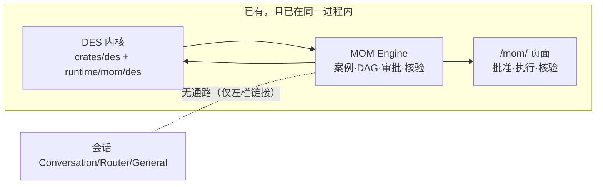
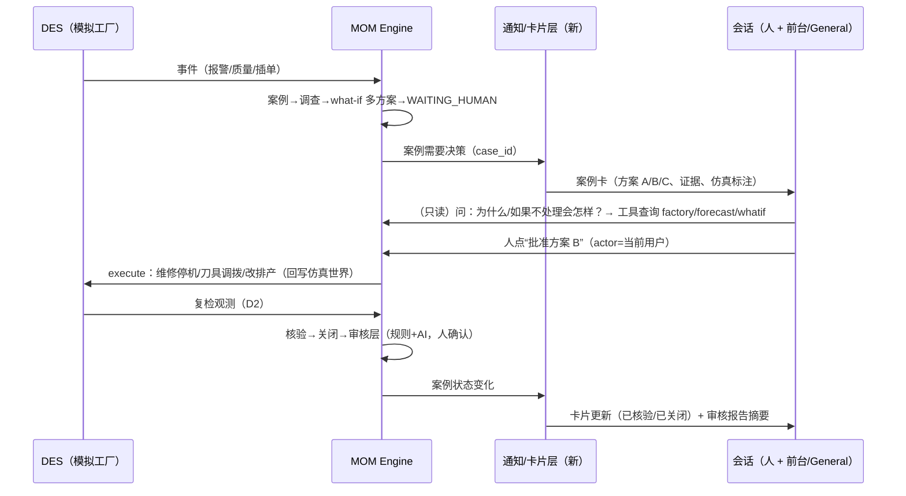

# 系统打通计划：从“三块各自完整”到“完整系统 + 整体场景 E2E”

状态：**草案（助手建议）**。方案取舍尚未经你确认；确认后的决定再记入 [DECISIONS.md](DECISIONS.md)。缺口依据见 [SYSTEM_GAPS.md](feature-map/SYSTEM_GAPS.md)，场景清单见 [SCENARIOS.md](feature-map/SCENARIOS.md)。
按 AGENTS.md：涉及 `orchestrator.rs` / `store.rs` / `registry.rs` / `acp.rs` / `util.rs` 的工作包，动手前先单独出方案并等你批准；每个工作包新增行为先在 `docs/testing/CASES.md` 定稿用例并见到业务断言 Red。

## 一、目标与“完成”的定义

**目标**：把对话/任务平台、MOM/DES、治理旁路连成一个系统，并能用多个**跨模块的完整场景**做端到端测试。

**完成 =** 下面 6 个“黄金场景”都有浏览器 E2E（受控模型）且通过；每个场景的断言都跨越至少两个模块；同时没有“死胡同状态”（任何状态用户都有出口）。

| 黄金场景 | 串起的模块 | 对应缺口 |
|---|---|---|
| **GS1 制造异常闭环**：DES 报警 → MOM 案例 → 会话里看到并追问 → 人批准 → 执行回写 DES → 复检核验 → 审核报告回到会话 | DES · MOM · 会话 · 审批 · 审核 | G01（本轮先做） |
| **GS2 写代码全链路**：无助手 → 对话接入 → 改代码 → diff 证据 → 审查 → 完成 | 助手管理 · 路由 · 编排 · git 证据 · Reviewer | S05 |
| **GS3 审查需人工**：审查判需人工 → 用户验收通过/退回 → 返工或完成 | Reviewer · 审批 · 编排 | G04 |
| **GS4 多问题拆分**：一条消息多个问题 → 拆成并行子任务 → 汇合回复 | 路由 · 模板 · 编排 · Composer | G02 |
| **GS5 反馈改进**：派错 → 反馈 → 进评测集（人工确认）→ 评测 → 配置变更留痕 | 反馈 · an-eval · 路由 · DECISIONS | G06 |
| **GS6 重启与外发合规**：运行中重启 → 明确失败/恢复；开启外发检查后全链路脱敏 | 编排 · 存储 · DLP · MCP | G08 / G09 |

## 二、工作包与顺序

| WP | 内容 | 缺口 | 依赖 | 触碰高风险文件 | 产出的 E2E |
|---|---|---|---|---|---|
| **WP0** | E2E 底座：harness 支持同库重启、coding 临时 git 仓库、审查 fail→pass、节点模拟；修正 DESIGN §15 过时描述 | 三(6)、G08 文档 | — | 否（测试与文档） | 为 GS2/3/6 铺路 |
| **WP1** | **DES-MOM-会话闭环**（本文第三节） | G01、G10 | WP0 部分 | 预计否（需核实） | **GS1** |
| WP2 | 审查“需人工”的出口：状态拆分（待批准 / 待验收）+ 验收通过/退回返工 | G04、G05 | — | **是**（orchestrator/store） | GS3 |
| WP3 | 补现有功能的整链 E2E：改代码全链路、补充要求、反馈 UI、节点 UI | S05/S06/S08/S10 | WP0 | 否 | GS2 |
| WP4 | 任务拆分与模板执行（M4.3）：模板接入编排器、并行与 Composer 汇合 | G02 | WP2 | **是** | GS4 |
| WP5 | 反馈闭环 + 会话摘要/知识接入 | G06、G07 | WP3 | 视方案 | GS5 |
| WP6 | 准入界面 + 认证；外发“保证范围”文档与出口审计；观测统一（trace_id） | G03、G09、G10 | WP1 | 部分 | GS6（外发部分） |
| WP7 | 重启语义：待批准保持、运行中任务的续跑或明确失败原因 | G08 | WP0 | **是** | GS6（重启部分） |
| WP8 | 整体验收：6 个黄金场景合并回归、真实模型/真实 ACP 清单、CI 接入 | 全部 | 前述 | 否 | 全部 |

顺序原则：先做**不需要新产品决策、能立刻增加 E2E 证据**的（WP0），再做你指定的 WP1；WP2/4/7 是高风险文件，各自先出方案。

## 三、WP1：DES-MOM-会话闭环

### 3.1 现状（已核对代码）

- 主进程 `main.rs` 已创建 MOM `Engine`（独立 SQLite：`<db_path>.mom.db`）并起了时钟，同源挂载 `/mom/`。所以“进程内通信”没有障碍。
- DES 闭环已具备：执行回写仿真世界、复检证据、协同事项、审核层（RT-DES-*）；设计 §9 早已规划“会话可调用只读仿真接口”，设计 R7 要求“仿真能力要能在人与 agent 的会话中被调用和报告”——**这条一直没落地**。
- 会话侧已有可复用的机制：`ChatCard`（对话里的卡片，`add_message_with_card` / `update_message_card` 已在 store 中）、`manage_agents` 这类“前台识别领域动作”的先例、`Tool` + `CapabilityCard`（效果分级 ReadOnly/WorkspaceWrite/ExternalWrite/Destructive）、`ToolRegistry` 在 `runtime/lib.rs` 装配。
- 缺的：①会话能读 MOM/DES；②MOM 有事要人决策时会话能知道；③人在会话里能批准；④结果回到会话；⑤一条贯穿的关联标识。

### 3.2 要形成的闭环

**不变量（必须成立，也是 E2E 的断言来源）**
1. **模型不写**：批准/执行/关闭只能由人点卡片触发；会话里的模型只有只读工具，`Effect = ReadOnly`。
2. **一套状态**：案例状态只在 MOM Engine 里；卡片是投影，刷新/重启后以 Engine 为准。
3. **一条关联线**：`case_id` ↔ `conversation_id` ↔ `message_id` 写入日志与卡片，用一个字段即可串起时间线。
4. **仿真永远标注**：所有从 DES 来的内容带 `provenance=simulation`，卡片与回答里显示“仿真估计”。
5. **标准答案隔离**：会话与 agent 看不到 ground truth；只有审核层可读。
6. **失败可见**：Engine 不可用、案例已被他人处理、审批过期时，卡片显示明确原因，不静默。

### 3.3 方案选项

| | A：工具式前门 + 案例卡（**推荐**） | B：案例即任务（深度集成） | C：保持独立，只加跳转/深链 |
|---|---|---|---|
| 做法 | 会话通过只读工具读 MOM；MOM 通过新的案例卡把决策推到会话；批准经卡片按钮调用 MOM 现有批准路径 | 每个案例映射为平台 Task，由 Orchestrator/Policy/Registry 统一管理，MOM Master 并入 Router | 案例卡只做提醒与链接，批准仍在 `/mom/` |
| 优点 | 复用现有 `ChatCard`/`Tool`；MOM 状态机不动；风险局部；能完整形成闭环 | 概念最统一（同一审批、同一时间线、同一 `task_id`） | 改动最小 |
| 缺点 | 仍是两套状态机，靠关联标识对齐；需要新增卡片类型与通知层 | 改动 orchestrator/store/registry（高风险），MOM 的案例/DAG 语义要重写进任务模型，工作量大 | 不是闭环，用户要在两个页面间切换，GS1 的“会话里批准”做不到 |
| 触碰高风险文件 | 预计不触碰（需在方案评审时核实注入点） | 必然触碰 | 否 |
| 为后续留的口子 | 之后可演进到 B（卡片/工具层不丢弃） | — | 无 |

### 3.4 分阶段（推荐 A；每阶段独立可验收，均基于进程内 DES）

| 阶段 | 内容 | 验收（先定义为用例，再实现） |
|---|---|---|
| **L0 关联与前置** | 统一 `case_id`/`conversation_id` 关联字段；MOM 日志带 `case_id`；主进程把 MOM 句柄注入会话侧装配点（核实 `runtime/lib.rs` 装配与 `main.rs` 顺序） | RT：案例事件可按 `case_id` 过滤；关联字段在日志里 |
| **L1 会话可读** | 只读工具集：`mom_cases`（列表/详情摘要）、`mom_factory_status`、`mom_forecast`、`mom_whatif`；返回带 `provenance`/`observed_at`/`limitations`；General 可用，登记在 `/api/capabilities` | E2E：在会话问“CNC 现在怎么样/有哪些待处理案例”，回答内容与 `GET /api/mom/*` 一致且标注仿真；工具效果为 ReadOnly；越权调用（写）不存在 |
| **L2 案例推到会话 + 人在会话批准** | 新 `ChatCard::MomCase`：标题、证据、方案列表、批准/驳回按钮；MOM 案例进入 `WAITING_HUMAN` 时向“运营会话”写卡；点击按钮调用 Engine 的 `approve/execute`（actor 明确）；`update_message_card` 更新状态 | E2E：DES 报警 → 会话出现卡片 → 点“批准” → 案例 `VERIFYING`（与 `/mom/` 页面显示一致）；未点击前没有任何执行；重复点击幂等；案例已被 `/mom/` 批准时卡片显示已处理 |
| **L3 闭环回写与审核报告** | 执行→DES 回写→复检观测→核验→关闭；案例关闭后卡片更新并附审核层摘要（规则检查 + AI 审核降级标注 + 人确认入口） | E2E：全链路 GS1 从报警到关闭；缺核验证据时不能关闭并在卡片显示原因（延续 E2E-COMPLAINT 精神）；审核报告不含标准答案 |
| **L4 连接器替换（可并行/之后）** | ⑤a-2：经 `an-des-mcp` 的 `FactoryService::call` 接口替换进程内 DES 调用；写操作带幂等键与审批引用 | 同种子下进程内与 MCP 模式结果一致（已有 RT-DESM-02 基线）；工厂离线时卡片显示明确错误 |

### 3.5 预计改动范围（待方案评审时逐项核实）

| 位置 | 改动 | 风险 |
|---|---|---|
| `crates/core/src/lib.rs` | 新增 `ChatCard::MomCase`（并重新生成 `web/src/bindings`） | 公开类型变更，需说明；CI 检查绑定最新 |
| `crates/runtime/src/mom/`（新文件） | 只读视图适配、案例→卡片事件、`case_id` 关联 | 低 |
| `crates/runtime/src/lib.rs` | 向 `ToolRegistry` 注入 MOM 只读工具（可选，仅在启用 MOM 时） | 中（装配顺序） |
| `crates/server/src/mom.rs`/`main.rs` | 案例推送与卡片批准接口（走现有 Engine 批准路径） | 中 |
| `web/src/components/ChatCards.tsx` | 新卡片组件，按 role/name 暴露稳定定位 | 低 |
| `docs/testing/CASES.md`、`features.json`、`docs/feature-map/*` | 新用例 `E2E-MOMLOOP*`、`RT-MOMCHAT-*` 等 | 低 |
| `orchestrator.rs` / `store.rs` / `registry.rs` | **预计不改**（`add_message_with_card` 已存在） | 若评审发现必须改，先停下单独出方案 |

### 3.6 需要你先定的 4 件事（见下方对话提问）

1. 集成方式：A / B / C。
2. 案例卡落点：固定“运营会话”？当前会话？每案例一个会话？
3. 批准身份：沿用本机 fixture 身份并在卡片显示 actor（已知限制，登记为 G03 相关缺口），还是此轮就引入角色？
4. 首版 DES 接入：进程内先走通（L1–L3），连接器 L4 随后，还是先做 L4？

### 3.7 不做（本轮明确排除）

真实 MES/EAM 连接；让会话模型直接审批/执行；把 MOM 重写进 Task 模型（除非选 B）；多用户权限体系；DES 参数标定。

## 四、风险与回滚

| 风险 | 缓解 | 回滚 |
|---|---|---|
| 卡片与 Engine 状态不一致 | 卡片只是投影，渲染与批准都先读 Engine；批准接口幂等并校验版本 | 功能开关 `[mom] chat_bridge = false` 默认关，关闭后行为与现在一致 |
| 通知刷屏（DES 高频报警） | 协同事项归并已有（同线 60 分钟）；卡片只对 `WAITING_HUMAN` 生成，同案例只更新不新增 | 同上 |
| 模型把仿真当真实 | 工具输出强制 `provenance`/`limitations`，回答模板要求标注；E2E 断言 | 工具集可按配置关闭 |
| 引入死胡同状态 | 卡片对每种终态/失败都有文案与出口；纳入 E2E | — |
