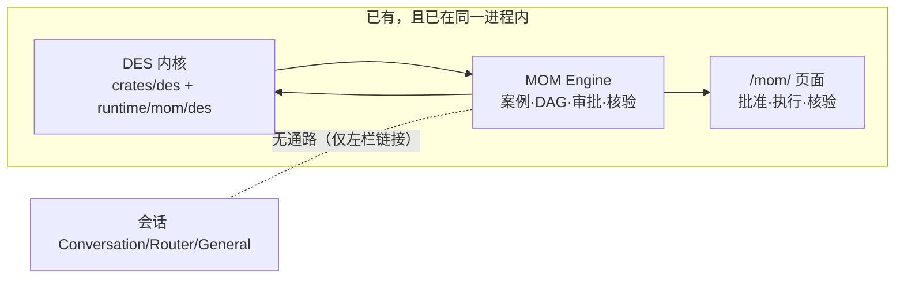
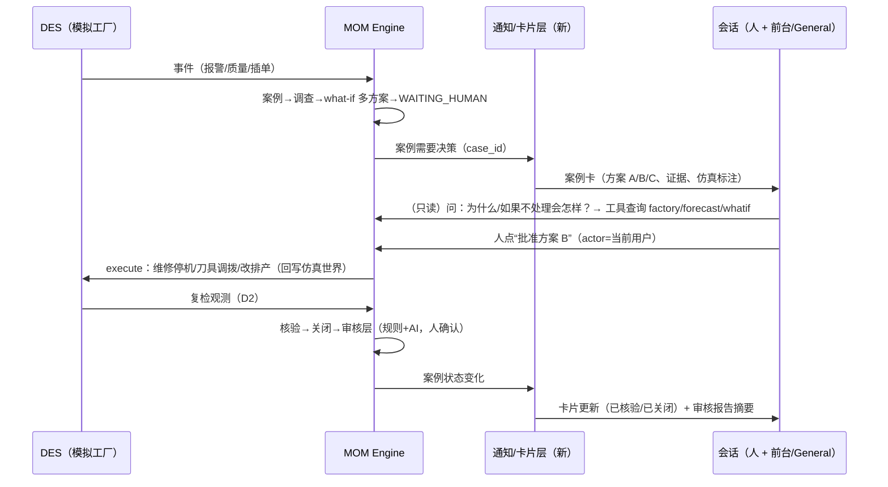

# 系统打通计划：从“三块各自完整”到“完整系统 + 整体场景 E2E”

状态：**WP1 方案已确认并在实施中**（决定见 [DECISIONS.md](DECISIONS.md) 第 56–58、60–62 条）；**产品壳主轴**见已确认的 [AI Desktop V1.7](ai-desktop/DESIGN.md)（交付顺序 A→B→C→D）。**产品前门按 World Adapter 推进**（决定 61、62；DES-31/32 已确认）。运营桌面 D0～D2 已完成；D3 与 GS1 改走 [WORLD_ADAPTER_PLAN.md](mom/WORLD_ADAPTER_PLAN.md) M0～M2；实验与运营入口拆分见 [mom/DES_EXPERIMENT_OPS_SPLIT.md](mom/DES_EXPERIMENT_OPS_SPLIT.md)。其余工作包仍是助手建议，开工前需用户确认。  
**执行级任务卡**：Desktop [ai-desktop/PLAN.md](ai-desktop/PLAN.md) + [ai-desktop/FEATURE_MAP.md](ai-desktop/FEATURE_MAP.md)；运营桌面 [mom/OPS_DESK_TASKS.md](mom/OPS_DESK_TASKS.md)；WP1 [mom/WP1_TASKS.md](mom/WP1_TASKS.md)；M0 [mom/WA_M0_TASKS.md](mom/WA_M0_TASKS.md)；其余工作包见本文第五节。  
缺口依据见 [SYSTEM_GAPS.md](feature-map/SYSTEM_GAPS.md) 与 [ai-desktop/GAPS.md](ai-desktop/GAPS.md)，场景清单见 [SCENARIOS.md](feature-map/SCENARIOS.md)。
按 AGENTS.md：涉及 `orchestrator.rs` / `store.rs` / `registry.rs` / `acp.rs` / `util.rs` 的工作包，动手前先单独出方案并等你批准；每个工作包新增行为先在 `docs/testing/CASES.md` 定稿用例并见到业务断言 Red。

## 0. 与 AI Desktop 的关系（2026-11-20 用户确认：不做双轨）

**产品主轴只有一条：组织级 AI 桌面（V1.7）。** A1 一次换壳；本文 WP0–WP8 / WP1 / 运营 D* 是桌面内的能力与真实替换项，不再维护第二套前端导航。

| 层级 | 职责 | 完成看什么 |
|---|---|---|
| **AI Desktop A–D** | 完整前端、Feature Map+Playwright、Mock→真实（见 [ai-desktop/MOCK_REGISTRY.md](ai-desktop/MOCK_REGISTRY.md)） | 每里程碑 AD-* 全绿；已替换能力有真实集成证据 |
| **本文 WP*** | 模块协议、黄金场景 GS1–GS6、高风险后端 | 跨模块断言；接入桌面后仍从桌面入口操作 |

约束：

1. A1 **移除**旧「会话 | 运营桌面」一级页签模型，入口重定向进桌面模块。  
2. 运营「看板 / 任务 / 资源」= 桌面内运营模块；**D3a** 补任务+资源；**L4** 单独方案。  
3. GS1 断言链不变；操作路径只认桌面入口。  
4. A 阶段 SMT-03 **允许纯 Mock**；L1–L3 等真实 MOM 能力在 B/C 与 M4/M5 替换时汇合。

### 五条研发线与近期汇合

当前按[五线分工决定](decisions/2026-11-22-five-workstreams.md)排期，近期没有确定的工厂试点窗口。下表是近期工作范围，后文保留完整黄金场景及工作包。

| 研发线 | 负责的交付 | 近期次序 |
|---|---|---|
| 1 AI 桌面产品入口 | 正常入口、交互反馈、任务和证据展示 | 首页真实委派优先。消费第 4 线的请求和任务状态；继续维护第 3 线的运营频道入口 |
| 2 独立复跑与集成协调 | 跨组场景、复跑环境、验收证据、问题归属和复验 | 输入为任务卡、PR、Feature Map、CASES 和证据；按合入 SHA 复跑，分别记录 fixture、真实服务和未验项。沿用 [T-60](testing/evidence/t60-cross-group-acceptance.md) 和 [T-63](testing/evidence/t63-m2-reverify.md)；T-63 已验合同及 harness，远程 DES MCP 仍待本线独立复跑 |
| 3 工业业务闭环 | DES、MOM、运营处置与 World Adapter；业务来源核验 | 沿用 M2-6 准出与 [T-63](testing/evidence/t63-m2-reverify.md)，维持远程 DES 回归；M3-2 已用桩数据验证绑定、观测和水位；M3-3 已验权限、过期续读、延迟与写关闭，下一步是 M3-4 浏览器验证，站点和授权明确后进入真实验收 |
| 4 执行协议与共享契约 | 通用任务受理、编排、执行组、结果整合及跨模块一致语义 | 先验持久受理、重试去重、可查分流；再把已合入的执行后人工验收（WP2，#215）纳入桌面主路径，并补终态结果可靠回传。运行中恢复按 WP7 分期 |
| 5 内省、分层记忆与会话上下文 | 内省发现、记忆生命周期及每轮上下文选材 | 先走受控会话上下文切片，并行维持 INT 证据；分期见[特性计划](features/conversation-memory/PLAN.md) |

| 汇合场景 | 交付与独立复跑 |
|---|---|
| 首页真实委派 | 第 1、4 线交付，第 2 线从日常入口验「丢回执后只有一次受理、同一任务可查、重连回到原会话」。随后验人工通过或退回，结果和证据仍回原会话 |
| 运营频道远程 DES | 第 1、3 线交付，第 2 线复跑同一次正式运行的审批、执行、核验和异常对账。MOM 与来源系统的回执分别关联通用任务和业务执行标识 |
| 会话上下文可追溯 | 第 5 线先交付受控切片，第 1 线承接来源展示，第 4 线确认调用边界，第 2 线复验跨会话隔离、来源失效和超时降级。后续再接内省发现及获授权的共享来源 |

共享契约继续以 [contracts/](contracts/README.md) 为权威入口。工业审批与来源系统核验由第 3 线负责。新出现的跨线语义先提出方案，按研发规范确认后登记。

## 一、目标与“完成”的定义

**目标**：把对话/任务平台、MOM/DES、治理旁路连成一个系统，并能用多个**跨模块的完整场景**做端到端测试。

**完成 =** 下面 6 个“黄金场景”都有浏览器 E2E（受控模型）且通过；每个场景的断言都跨越至少两个模块；同时没有“死胡同状态”（任何状态用户都有出口）。

| 黄金场景 | 串起的模块 | 对应缺口 |
|---|---|---|
| **GS1 制造异常闭环**：选定世界 → DES 报警经 MOM 投递 → 工作台/会话观察与续读 → 人批准 → Execute/Confirm 回写 DES → 复检核验 → 审核报告可见（不含标准答案） | DES · MOM · World Adapter · 会话 · 审批 · 审核 | G01（本轮先做；验收对齐 WA-05/08） |
| **GS2 写代码全链路**：无助手 → 对话接入 → 改代码 → diff 证据 → 审查 → 完成 | 助手管理 · 路由 · 编排 · git 证据 · Reviewer | S05 |
| **GS3 审查需人工**：审查判需人工 → 用户验收通过/退回 → 返工或完成 | Reviewer · 审批 · 编排 | G04 |
| **GS4 多问题拆分**：一条消息多个问题 → 拆成并行子任务 → 汇合回复 | 路由 · 模板 · 编排 · Composer | G02 |
| **GS5 反馈改进**：派错 → 反馈 → 进评测集（人工确认）→ 评测 → 配置变更留痕 | 反馈 · an-eval · 路由 · DECISIONS | G06 |
| **GS6 重启与外发合规**：运行中重启 → 明确失败/恢复；开启外发检查后全链路脱敏 | 编排 · 存储 · DLP · MCP | G08 / G09 |

## 二、工作包与顺序

| WP | 内容 | 缺口 | 依赖 | 触碰高风险文件 | 产出的 E2E |
|---|---|---|---|---|---|
| **WP0** | E2E 底座：harness 支持同库重启、coding 临时 git 仓库、审查 fail→pass、节点模拟；修正 DESIGN §15 过时描述 | 三(6)、G08 文档 | — | 否（测试与文档） | 为 GS2/3/6 铺路 |
| **WP1** | **DES-MOM-会话闭环**（本文第三节） | G01、G10 | WP0 部分 | 预计否（需核实） | **GS1** |
| WP2 | 审查“需人工”的出口：状态拆分（待批准 / 待验收）+ 验收通过/退回返工 | G04、G05 | — | **是**（orchestrator/store） | GS3 |
| WP3 | 补现有功能的整链 E2E：改代码全链路、补充要求、反馈 UI、节点 UI | S05/S06/S08/S10 | WP0 | 否（本卡交付 S05+S08 写入；S06/S10 仍缺） | GS2 |
| WP4 | 任务拆分与模板执行（M4.3）：模板接入编排器、并行与 Composer 汇合 | G02 | WP2 | **已合入**（#222；汇合交付竞态热修 #227） | GS4 |
| WP5 | 反馈闭环 + 会话摘要/知识接入 | G06、G07 | WP3 | 视方案 | GS5 |
| WP6 | 准入界面 + 认证；外发“保证范围”文档与出口审计；观测统一（trace_id） | G03、G09、G10 | WP1 | 部分 | GS6（外发部分） |
| WP7 | 重启语义：待批准保持、运行中任务的续跑或明确失败原因 | G08 | WP0 | **是** | GS6（重启部分） |
| WP8 | 整体验收：6 个黄金场景合并回归、真实模型/真实 ACP 清单、CI 接入 | 全部 | 前述 | 否 | 全部 |

顺序原则：先做**不需要新产品决策、能立刻增加 E2E 证据**的（WP0），再做你指定的 WP1；WP2/4/7 是高风险文件，各自先出方案。

## 三、WP1：DES-MOM-会话闭环

### 3.1 现状（已核对代码）

- 主进程 `main.rs` 已创建 MOM `Engine`（独立 SQLite：`<db_path>.mom.db`）并起了时钟，同源挂载 `/mom/`。所以“进程内通信”没有障碍。
- DES 闭环已具备：执行回写仿真世界、复检证据、协同事项、审核层（RT-DES-*）；设计 §9 早已规划“会话可调用只读仿真接口”，设计 R7 要求“仿真能力要能在人与 agent 的会话中被调用和报告”——**这条一直没落地**。
- 会话侧已有可复用的机制：`ChatCard`（对话里的卡片，`add_message_with_card` / `update_message_card` 已在 store 中）、`manage_agents` 这类“前台识别领域动作”的先例、`Tool` + `CapabilityCard`（效果分级 ReadOnly/WorkspaceWrite/ExternalWrite/Destructive）、`ToolRegistry` 在 `runtime/lib.rs` 装配。
- 缺的：①会话能读 MOM/DES；②MOM 有事要人决策时会话能知道；③人在会话里能批准；④结果回到会话；⑤一条贯穿的关联标识。

### 3.2 要形成的闭环

**不变量（必须成立，也是 E2E 的断言来源）**
1. **模型不写**：批准/执行/关闭只能由人点卡片触发；会话里的模型只有只读工具，`Effect = ReadOnly`。
2. **一套状态**：案例状态只在 MOM Engine 里；卡片是投影，刷新/重启后以 Engine 为准。
3. **一条关联线**：`case_id` ↔ `conversation_id` ↔ `message_id` 写入日志与卡片，用一个字段即可串起时间线。
4. **仿真永远标注**：所有从 DES 来的内容带 `provenance=simulation`，卡片与回答里显示“仿真估计”。
5. **标准答案隔离**：会话与 agent 看不到 ground truth；只有审核层可读。
6. **失败可见**：Engine 不可用、案例已被他人处理、审批过期时，卡片显示明确原因，不静默。

### 3.3 方案选项

| | A：工具式前门 + 案例卡（**推荐**） | B：案例即任务（深度集成） | C：保持独立，只加跳转/深链 |
|---|---|---|---|
| 做法 | 会话通过只读工具读 MOM；MOM 通过新的案例卡把决策推到会话；批准经卡片按钮调用 MOM 现有批准路径 | 每个案例映射为平台 Task，由 Orchestrator/Policy/Registry 统一管理，MOM Master 并入 Router | 案例卡只做提醒与链接，批准仍在 `/mom/` |
| 优点 | 复用现有 `ChatCard`/`Tool`；MOM 状态机不动；风险局部；能完整形成闭环 | 概念最统一（同一审批、同一时间线、同一 `task_id`） | 改动最小 |
| 缺点 | 仍是两套状态机，靠关联标识对齐；需要新增卡片类型与通知层 | 改动 orchestrator/store/registry（高风险），MOM 的案例/DAG 语义要重写进任务模型，工作量大 | 不是闭环，用户要在两个页面间切换，GS1 的“会话里批准”做不到 |
| 触碰高风险文件 | 预计不触碰（需在方案评审时核实注入点） | 必然触碰 | 否 |
| 为后续留的口子 | 之后可演进到 B（卡片/工具层不丢弃） | — | 无 |

### 3.4 分阶段（推荐 A；与 World Adapter 对齐）

运营频道 + 桌面批准（L2 / D2）已落地。会话只读工具（L0～L1）与闭环回写卡片（L3）仍按本表推进。**远程工厂挂载（原 L4）中的⑤a-2/③已完成**；产品侧余下工作并入 World Adapter（DES-31）。

| 阶段 | 内容 | 验收（先定义为用例，再实现） |
|---|---|---|
| **L0 关联与前置** | 统一 `case_id`/`conversation_id` 关联字段；MOM 日志带 `case_id`；主进程把 MOM 句柄注入会话侧装配点（核实 `runtime/lib.rs` 装配与 `main.rs` 顺序） | RT：案例事件可按 `case_id` 过滤；关联字段在日志里 |
| **L1 会话可读** | 只读工具集：`mom_cases`、`mom_factory_status`、`mom_forecast`、`mom_whatif`（或等价的 World Adapter Observe 投影）；返回带 `provenance`/`observed_at`/`limitations`；General 可用，登记在 `/api/capabilities` | E2E：会话追问与 `GET /api/mom/*` / Observe 一致且标注仿真；效果 ReadOnly；无写工具 |
| **L2 案例推到会话 + 人批准** | **已由 D0～D2 落地**：`OpsCase` 卡 + 运营频道批准（决定 60）。会话内「问起才发卡」仍可选，L1 之后确认 | E2E-OPSAPPROVE 等已绿；跨世界/过期批准的协议断言并入 WA-03 |
| **L3 闭环回写与审核报告** | 执行→DES 回写→复检→关闭；卡片更新并附审核摘要（不含标准答案） | 与 WA-05/08、E2E-WA-07 对齐；缺核验证据不能关闭 |
| **L4 远程工厂（已完成基线）** | ⑤a-2 连接器 + ⑤a-3 `an-mom --des-mcp`（RT-DESC-01～12） | 同种子进程内与 MCP 一致；离线明确报错。**不再作为 WP1 阻塞项** |
| **WA M0～M2 产品前门** | 完整工作台 + 协议 Mock → 远程 DES 读 → 远程 DES 写/确认；主应用 MOM 共享引擎与连接器 | [WORLD_ADAPTER_PLAN](mom/WORLD_ADAPTER_PLAN.md)；Feature Map `world-adapter.md`；GS1 最终验收走 WA-08 |

### 3.5 预计改动范围（待方案评审时逐项核实）

| 位置 | 改动 | 风险 |
|---|---|---|
| `crates/core/src/lib.rs` | 新增 `ChatCard::MomCase`（并重新生成 `web/src/bindings`） | 公开类型变更，需说明；CI 检查绑定最新 |
| `crates/runtime/src/mom/`（新文件） | 只读视图适配、案例→卡片事件、`case_id` 关联 | 低 |
| `crates/runtime/src/lib.rs` | 向 `ToolRegistry` 注入 MOM 只读工具（可选，仅在启用 MOM 时） | 中（装配顺序） |
| `crates/server/src/mom.rs`/`main.rs` | 案例推送与卡片批准接口（走现有 Engine 批准路径） | 中 |
| `web/src/components/ChatCards.tsx` | 新卡片组件，按 role/name 暴露稳定定位 | 低 |
| `docs/testing/CASES.md`、`features.json`、`docs/feature-map/*` | 新用例 `E2E-MOMLOOP*`、`RT-MOMCHAT-*` 等 | 低 |
| `orchestrator.rs` / `store.rs` / `registry.rs` | **预计不改**（`add_message_with_card` 已存在） | 若评审发现必须改，先停下单独出方案 |

### 3.6 需要你先定的 4 件事（**已确认**，保留作记录）

确认结果：方案 A；案例卡不固定在某个会话，只在需要时推送，另设专属运营频道（`ops-channel`）和最小只读运营桌面；批准身份用本机 fixture 身份、卡片上显示批准人；DES 先进程内，连接器 L4 随后。

1. 集成方式：A / B / C。
2. 案例卡落点：固定“运营会话”？当前会话？每案例一个会话？
3. 批准身份：沿用本机 fixture 身份并在卡片显示 actor（已知限制，登记为 G03 相关缺口），还是此轮就引入角色？
4. 首版 DES 接入：进程内先走通（L1–L3），连接器 L4 随后，还是先做 L4？

### 3.7 不做（本轮明确排除）

让会话模型直接审批/执行；把 MOM 重写进 Task 模型（除非选 B）；完整多用户权限体系；DES 参数标定；PLC/现场联锁控制。  
**修订（对齐决定 61）**：真实 MES/EAM **读取**与**首个可查证写动作**不在 WP1 L1～L3 内做，但列入 World Adapter M3～M4，不再视为永久排除。完整 React 工作台（看板/任务/资源）由 World Adapter M0 交付，不再适用决定 56「暂不用 MOM 界面」对产品前门的限制（该限制仍适用于 WP1 L1～L3 当时的范围）。

### 3.8 进度（与 PLAN.md / OPS_DESK_TASKS 同步）

| 阶段 | 状态 | 说明 |
|---|---|---|
| 运营桌面/频道 D0～D2 | 已完成（#118、#121、#136） | 发布器、看板、频道批准 |
| D3 任务/资源入口 | 改走 WA M0 | 见 OPS_DESK_TASKS §8、WORLD_ADAPTER_PLAN；挂入 AI Desktop 运营区 |
| L0、L1 | 未开始 | 任务卡见 WP1_TASKS；可读面可与 WA Observe 合并设计 |
| L2 | 已完成（D2） | 运营卡批准 |
| L3 | 未开始 | 与 WA M2 确认/核验对齐 |
| L4 连接器 | 基线已完成（⑤a-2/③） | 产品侧余下见 WA M1～M2 |
| WA M0～M4 | 设计已确认，协议待实施 | 决定 61；DES-31 待确认 |

## 四、风险与回滚

| 风险 | 缓解 | 回滚 |
|---|---|---|
| 卡片与 Engine 状态不一致 | 卡片只是投影，渲染与批准都先读 Engine；批准接口幂等并校验版本 | 功能开关 `[mom] chat_bridge = false` 默认关，关闭后行为与现在一致 |
| 通知刷屏（DES 高频报警） | 协同事项归并已有（同线 60 分钟）；卡片只对 `WAITING_HUMAN` 生成，同案例只更新不新增 | 同上 |
| 模型把仿真当真实 | 工具输出强制 `provenance`/`limitations`，回答模板要求标注；E2E 断言 | 工具集可按配置关闭 |
| 引入死胡同状态 | 卡片对每种终态/失败都有文案与出口；纳入 E2E | — |

## 五、其余工作包的任务卡概要（接手前必读）

通用规则：每张卡做之前，先把本节概要补写成与 [OPS_DESK_TASKS.md](mom/OPS_DESK_TASKS.md) 同粒度的卡片（文件路径、接口、先写的用例、命令），**发给用户确认后再动手**；一张卡一个 PR；通用流程、完成的定义、环境坑见 OPS_DESK_TASKS 第 2 节。下表“先读”的文件必须实际打开读过，不要凭本文描述写代码。

### WP0 E2E 底座（不碰高风险文件，可优先）
| 卡 | 做什么 | 先读 | 验收 |
|---|---|---|---|
| WP0-1 | harness 支持“同一数据库重启”：杀掉服务进程，用同一个 `db_path` 再起，返回新实例 | `web/e2e/harness.mjs`（当前配置写在 `configText`，端口 18787，数据目录是临时目录） | 新用例：建会话 → 重启 → 会话与消息仍在 |
| WP0-2 | coding 助手用的临时 git 仓库夹具（`[agents.coding] enabled=true`，工作目录指向临时仓库） | `harness.mjs` 里 `[agents.coding] enabled=false` 的位置；`crates/agents/src/coding.rs` | 夹具能让 coding 助手改文件并产出 diff 证据 |
| WP0-3 | 审查助手“先不过、后通过”的模拟（ACP mock 的回复可配置） | `harness.mjs` 的 `mockAcp`、环境变量 `AN_MOCK_ACP_REPLY` | 审查 fail → 返工 → pass 可在 E2E 里重现 |
| WP0-4 | 节点模拟（`[nodes]` 下一个假节点） | `crates/node`、`web/src/components` 的 NodesPanel | 节点面板出现假节点并可删除 |
| WP0-5 | 修正 `docs/DESIGN.md` §15 过时描述 | §15 全文 | 描述与代码一致，评审通过 |

### WP2 审查“需人工”的出口（**高风险：orchestrator.rs/store.rs，必须先出方案并经用户批准；弱 agent 不得直接实施**）
T-69（#215）已合入：沿用 `NEEDS_HUMAN`，按是否已有结果区分待批准和待验收；`review-verdict` 提供验收通过、退回返工路径。方案见 [WP2 实施计划](fencing/WP2_IMPLEMENTATION_PLAN.md)，接口用例见 [review_verdict.rs](../crates/server/tests/review_verdict.rs)。后续从首页委派链路验收 GS3。

### WP3 现有功能整链 E2E（不碰高风险文件）
按 `docs/feature-map/SCENARIOS.md` 的 S05/S06/S08/S10 逐个补：每个场景一个 `web/e2e/*.spec.ts` 用例，断言跨两个模块以上；依赖 WP0-2/0-3。先读 `web/e2e/features.spec.ts` 的写法，复用其辅助函数。

**本卡进度**：S05 ✅（E2E-CODEFLOW + WP0-2 临时 git workdir）；S08 写入路径 ✅（E2E-FEEDBACK；消费者仍属 WP5/G06）；S06 / S10 未交付。GS2 浏览器整链可跑通（受控模型 + mock ACP）。

### WP4 任务拆分与模板执行（**高风险：orchestrator.rs / store.rs，先出方案；依赖 WP2**）

完整实施方按（父子任务、最小 DDL、Router 三字段、汇合与 Composer、验收矩阵、唯一负责人）见 [fencing/WP4_IMPLEMENTATION_PLAN.md](fencing/WP4_IMPLEMENTATION_PLAN.md)。  
决策：[2026-11-22-wp4-task-split-template-plan](decisions/2026-11-22-wp4-task-split-template-plan.md)（待用户确认后另卡实现）。  
依赖：WP2 已合入（#215）。校验基线 RT-TPL-01～10 已绿；实现卡接编排与 E2E-TPL / GS4。

### WP5 反馈闭环
会话摘要与知识接入由第 5 线按[分层记忆计划](features/conversation-memory/PLAN.md)推进。WP5 保留任务反馈到评测的链路。
先读 `docs/DESIGN.md` 反馈章节，并用 `rg -ln eval` 找评测相关代码（仓库里没有 `crates/eval`，根目录有 `evals/`）；反馈 → 评测集必须**人工确认**后才入库；配置变更要留痕到 DECISIONS。方案是否触碰 `store.rs` 在出方案时确认。
### WP6 准入界面与认证；外发保证范围；观测统一
准入已有后端（`crates/server/tests/admission.rs`）；先做“界面 + 认证”的方案；外发“保证范围”写文档并加出口审计用例（`crates/server/tests/egress.rs` 为基线）。
### WP7 重启语义（**高风险：store.rs/orchestrator.rs，先出方案；依赖 WP0-1**）
要写清：待批准保持、运行中任务续跑或明确失败原因；当前行为是 `fail_interrupted_tasks`（启动时把中断任务标 FAILED，见 `runtime/src/lib.rs::assemble`）。
### WP8 整体验收
6 个黄金场景合并回归，真实模型/真实 ACP 的人工清单，CI 接入。只在前面全部完成后做。

## 六、容易踩的坑（累积，发现新的请追加）

1. **决策编号撞号**：多会话并行时 `DECISIONS.md` 编号被占用；推送前 `fetch` 确认，改号要连带改引用。
2. **浏览器用例环境**：`PLAYWRIGHT_BROWSERS_PATH=$HOME/Library/Caches/ms-playwright`；各 spec 端口不同（harness 18787、ops 18791、新增的用 18792 起往后），不要复用。
3. **推送**：直连优先，失败再用 git 配置的代理 `127.0.0.1:7897`；先从远端同步再继续。
4. **钩子**：提交走正常钩子，不绕过；`cargo fmt --all` 要在推送前跑（CI 的 rust 检查会 `--check`）。
5. **check-map**：E2E 用例 id 仅大写字母；表格行必须有同名测试，草稿写 bullet。
6. **引擎时间是仿真分钟**，发布器时间是墙钟秒；测试夹具里不要写死绝对时间，批准要赶在证据过期之前。
7. **本机特有失败**：`an-server --test admission::rt_adm_14_admission_http_end_to_end` 本机失败、CI 通过。
8. **用户的未跟踪文件**（`AgentNexus_统一外发脱敏服务_技术方案.md`、`evals/reports/`、`test_data_set/`）不要提交或删除。
