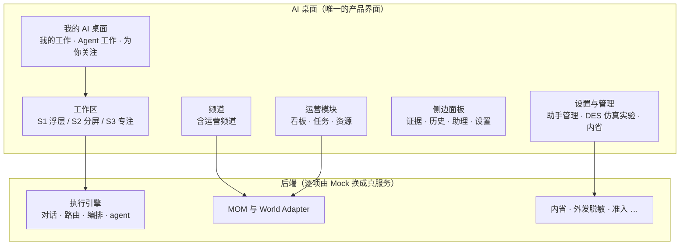

# 设计意图：产品主轴只有 AI 桌面，不做双轨

| 项目 | 内容 |
|---|---|
| 日期 | 2026-11-20（决定）；2026-11-21 补全设计意图与依据 |
| 来源 | 用户确认 |
| 状态 | 有效 |
| 影响范围 | 整个前端与导航；所有面向用户的特性的入口位置；里程碑与验收方式 |
| 相关设计 | [产品宪章](../PRODUCT.md) 第 3 节第 1 条；[ai-desktop/DESIGN.md](../ai-desktop/DESIGN.md) 第 1、2 节；[ai-desktop/GAPS.md](../ai-desktop/GAPS.md) 第 5、6 节；[INTEGRATION_PLAN.md](../INTEGRATION_PLAN.md) 第 0 节 |

**一句话结论**：AgentNexus 只有一个产品界面——组织级 AI 桌面。不同时维护“旧 MVP 界面 + 桌面”两套；已有的会话、运营、内省等能力都作为桌面里的模块，缺的后端先用登记过的 Mock 顶上，再逐项换成真服务。

本文件补全 `DECISIONS.md` 第 61 条「61（AI 桌面）」的设计意图和依据，不改变该决定。

## 背景

- **AI 桌面**：面向组织的 AI 工作界面。用户在“我的 AI 桌面”首页提问、委派任务、看证据、协作和审批；同一任务可以在三种工作状态间切换：S1 桌面浮层（简单问答）、S2 分屏工作区（左侧任务信息、右侧会话）、S3 专注工作区（只看会话）。设计见 [ai-desktop/DESIGN.md](../ai-desktop/DESIGN.md)。
- **旧 MVP 界面**：2026-11-04 起逐步长出来的网页——左侧会话列表，中间是“会话 | 运营桌面”页签，右侧是任务、内省、助手等多个页签平铺；另有独立的 MOM 工作台 `/mom/`，只靠左栏一个链接进入。
- **双轨**：新桌面和旧界面同时保留、并行维护，用开关切换。
- 2026-11-20 用户拿到 AI 桌面 V1.6 原型和特性清单后，需要决定它和旧界面、以及已在推进的运营桌面、打通计划怎么排。

## 问题

1. 旧界面和新桌面并存时，同一功能要在两处实现、两套测试，导航也是两套，用户不知道该从哪进。
2. 已有能力（会话、运营桌面与运营频道、内省、助手管理）要放在哪里，各自另起入口还是归到一处。
3. 后端很多能力还没做好，等后端再做界面会让整条用户路径很晚才能验证。

## 决策依据

1. **旧界面不是目标形态**：主 Web 仍是“会话列表 + 对话/运营桌面页签 + 右侧任务/内省”，没有桌面首页、没有 S1/S2/S3、没有统一侧边面板（[ai-desktop/GAPS.md](../ai-desktop/GAPS.md) 第 1、3 节，缺口 AD-G1～G4，均为“高”）。
2. **已经吃过“两套入口”的亏**：决定 57 选运营桌面方案时，明确放弃“复用 MOM 工作台”，原因是它“有自己的批准入口，会出两套”；SYSTEM_GAPS G04 记录了“待批准”和“审查要人看”共用状态、用户没有出口的问题（[feature-map/SYSTEM_GAPS.md](../feature-map/SYSTEM_GAPS.md)）。
3. **系统本来就是割裂的**：2026-11-18 的缺口分析结论是“三个各自完整、但互相不连通的部分”（对话平台、MOM/DES、治理），用户无法从一个入口走完整体场景（SYSTEM_GAPS 开头与 G01）。再加一套前端只会多一个孤岛。
4. **一套前端才能一套验收**：项目的验收方式是 Feature Map + Playwright 端到端用例，回归要“严格覆盖设计特性清单”；两套导航意味着两套 Feature Map 和两倍的回归（决定 61 第 2 条；[ai-desktop/PLAN.md](../ai-desktop/PLAN.md)）。
5. **Mock 先行可以让界面不等后端**：每个缺的后端在 [MOCK_REGISTRY.md](../ai-desktop/MOCK_REGISTRY.md) 登记 Mock、负责人和替换里程碑，界面从第一个里程碑起就能走完全流程；A 阶段已经用这种方式完成 A0～A5，随后 B1～B3、C1 逐项换成真服务（[PLAN.md](../PLAN.md)「AI Desktop 进度」）。
6. **用户意见**（2026-11-20）：“不采用双轨，直接做组织级 AI 桌面”；A1 一次换壳，旧路径重定向（[ai-desktop/GAPS.md](../ai-desktop/GAPS.md) 第 6 节拍板记录）。2026-11-21 用户再次确认“AI 桌面是唯一的产品主轴”。

## 定了什么

- 产品界面只有 AI 桌面；不保留旧界面与桌面并行，不设长期的兼容开关。
- A1 一次换壳：默认进入“我的 AI 桌面”；旧的“会话 | 运营桌面”一级导航移除，旧入口重定向到桌面里对应的模块。
- 已有能力作为桌面里的模块：会话进工作区，运营桌面和运营频道进运营模块与频道，内省、助手管理等也作为桌面内模块（具体位置按 ai-desktop/DESIGN 第 2 节）；不另起一级导航。
- 缺的后端用登记过的 Mock，按 A → B → C → D 逐项替换；生产模式缺服务时显示明确的不可用状态，不静默回退到 Mock。
- 原打通计划（INTEGRATION_PLAN 的工作包和黄金场景）的断言保留，但操作路径只认桌面入口。

## 简单设计

| 旧入口 | 桌面里的位置 |
|---|---|
| 会话列表 + 对话 | 首页与工作区（S1/S2/S3），历史在侧边面板 |
| 运营桌面页签 | 运营模块（看板、任务、资源） |
| 运营频道 | 频道 |
| 右侧任务 / 内省 / 助手页签 | 任务信息进工作区；内省、助手管理作为桌面内模块，位置按 ai-desktop/DESIGN 第 2 节 |
| `/mom/` 工作台 | 迁移期标为“MOM 仿真沙盘”，新入口验收后跳转或退役（见 [DES_EXPERIMENT_OPS_SPLIT.md](../mom/DES_EXPERIMENT_OPS_SPLIT.md) 第 1 节） |

完整的导航、工作区与面板设计见 [ai-desktop/DESIGN.md](../ai-desktop/DESIGN.md) 第 2 节；交付顺序见第 1 节。

## 没选什么

| 做法 | 为什么没选 |
|---|---|
| 新桌面与旧界面双轨并行 | 两套导航、两套实现和回归；用户不知道从哪进（依据 2、4） |
| 换壳时长期保留兼容开关 | 等于变相双轨；决定 61 明确“A1 兼容开关长期并存”不选 |
| 先把后端做完再换界面 | 整条用户路径要很晚才能验证；Mock 先行已证明可行（依据 5） |
| 各能力保留自己的一级入口 | 正是“三块互不连通”的原因（依据 3） |

## 影响与后续

- 新特性的界面必须挂在桌面已有的导航位置上；需要新的一级导航时，先改宪章（要用户确认）。
- `/mom/` 旧入口在新入口验收后安排跳转或退役。
- 真实登录、组织权限等 C、D 阶段能力仍待替换，见 [MOCK_REGISTRY.md](../ai-desktop/MOCK_REGISTRY.md)。

## 出问题先看

- 是否又出现了第二套一级导航（决定 61 的“出问题先看”）。
- 生产模式是否静默回退到 Mock。
- 某能力的入口在哪：先查上面的入口对照表，再查 ai-desktop/DESIGN 第 2 节。

## 变更记录

| 日期 | 变化 | 关联 |
|---|---|---|
| 2026-11-20 | 用户确认，记为 `DECISIONS.md` 第 61 条「61（AI 桌面）」 | [ai-desktop/GAPS.md](../ai-desktop/GAPS.md) 第 6 节 |
| 2026-11-21 | 按新的决策写法补全设计意图、依据和简单设计 | [2026-11-21-decision-format](2026-11-21-decision-format.md) |
