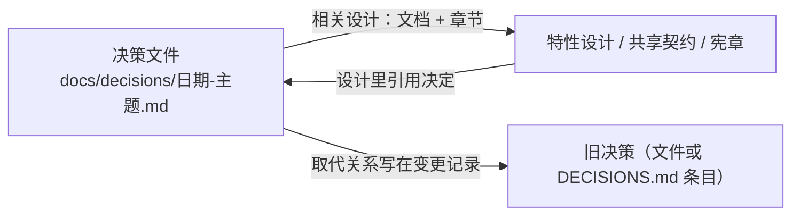

# 决策一条一个文件，并写清决策依据，必要时附简单设计

| 项目 | 内容 |
|---|---|
| 日期 | 2026-11-21 |
| 来源 | 用户确认 |
| 状态 | 有效（本目录内即日起执行；写进 `AGENTS.md` 待 L3 批准） |
| 影响范围 | 所有新决策；`docs/decisions/`、`docs/DECISIONS.md`、`AGENTS.md`（待批准） |
| 相关设计 | [decisions/README.md](README.md)（写法与模板）；[文档体系整理计划](../DOC_SYSTEM_PLAN.md) 第 2、4 节 |

**一句话结论**：每条决策单独成文，必须写清决策依据，让没参加讨论的新接手的人只读这一个文件就能看懂；决定涉及结构、接口、状态或流程时，附简单设计或引用设计文档的具体章节。

## 背景

这个项目由多个 AI agent 团队（Claude Code、Cursor 的会话，以及夜间评审和修复 agent）并行开发，人只在关键处拍板。agent 每次开工都是“新接手的人”：它不记得之前的讨论，只能靠文档理解为什么系统是现在这样。

到 2026-11-21，`docs/DECISIONS.md` 已有 1500 多行、70 条左右。它的写法是“问题、定了什么、为什么、没选什么、出问题先看”五项，但“为什么”常常只有一两句，读者很难核对。

## 问题

1. **并行撞号和冲突**：多个分支同时往 `DECISIONS.md` 末尾追加，各自取“最大号 + 1”。
2. **依据不清**：只写结论或一句理由，后来的人无法判断这条决定在条件变化后是否还成立，只能要么盲从、要么推翻。
3. **设计和决定脱节**：决定改变了结构或流程，但没说改成什么样，读者要在多份设计文档里自己拼。

## 决策依据

1. **撞号是实际发生的**：`DECISIONS.md` 里 42、43、59、61 各被用了两次，63 与 62 内容重复（2026-11-21 核对，见 [2026-11-21-design-overview](2026-11-21-design-overview.md)）；同日 `cursor/wa-des-connector-wire-f2df` 分支新增的决策用了已被占用的 69 号。
2. **末尾追加是主要冲突源**：`DECISIONS.md` 在 2026-11-18～21 三天内被改约 55 次；用 `git merge-tree` 模拟合并，活跃分支与 master 的冲突集中在该文件末尾（2026-11-21 核对，见 [文档体系整理计划](../DOC_SYSTEM_PLAN.md) 第 5 节）。
3. **新接手者是常态**：多数开发由新开的 agent 会话完成，它们只按根目录规则文件（`AGENTS.md`，经 `CLAUDE.md` 导入）读取上下文，不记得之前的对话。
4. **用户的明确要求**（2026-11-21）：“决策单列很有必要，每一个决策要说明决策依据，尽可能让新接手的人能理解。如果有必要的话，也需要在决策中附上简单设计或者附上对设计文档的引用。”

## 定了什么

- 新决策写成 `docs/decisions/YYYY-MM-DD-主题.md`，不再分配序号；`DECISIONS.md` 冻结为历史档案，只给旧条目标“已取代”。
- 每条决策必须有：开头表格（日期、来源、状态、影响范围、相关设计）、一句话结论、背景、问题、**决策依据**、定了什么、没选什么、影响与后续、出问题先看、变更记录。
- **决策依据要能核对**：数据或实验（带数字和出处）、代码事实（文件与行号或提交）、测试或评审编号、外部资料链接、用户意见（注明日期）。推断要标“推断”。
- 决定影响结构、接口、状态或流程时，写“简单设计”：一张图或表；已有设计文档的，写明文档和章节，并用一两句概括要点。
- 写法和模板以 [decisions/README.md](README.md) 为准。

## 简单设计

决策文件只写“为什么这样定”和必要的结构要点；完整设计仍在设计文档里，两边互相引用。

## 没选什么

| 做法 | 为什么没选 |
|---|---|
| 继续在 `DECISIONS.md` 追加，只要求“写之前先查最大号” | `memory/README.md` 早已写了这条提醒，撞号仍然发生；并行分支看不到彼此未合并的编号 |
| 一条一个文件，但沿用全局序号 | 序号仍需协调，撞号问题不变 |
| 只要求写“为什么”，不要求依据可核对 | 正是现在的写法，依据经常只有一句，新接手的人无法判断是否仍然成立 |
| 把设计全文写进决策 | 决策与设计会两处维护、相互漂移；只写要点并引用设计文档章节 |

## 影响与后续

- 已有的两条新决策（[2026-11-21-design-overview](2026-11-21-design-overview.md)、[2026-11-21-doc-layers](2026-11-21-doc-layers.md)）按新格式补齐。
- `DECISIONS.md` 里的旧条目不批量改；被引用或被修订时再顺手补依据。
- 写进 `AGENTS.md` 并由 CI 检查文件格式，属于 [文档体系整理计划](../DOC_SYSTEM_PLAN.md) 第 4 节的 P5，待用户批准。

## 出问题先看

- 新决策是否放在 `docs/decisions/`、文件名是否符合 `YYYY-MM-DD-主题.md`。
- “决策依据”里的每一条能否点开或复现；不能核对的，退回补充。

## 变更记录

| 日期 | 变化 | 关联 |
|---|---|---|
| 2026-11-21 | 新建 | 补充 [2026-11-21-doc-layers](2026-11-21-doc-layers.md) 中“新决策一条一个文件”的写法要求 |
