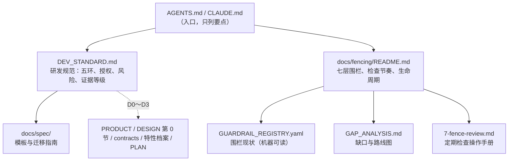

# 唯一研发规范 DEV_STANDARD.md 与唯一围栏入口 docs/fencing/README.md；三套编号分开；围栏登记表

| 项目 | 内容 |
|---|---|
| 日期 | 2026-11-21 |
| 来源 | 用户确认（“四个问题我都同意，193 先合并，继续吧”） |
| 状态 | 有效 |
| 影响范围 | `DEV_STANDARD.md`（新）、`docs/spec/`、`docs/fencing/`、`7-fence-review.md`、`AGENTS.md`、`CLAUDE.md`、`REVIEW.md`、`FIX.md`、`config/risk-policy.toml`、`docs/PRODUCT.md`、`docs/contracts/README.md`、`docs/DOC_SYSTEM_PLAN.md`、`docs/DESIGN.md` 第 0.4 节 |
| 相关设计 | [DEV_STANDARD.md](../../DEV_STANDARD.md)；[docs/fencing/README.md](../fencing/README.md)；[GUARDRAIL_REGISTRY.yaml](../fencing/GUARDRAIL_REGISTRY.yaml)；[GAP_ANALYSIS.md](../fencing/GAP_ANALYSIS.md) |

**一句话结论**：研发流程只有一个规范 `DEV_STANDARD.md`（放在仓库根目录），围栏只有一个入口 `docs/fencing/README.md`；文档层级、风险等级、围栏层三套编号分开；围栏现状用一份登记表记录，第一批只新增登记表和缺口分析两个文件。

## 背景

2026-11-21 用户在仓库外起草了两份文档：《Agent 自主开发七层围栏：审计、建设与持续治理规范》和《七层围栏实操指南》（原文存档于 [explore/guardrails-draft-2026-11-21/](../explore/guardrails-draft-2026-11-21/README.md)）。草案以一份名为 `DEV_STANDARD.md` v0.1 的研发规范为输入，但仓库里没有这个文件；功能相同的是当天合并的 `docs/spec/README.md`（研发对齐规范草案，PR #193）。

仓库里已有一套七层围栏落地材料：`docs/AUTONOMOUS_DEV_ACTION_GUIDE.md`（背景）、`7-fence-review.md`（定期检查手册，其中第 1 节是七层落点、第 3 节是差距清单）、`docs/fencing/` 下各阶段说明。

“七层围栏”指从需求到发布的七道防线：需求边界、产品知识与契约、执行隔离、自动验证、独立审查、风险审批、发布与恢复。

## 问题

1. 草案和仓库现有文档并存，会出现两个都自称权威的规范和两个围栏入口。
2. 三套编号都用 L：风险等级 L0～L3（脚本与 CI 在用）、文档层级 L0～L3、草案的围栏层 L1～L7。
3. 草案引用了仓库中不存在的脚本和文件，并建议新建约 10 个围栏文件，容易再次分散。
4. 已有围栏的真实状态没有统一记录，“有文档”“有脚本”“确实生效”混在一起说。

## 决策依据

1. **我对草案的对照意见**（2026-11-21 对话）：列出了与仓库对不上的地方（`DEV_STANDARD.md` 不存在；`trace_check.py`、`drift_check.py`、`guardrail_audit.py`、`preflight.sh` 不存在；仓库 action 已固定 SHA；已有每晚评审和周检）、编号冲突、可吸收的改进和建议精简处，并给出 4 个待决定问题与推荐答案。
2. **用户意见**（2026-11-21）：四个问题全部同意推荐答案——①研发规范叫 `DEV_STANDARD.md` 放根目录，围栏以草案为基础改写进 `docs/fencing/README.md` 并取代 `7-fence-review.md` 第 1、3 节；②风险等级保留 L0～L3，文档层级改 D0～D3，围栏层用“第一层～第七层”；③第一批只新建登记表和 `GAP_ANALYSIS.md`；④先合并 PR #193，再开新 PR。
3. **编号冲突真实存在**：`tools/ci/risk_classify.py` 与 `config/risk-policy.toml` 输出 L0～L3；`docs/DOC_SYSTEM_PLAN.md` 用 L0～L3 表示文档层级；`7-fence-review.md` 用“第一层～第七层”。改风险等级编号需要改脚本、策略、CI 和影子审查（L3），收益小。
4. **围栏现状需要分级说清**（2026-11-21 核对）：`ci.yml` 各作业在 PR #193 与 master 运行中通过（VERIFIED）；分支保护设置云会话读不到（NOT_VERIFIED）；`CODEOWNERS` 只有一人，且 agent 以该账号提 PR，无法独立审批（IMPLEMENTED）；`nightly-e2e` 两次定时运行均失败（run 44795474606、44931610796）。

## 定了什么

- **研发规范**：`docs/spec/README.md` 的内容移到根目录 `DEV_STANDARD.md`（v0.2），并吸收草案的改进：授权来源与授权契约、风险等级与草案 R0～R3 的对照及不降低的底线、例外管理、按任务类型的 Red/Green、同步分阶段（发版信息只在发版时更新）、证据等级与 T1～T3、里程碑准出结论。`docs/spec/` 只留模板和指南，新增授权契约模板；版本说明模板加入里程碑准出一节。
- **围栏入口**：`docs/fencing/README.md` 改写为唯一围栏入口（七层定义与本仓库落点、检查节奏矩阵、登记与生命周期、十个问题、可信边界、按真实的人和 agent 写的职责表）。`7-fence-review.md` 第 1、3 节改为指向，其余仍是定期检查手册。
- **登记表与缺口**：新增 `docs/fencing/GUARDRAIL_REGISTRY.yaml`（18 条现有围栏，如实标注证据等级，无一条写成 ENFORCED）和 `docs/fencing/GAP_ANALYSIS.md`（原 G1～G14 复核，新增 G15～G21，路线图前三项）。草案中的风险策略、审查策略、变更记录等不另建文件，并入已有文件。
- **编号**：文档层级改为 D0～D3（`PRODUCT.md`、`contracts/README.md`、`DOC_SYSTEM_PLAN.md` 已改；已有决策文件不改正文，只在变更记录注明）。
- **入口文件**：`AGENTS.md` 的阅读顺序以 `DEV_STANDARD.md` 开头，并提到授权来源；`CLAUDE.md`、`REVIEW.md`、`FIX.md` 的必读清单加入 `DEV_STANDARD.md` 与围栏入口。
- **保护**：`DEV_STANDARD.md` 列入 `config/risk-policy.toml` 的 L3 治理文件（草案要求规范变更须独立批准；改它等于改所有 agent 的规则）。

## 简单设计

| 编号 | 指什么 |
|---|---|
| D0～D3 | 文档层级 |
| L0～L3 | 风险等级 |
| 第一层～第七层 | 围栏层 |

## 没选什么

| 做法 | 为什么没选 |
|---|---|
| 原样放入草案作为另一份规范 | 会出现两个都自称权威的规范和两个围栏入口 |
| 风险等级改为 R0～R3 | 要改脚本、策略、CI 和影子审查（L3），收益小；用对照表说明即可 |
| 一次性建齐草案中的约 10 个围栏文件 | 与“设计意图不要分散”的目标相反；先建两份，其余并入已有文件 |
| 新建 Daily / Weekly / Milestone GitHub 工作流 | 已有每晚评审 agent、`nightly-e2e.yml`、周五周检；先对应现有机制 |
| 把 PR #193 再改大后一起合并 | #193 已是 L3、945 行，再加更难审 |

## 影响与后续

- 路线图前三项（见 `GAP_ANALYSIS.md` 第 3 节）：核实并收紧分支保护（需用户在 GitHub 操作）；修复每晚端到端；World Adapter 试点（PR #187 已合并，可以开始）。
- 2026-11-28：文档检查试点到期，决定是否改为阻断。
- 草案的外部链接未逐一核实，正式文档未依赖它们。

## 出问题先看

- 某条围栏是否真的生效：查 `GUARDRAIL_REGISTRY.yaml` 的 `evidence_level` 与 `evidence`。
- 编号看不懂：`DEV_STANDARD.md` 第 2 节。
- 规范与入口文件说法不一致：以 `DEV_STANDARD.md` 为准，并修正入口文件。

## 变更记录

| 日期 | 变化 | 关联 |
|---|---|---|
| 2026-11-21 | 新建 | [2026-11-21-doc-rules-enforcement](2026-11-21-doc-rules-enforcement.md)、[2026-11-21-doc-layers](2026-11-21-doc-layers.md) |
