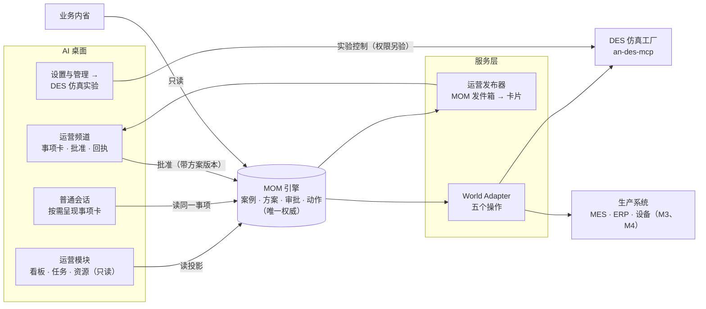

# 设计意图：MOM、运营桌面、World Adapter 是 AI 桌面里的工业业务能力，不是另一个产品

| 项目 | 内容 |
|---|---|
| 日期 | 2026-11-21（用户确认）；汇总 2026-11-18～20 的决定 56、57、58、60、61（World Adapter）、62 与 DES-31 |
| 来源 | 用户确认 |
| 状态 | 有效 |
| 影响范围 | MOM、运营桌面与运营频道、World Adapter、DES 仿真实验入口；AI 桌面的运营模块与频道 |
| 相关设计 | [产品宪章](../PRODUCT.md) 第 3 节第 2 条；[mom/DESIGN.md](../mom/DESIGN.md) 第 2 节；[mom/OPS_DESK.md](../mom/OPS_DESK.md)；[mom/WORLD_ADAPTER.md](../mom/WORLD_ADAPTER.md) 第 1 节；[mom/DES_EXPERIMENT_OPS_SPLIT.md](../mom/DES_EXPERIMENT_OPS_SPLIT.md) |

**一句话结论**：MOM 是案例、方案、审批和动作记录的权威来源，但没有自己的产品界面；人通过 AI 桌面的运营频道、运营模块和普通会话看到并处理这些事项，实验人员通过“设置与管理 → DES 仿真实验”控制仿真；所有对仿真工厂或真实工厂的读写都经 World Adapter。

## 背景

几个名词：

- **MOM**（制造运营管理）：本项目里指处理制造异常的“案例”系统。一个案例按（场景、批次、客户、设备）归并相关事件，带处置方案（A/B/C）、审批、执行动作和核验证据。代码在 `crates/runtime/src/mom/`，用独立的 SQLite 库。
- **DES**：离散事件仿真，即“模拟车间”，按物理规律模拟设备磨损、质量和订单，产生报警。
- **运营桌面与运营频道**：运营桌面是只读的事项看板；运营频道是一个固定会话，重要事项以卡片发进来，人在卡片上批准。
- **World Adapter**：统一访问“世界”（仿真工厂或真实工厂）的接口，五个操作：观察（Observe）、续读事件（Subscribe）、提方案（Propose）、执行（Execute）、确认（Confirm）。

演变过程：MOM 从 2026-11-06 起作为隔离模块开发，有自己的 Master agent、审批、事件队列和工作台 `/mom/`，“不修改原有 orchestrator/store/registry”（[mom/DESIGN.md](../mom/DESIGN.md) 第 1 节）。2026-11-18 起陆续定了会话里的案例卡、运营桌面、运营频道（决定 56～58、60）；2026-11-20 定了 World Adapter 和实验/运营入口拆分（决定 61（World Adapter）、62），以及 AI 桌面为唯一主轴（[2026-11-20-desktop-single-axis](2026-11-20-desktop-single-axis.md)）。

## 问题

MOM 一直按“独立产品”的方式长：自己的界面、自己的批准、自己的标识。这带来三个问题：

1. 用户无法在会话里处理一个制造异常，对话平台和 MOM 之间只有一个链接。
2. 同一个“批准”有两套实现（任务卡的“批准执行”和 MOM 页的“批准”）。
3. 日志里对话用 `task_id`、MOM 用 `case_id`，查不通。

需要定下：MOM 在产品里到底是什么，人从哪里接触它。

## 决策依据

1. **零集成的事实**：`conversation.rs`、`router.rs`、`orchestrator.rs`、`registry.rs` 中没有任何 MOM 引用，主界面与 MOM 只靠左栏一个链接 `/mom/`（[SYSTEM_GAPS.md](../feature-map/SYSTEM_GAPS.md) G01，2026-11-21 设计评审时复核仍成立）。
2. **两套入口的代价已被认定**：决定 57 放弃“复用 MOM 工作台”和“桌面也能批准”，理由分别是“有自己的批准入口，会出两套”和“要定义两入口一致性和身份”；决定 60 规定批准只在运营频道的案例卡上做。
3. **状态只能有一个权威**：MOM 设计要求“业务事实仍归源系统所有……只有源系统受理并核验后，才能将写动作标记为完成”（[mom/DESIGN.md](../mom/DESIGN.md) 第 2 节）；World Adapter 设计规定 MOM 是案例、方案修订、审批和动作记录的权威来源，World Adapter 复用 MOM 的领域校验（[WORLD_ADAPTER.md](../mom/WORLD_ADAPTER.md) 第 1 节）。桌面、频道、看板若各存一份状态，必然出现不一致，所以决定 58 把运营桌面设计成 MOM 事件的投影，“不存新状态”。
4. **两类用户目标不同**：同一个“MOM 运营公告板”同时承担场景构建、时间控制和业务处置，用户难以识别当前任务；实验人员要配置和控制运行，运营人员要看懂异常、作决定、跟进结果（决定 62；[DES_EXPERIMENT_OPS_SPLIT.md](../mom/DES_EXPERIMENT_OPS_SPLIT.md) 第 1 节）。
5. **仿真与生产要走同一条路**：会话里的动态 DES 闭环要能复用到生产世界，并能追踪同一个动作在两类世界中的证据，所以定义了统一的五个操作（决定 61（World Adapter））。原“车间视图”、打通计划 GS1 和运营桌面 D3 的排期都并入 World Adapter M0～M2（DES-31）。
6. **用户意见**（2026-11-21）：“AI 桌面是唯一的产品主轴，MOM / World Adapter 是其中的工业业务能力。”

## 定了什么

- **MOM 是权威，不是界面**：案例、方案版本、审批、动作记录以 MOM 为准；其他地方只做投影或引用，不另存业务状态。
- **人从桌面接触 MOM**：
  - 运营人员：运营频道（事项卡、方案审批、执行回执、核验证据）和运营模块（看板、任务、资源，均为只读投影）；
  - 普通会话：用户问起或主动打开事项时，呈现同一事项的卡片，不自动往会话里推；
  - 实验人员：“设置与管理 → DES 仿真实验”（配置、试跑、正式运行、时钟控制、结果；“设置与管理”是建议入口名，与桌面统一导航对接时沿用实际名称）。
- **批准只有一个入口**：运营频道的案例卡；桌面其他位置可以定位到这张卡，但不另设批准按钮。卡片携带方案版本，方案过期由 MOM 拒绝。
- **读写世界只经 World Adapter**：会话 agent 只能观察、续读、提方案和查看结果；审批由人从授权入口作出，执行由可信服务完成。
- **试跑与正式运行隔离**：试跑不向运营频道投递；正式运行固定配置版本和目标频道。
- **旧 `/mom/` 工作台**：迁移期标为“MOM 仿真沙盘”，新入口验收后跳转或退役。
- MOM 也是平台的一部分：内省读取 MOM 数据产出结论，外发脱敏、身份与审批、事件与追踪等共享契约同样适用于 MOM。

## 简单设计

| 东西 | 谁是权威 | 在哪展示 | 在哪操作 |
|---|---|---|---|
| 案例、方案版本、审批、动作记录 | MOM | 运营频道卡、运营模块、会话卡 | 批准只在运营频道卡 |
| 世界里的业务事实（订单、设备、工单） | 源系统（DES 或生产系统） | 经 World Adapter 观察后展示 | 只经 World Adapter 执行 |
| 仿真运行（配置、时钟、试跑/正式） | DES | DES 仿真实验页 | DES 仿真实验页（实验权限） |
| 卡片、未读、投递记录 | 运营发布器（MOM 事件的投影） | 运营频道 | — |

细节见：运营桌面与频道 [mom/OPS_DESK.md](../mom/OPS_DESK.md)；World Adapter 五个操作与状态 [mom/WORLD_ADAPTER.md](../mom/WORLD_ADAPTER.md) 第 4、5 节；实验与运营入口 [mom/DES_EXPERIMENT_OPS_SPLIT.md](../mom/DES_EXPERIMENT_OPS_SPLIT.md) 第 1～4 节。

## 没选什么

| 做法 | 为什么没选 |
|---|---|
| MOM 继续作为独立产品（自己的界面和导航） | 依据 1、2：用户无法在一处完成整体场景；批准出两套 |
| 案例即任务（把 MOM 案例改成对话平台的任务） | 要改任务状态机和存储等高风险文件；先用卡片和工具接入，看到整链后再定（决定 56） |
| 把案例卡自动推到用户当前会话 | 打断正在聊别的事的人；没人在会话里时卡片没人看（决定 57） |
| 运营桌面也能批准 | 要定义两个入口的一致性和身份（决定 57） |
| 实验控制和业务处置放在同一页 | 两类用户目标不同，难以识别当前任务（决定 62） |

## 影响与后续

- 新的工业业务能力（例如生产只读、首个生产写动作）都按这个模式接入：MOM 权威 + World Adapter 访问 + 桌面入口。
- 尚未解决：真实身份（目前批准用夹具身份 `supervisor`）、跨对话与案例的追踪标识（SYSTEM_GAPS G10）、取消后不得下发写操作（台账 R-20261120-H2）；见共享契约草案 [身份与审批](../contracts/identity-and-approval.md)、[状态与取消](../contracts/state-and-cancellation.md)、[事件与追踪](../contracts/events-and-trace.md)。
- `/mom/` 旧入口退役时间随 World Adapter 里程碑安排。

## 出问题先看

- 某个界面显示的状态和 MOM 不一致：先查是不是展示层自己存了状态（应只读 MOM 或投影）。
- 出现了第二个批准入口：对照决定 57、60。
- 运营频道里出现试跑卡片：查运行模式与投递目标（决定 62）。

## 变更记录

| 日期 | 变化 | 关联 |
|---|---|---|
| 2026-11-21 | 新建，汇总决定 56、57、58、60、61（World Adapter）、62 与 DES-31 的设计意图 | [2026-11-20-desktop-single-axis](2026-11-20-desktop-single-axis.md) |
