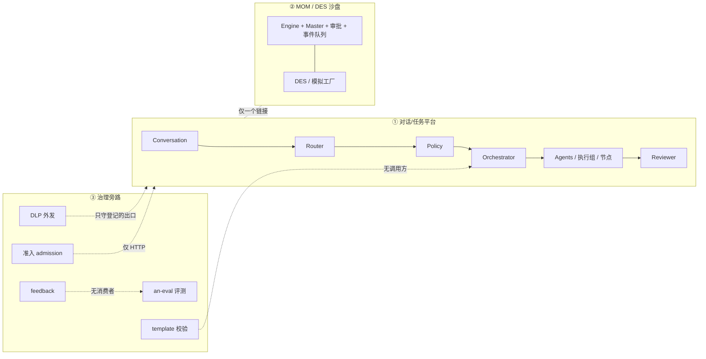

# 系统完整性分析：模块联系与整体场景的缺口

目的：回答“各模块之间联系弱、缺乏对整体场景的支撑”是否属实，缺在哪。依据是当前代码与文档（取证命令和位置见每条“证据”），不是对设计意图的推测。**这是分析，不是已确认的决定**；要纳入计划或写进 `docs/DECISIONS.md`，需要你拍板。

结论先说：感觉是对的，而且可以归成一句话——

> 系统由**三个各自完整、但互相不连通的部分**组成：①对话/任务平台（Conversation→Router→Policy→Orchestrator→Agent）；②MOM/DES 制造运营沙盘；③工程治理旁路（DLP 外发、准入、评测、日志）。①内部链路完整；②几乎是独立产品；③大多是“有机制、没接上闭环”。

## 一、模块间断开的地方（G01–G10）

严重度：**高** = 影响“整体场景能否成立”；**中** = 场景能走但有明显断点；**低** = 体验或维护问题。

| # | 缺口 | 严重度 | 证据 | 影响 | 建议方向（待你决定） |
|---|---|---|---|---|---|
| G01 | **MOM 与对话平台零集成** | 高 | `crates/server/src/mom.rs` 只依赖 `an_runtime::mom`；`conversation.rs`/`router.rs`/`orchestrator.rs`/`registry.rs` 中没有任何 MOM 引用（唯一出现是 `config.rs` 的 `mom_reviewer` 配置项）。主界面与 MOM 只靠左栏一个链接 `/mom/`。MOM 自己有一套 Master、审批、事件、租约，不经 Policy / Orchestrator / ACP agent；案例用 `case_id`，没有 `task_id` | 用户无法在对话里说“处理这个设备报警”；同一个“批准”概念有两套实现（任务卡的“批准执行” vs MOM 页的“批准”）；日志不能用 `task_id` 串起来；MOM 的“专业子 Agent”是脚本，不是平台里的真实 agent | 先定位：MOM 是平台上的一个**业务场景**（案例 = 一类任务，Master 即 Conversation/Router，调查 = Agent/Capability），还是继续做独立产品。前者需要把 case 映射为 task、统一审批与证据 |
| G02 | **模板（M4.3）有校验没有执行** | 高 | `crates/runtime/src/template.rs`（650 行）只在 `lib.rs` 里 `pub mod template;`，生产代码无调用；`PLAN.md` 待确认第 4 项写明“校验已实现，执行与汇合待实现” | “多问题逐条回答 / 任务拆分并行”这个核心场景只存在于设计与测试；Composer 汇合回复未实现；DESIGN 里的 DAG 能力在运行时不存在 | 明确 M4.3 排期，或把模板能力从对外描述中降级为“设计中” |
| G03 | **准入（admission）无界面、无认证，与“助手”页签是两条接入路径** | 中 | `/api/admission/*` 仅 HTTP（`admission_api.rs`），开启 `[admission]` 才存在；PLAN 明确“没有调用者身份认证或 endpoint 网络白名单”。“助手”页签管理 ACP/本机助手，准入管理 `kind=a2a` 外部 agent | 两类 agent 最终进同一注册表，但用户看到两个入口、两套信任模型；准入的“撤权/降级”在界面上不可见 | 统一“助手”视图：显示准入等级与撤权入口；认证先于开放 |
| G04 | **审查“需人工”是死胡同，且与“待批准”共用同一状态** | 高 | `orchestrator.rs` 审查失败或判 `needs_human` 时置 `NEEDS_HUMAN` 且保留 result；`labels.ts` 把该状态显示为“待批准”；`ChatView.tsx`/`TaskPanel.tsx` 只在 `!task.result` 时给“批准执行”；`approve()` 只接受尚未执行的任务；DESIGN §15 限制 #4 | “完成≠验收通过”原则的最后一环断了：Reviewer 要人看时，用户看到“待批准”却没有任何可点的批准/拒绝；对话里这类任务因 `isRunning` 排除 `NEEDS_HUMAN` 甚至没有取消按钮（任务面板里有） | 拆成两个状态（待批准 / 待验收）并给“验收通过/退回返工”入口；至少区分文案 |
| G05 | **审查能力弱于“必须审查”的承诺** | 中 | DESIGN §15 限制 #18：Reviewer 不能读文件；`reviewer.rs` 只看 `result.evidence`；ACP 不代理文件/终端操作（限制 #10） | 代码类审查依赖 agent 自己提供的证据（git diff 由宿主采集，较可靠；文件内容类证据由 agent 自述） | 给 Reviewer 只读文件工具；宿主侧采集证据优先 |
| G06 | **反馈闭环没有闭合** | 中 | `POST /api/feedback` 写库；COVERAGE 写明“导出仅为草稿”“不自动改主评测集”；`an-eval` 只评“判断+路由”（限制 #17），评测集由 `evals/make_dataset.py` 生成 | “派错了”反馈、运行日志、路由评测、提速实验（FT）是四个孤岛：真实使用数据不进评测集，评测结果不回到路由配置 | 定义一条数据流：反馈 → 评测集候选（人工确认）→ 评测 → 配置变更记录（DECISIONS） |
| G07 | **没有长期记忆/上下文，RelOS 只在 MOM 里可选使用** | 中 | `[orchestrator].history_messages=12`；限制 #5 “上下文只取最近消息”；README“长期记忆没做”；`mom_relos.rs` 仅被 `an-mom` 的 S1 诊断调用 | 对话平台里的 General/Coding 没有项目/组织知识；跨会话重复解释；MOM 诊断用的知识库对话平台用不上 | 会话摘要（近期）；知识接入走统一 Capability（与 MCP 同一入口） |
| G08 | **重启与恢复语义不一致，且文档已过时** | 中-高 | 限制 #3：重启时未完成任务直接失败，不能续跑；MOM 有持久事件队列并支持“重启恢复”。**DESIGN §15 限制 #2（背景信息只在内存）已过时**：`store.rs` 的 `tasks.context` 列已落库，`orchestrator.rs:553` 注释写明“重启后等待审批的任务被批准时依然可用”，返工上下文也写回库 | 任务平台“重启即失败”，MOM“重启可恢复”，两套语义；文档与代码不一致会误导测试与排错 | 先核对并更新 DESIGN §15 #2；再决定是否做运行中任务的续跑（高风险文件，先出方案） |
| G09 | **外发控制只守“登记的出口”，旁路很多** | 高（若用于真实数据） | `[egress]` 仅检查登记的工具与 LLM 后端；ACP 外部 agent 用自己的模型与网络（限制 #11）；节点明文 HTTP（限制 #9）；`[[mcp.servers]]` 未登记即无检查；DLP 与准入/节点没有关联 | “enforce 下只发脱敏内容”只对登记路径成立；外部 agent 自行外发不受控；整体合规声明不能写成“系统不外泄” | 在文档里明确**保证范围**；增加“未登记出口”的启动审计（列出所有出口及其是否受控） |
| G10 | **观测链路不统一** | 低-中 | 主平台日志以 `task_id` 贯穿；MOM 事件以 `case_id`、`seq`；DES 有自己的事件；`docs/DESIGN.md` §10 的事件名对 MOM 不适用 | 排错要在两套标识间人工对照；“用 `task_id` 查完整时间线”的承诺只对平台部分成立 | MOM 事件带上关联的 `task_id`（若 G01 采纳）或统一 `trace_id` |

## 二、整体场景层面的缺口

按“一个用户要完成的事”来看，下面这些整体场景现在**走不通或只能走一半**（详见 [SCENARIOS.md](SCENARIOS.md)）：

| 场景 | 断在哪 |
|---|---|
| 从对话处理一个制造异常（S15） | G01：对话与 MOM 没有通路 |
| 一次问多个问题，逐条回答/并行处理 | G02：模板有校验无执行 |
| 审查要人看时用户做决定（S04） | G04：状态与入口缺失 |
| 重启后继续工作（S13） | G08：运行中的任务重启即失败，不能续跑（待批准任务的背景信息已落库，可继续批准） |
| 用反馈让系统变准（S08） | G06：反馈无消费者 |
| 第一次使用的引导 | 没有 LLM/没有助手时的引导路径：LLM 红色只是状态，未给“怎么办”；发现卡只在“助手”侧出现一次 |
| 多人/多角色使用 | 无登录与鉴权（限制 #8）；审批无“谁批准”的身份；MOM 身份是 fixture |
| 并行使用 | 前一条消息处理完前不能再发（限制 #16）；执行组不能多 agent 并行对比（限制 #13） |

## 三、Feature Map 本身对端到端测试的审查结论

1. **覆盖不均衡**：`features.json` 28 个功能里只有 8 个 `coverage: browser`（conversation、tasks、approval、assignment、cancellation、observability、mom、agent-ui）。`nodes`、`feedback`、`agent-links`、`reports`、`admission`、`http-host` 等有用户可见或可操作的面，却没有浏览器用例。
2. **单功能视角，缺跨功能旅程**：CASES 按功能定义，没有“接入助手 → 真正改代码 → diff → 审查”这类串联用例。本次新增 [SCENARIOS.md](SCENARIOS.md) 补这一层。
3. **受控模型决定了 E2E 的边界**：路由/审批/审查结论都由触发词决定（`harness.mjs`），所以 E2E 证明的是“系统在给定决策下的行为”，**不能证明路由质量、回答质量、真实 ACP 握手、真实搜索**。这些必须另有真实环境验收，COVERAGE 里已多处标注，但没有一份汇总清单。
4. **COVERAGE.md 混有变更日记**（R-2026… 修复条目与功能表混排），做 E2E 选型时难以一眼找到“某功能现在能测什么”。建议后续把修复证据条目移到 `docs/testing/evidence/` 索引，COVERAGE 只保留功能状态表（本次未改，避免大范围重排）。
5. **本目录文档自身是草稿**：步骤依据源码与已有用例整理，**没有逐条重新驱动**；其中已核对请求体的接口：`probe`/`diagnose`/`diagnose/preview`/`diagnose/send`（`{id}`、`{id,helper}`、`{consent_id,consent_token}`）、`proposals/{id}/apply`（`{token}`）、`feedback`、`nodes/pair`。需要在驱动前再确认的：受控模型触发词以外的真实路径、MOM 页面元素 id（取自现有 E2E，未重新核对）。
6. **harness 能力缺口**：不支持同库重启、没有 coding 工作目录（git 仓库）、没有节点/第二台电脑模拟、没有多浏览器；这些决定了 S05/S10/S13 能不能写。

## 四、建议的处理顺序（供你取舍）

| 优先级 | 事项 | 理由 |
|---|---|---|
| 1 | G04 审查“需人工”的出口 + 状态拆分 | 直接破坏“完成≠验收”这条核心原则，改动面小，可立即补 E2E |
| 2 | G08 先更正文档（DESIGN §15 #2 已过时），再决定续跑 | 文档修正无风险；续跑属高风险文件（`store.rs`/`orchestrator.rs`），先出方案 |
| 3 | G01 决定 MOM 的定位 | 决定后续大量工作是“接入平台”还是“保持独立”；不决定则 S15 永远写不了 |
| 4 | 补 S05、S06、S08 的浏览器 E2E | 都是现有功能的整体链路，不需要新产品决策 |
| 5 | G09 写清外发保证范围 + 出口审计 | 文档与启动检查即可，风险小 |
| 6 | G02 / G06 / G07 | 属于路线图级别，需要排期 |

> 涉及 `orchestrator.rs`、`store.rs`、`registry.rs`、`acp.rs`、`util.rs` 的改动按 AGENTS.md 先给方案、经你批准再动；本文不含任何代码改动。

## 五、与 AI Desktop V1.7 的叠加缺口（2026-11-20）

已确认的 UE/交付规格见 [ai-desktop/DESIGN.md](../ai-desktop/DESIGN.md)。对照现状的 Desktop 专属缺口（AD-G1–AD-G12）、与 G01–G10 的挂靠关系、以及对 WP1/运营桌面计划的调整建议，见 [ai-desktop/GAPS.md](../ai-desktop/GAPS.md)。

一句话：G01–G10 描述的是**模块间打通**；AD-G* 描述的是**产品壳尚未建成**。两者都要做；推荐以 Desktop A（完整前端 + Mock）为壳主轴，把运营三入口（原 D3）与 WP1 闭环嵌进该壳，而不是在现有「会话|运营桌面」页签上继续平行堆叠。
