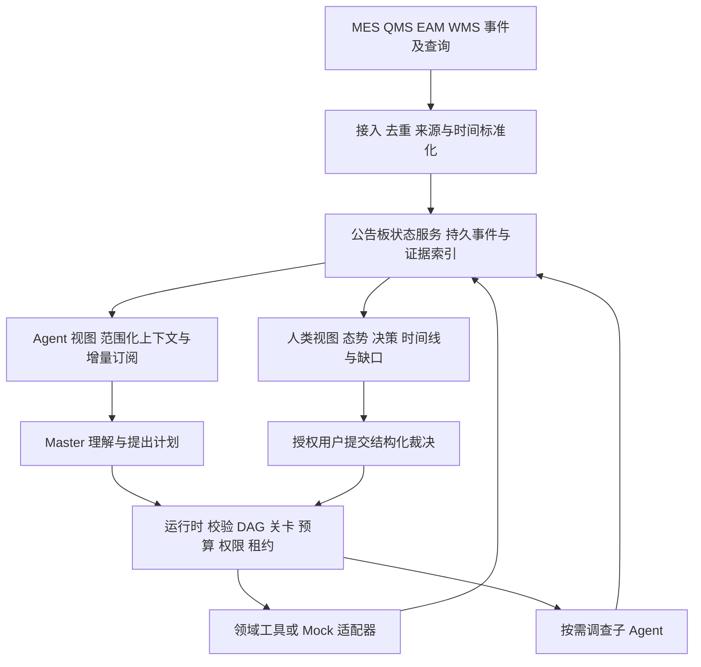
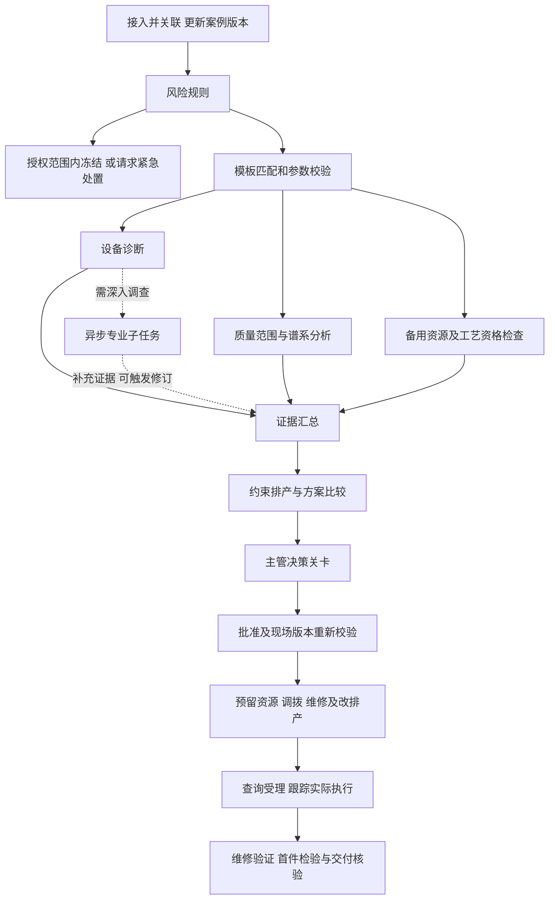
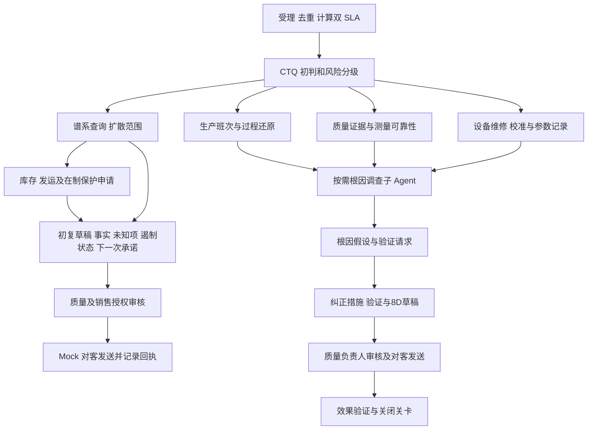

# MOM 主 Agent、公告板与领域工具设计

日期：2026-11-05（America/Vancouver）。状态：A 层模拟实现已落地，未连接生产系统。运行方式及实施边界见 [IMPLEMENTATION.md](IMPLEMENTATION.md)。

人类工作台的导航、事项闭环、DAG 交互及 AI 会话边界遵守 [UI / UE 设计原则](UI_UX_PRINCIPLES.md)。该文档为界面开发约束，不代表目标能力已实现。

## 1. 目标与范围

用两条业务流程拉动共同架构：S1 插单、设备与质量多扰动；S2 重大客户投诉。默认一个 Master 负责解释、编排建议和统一交互，运行时控制状态、权限、关卡、预算；仅对耗时、专业、可独立交付的调查按需启动子 Agent。公告板提供同一事实版本的 agent 视图和人类视图。Mock 与真实能力逐项登记在 [MOCK_REGISTER.md](MOCK_REGISTER.md)，测试计划见 [TEST_PLAN.md](TEST_PLAN.md)。

原设计阶段仅交付文档。后续按用户授权实现隔离 MOM 模块、独立 SQLite v1 和模拟 HTTP 服务；不修改原有 orchestrator/store/registry、AgentAdapter 与现有配置字段。当前实现与完整生产目标之间的差距统一登记在 Mock 清单。

非目标：生产设备闭环控制、自动客户发信、自动质量放行、全厂排产求解器、无限递归 agent、自动证明根因、完整通用 BPM 引擎。人类批准不能绕过法定或工厂强制安全约束。

## 2. 架构与职责



| 部件 | 负责 | 不允许 |
|---|---|---|
| Master | 关联建议、模板选择建议、修订建议、证据整合、决策卡与报告草稿 | 直接写数据库状态、批准自己、绕过工具网关执行 |
| 运行时 | 原子认领、DAG 校验、阶段关卡、权限、预算、取消、恢复 | 根据模型自信程度放行安全操作 |
| 公告板 | 事实引用、任务和案例状态、决策、版本与可恢复订阅 | 把文本总结当业务账本，丢失来源 |
| 工具网关 | 类型与范围校验、调用、超时、幂等、受理查询 | 把超时一律当失败并盲目重复写入 |
| 子 Agent | 在指定范围调查并交付结构化证据 | 递归启动、改主计划、发客户消息、放行产品 |
| 人类 | 明确范围的裁决与审批、终止和纠正 | 用模糊批准覆盖发生变化后的所有操作 |

业务事实仍归源系统所有；公告板保留带时间与版本的观测和处置状态。候选观察、批准契约、实际业务状态分别存储。只有源系统受理并核验后，才能将写动作标记为完成。

## 3. 场景 S1：多扰动生产恢复

### 3.1 固定夹具

仿真日期使用工厂本地时区并在运行配置固定，所有事件存储带偏移的时间。08:17 收到 500 件插单，16:00 前要求检验放行；08:23 CNC-XX 振动预警；08:31 收到 Line-B 三个过程监测窗口 Cpk 下降至 1.1 的预警。1.33 是本夹具的能力警戒门槛，不是控制图控制限。测量系统与样本条件由质量工具报告。

CNC-XX 归属 Line-B，但只有加工履历和批次谱系匹配才形成质量关联。振动未达到硬联锁，故障原因未知。安全联锁仍由原有安全系统执行。

测试假定 XY、XZ 工艺认证有效。扣除原有负荷、换型与检验后，分别承担 260、240 件；XZ 缺指定刀具，仓库有合格库存，调拨加装配需 45 分钟；仿真给出 15:40 放行，并明确一个既有订单延期。上述是 Mock 夹具，不是工程能力结论。未确认的资源不得计入承诺产能。

### 3.2 案例与阶段

事件到达立即评估，不等待“事件集齐”。案例持续开放，5 分钟窗口只作候选检索，不能排除 08:23—08:31 的关联。记录 occurred_at、received_at，支持乱序和迟到。

宏观阶段：ASSESS → PLAN_APPROVED → EXECUTE → VERIFY → CLOSED。冻结/紧急安全处置是独立的预授权保护路径，可以早于方案审批；没有相应授权则请求处理，并将风险产品排除出可交付集合。



E 深入调查不一定阻断保守排产：若已知禁止使用 XX，运行时允许在明确排除 XX 的条件下推进；若方案依赖“XX 可继续使用”，缺少设备结论即阻断。是否可降级由节点输入契约决定，不由 Master 临场省略。

不安全赶工是 rejected alternative，附违反规则，不作为可批准选项。若所有方案不满足交期，应生成“交期调整/追加资源”决策，不伪造可行计划。

## 4. 场景 S2：重大客户投诉与跨系统事实拼接

图示要求：客户 4 小时初复、24 小时正式 8D；质量判定 CTQ 并组织原因分析；生产确认班次和现场；仓库冻结库存控制扩散；销售同步客户并管理承诺；MES/QMS/EAM/WMS 分别掌握部分事实。

### 4.1 用户故事与输入

09:00 收到客户投诉 CMP-001：客户 A 的部件 P-17、发货批 LOT-C100 存在关键尺寸异常。合同计时基准设为受理时间 09:00（可配置；夹具按连续自然小时）：当日 13:00 前初复、次日 09:00 前正式 8D。客户提供 5 件测量结果与照片；缺少完整抽样条件，因此不能直接据此断言整批不合格。

Mock 数据：MES 表明成品 C100/C101 关联生产批 B77，B77 跨两个班次并经过 CNC-XX；QMS 有尺寸趋势与检验记录；EAM 有设备维修/校准记录；WMS 表明 C100 已交付客户 300 件，C101 仍在库 200 件。每种数量以源记录与计量单位为准，缺失时标为未知，不凭总量倒推。设备记录仅形成原因假设，不能自动确认根因。

### 4.2 流程与并行工作



初复分支不能等待根因子任务。初复引用最新冻结受理/核验结果，未冻结的范围明确写“申请中/未知”，不能写“风险已全部控制”。

8D 按 D1 团队、D2 问题定义、D3 临时遏制、D4 根因、D5 永久措施选择、D6 实施验证、D7 防复发、D8 关闭分别记录证据与责任人。24 小时是报告交付 SLA，不意味着全部 8D 活动可完成。若证据不足，提交经审核的进展版/例外申请，明确未完成项与后续期限；若合同不接受进展版，则记录违约风险并升级，不能伪称满足正式 8D 要求。客户回执不等于问题关闭。

### 4.3 SLA 与升级

独立持久计时器，不靠 LLM 记时间。初复剩余 60/15 分钟、8D 剩余 4/1 小时通知责任人（默认测试配置，可调整）；重复提醒去重。超时保留 breach，不因暂停、等待人或服务重启重置时钟。达到期限不会自动外发未经批准的内容。

冻结库存不能自动召回已交付产品：对在途、客户端库存分别生成确认/召回评估任务。缺谱系时扩大调查候选范围并请求质量人员判断，不能冻结查询返回的第一批后宣布全部覆盖。

## 5. 公告板：一套事实，两类视图

### 5.1 面向 Agent 的机器视图

按 case_id、角色授权、任务、资产和订阅主题查询，返回类型化数据：目标与不可压缩硬约束、当前事实与新鲜度、适用契约、依赖产物、待办、有效决定、可用预算、增量游标。默认不注入所有历史聊天或原始日志。上下文预算耗尽时保留硬约束和证据索引，明确 truncated 与 next_cursor，不静默遗漏。

订阅按案例/实体/事件种类过滤，合并同类通知；普通进度不唤醒 Master，关键事实变化、工具结束、决策、SLA、租约失效才触发。消费者必须补拉 durable sequence；通知是提示，持久状态才是依据。外部资料作为不可信数据，不能修改权限或变成工具指令。

### 5.2 面向人的运营视图

| 区域 | 展示 |
|---|---|
| 案例总览 | 客户/产线、当前阶段、目标、风险、SLA、阻塞及负责人 |
| 已知与未知 | 事实、假设、冲突、来源与截至时间，明显区分 Mock |
| 当前计划 | DAG 简图、并行调查、失败/降级、待审批和执行进度 |
| 决策收件箱 | 可执行选项、约束、影响、建议、批准范围与有效期 |
| 处置回执 | 已申请、已受理、执行中、已核验，部分成功与补偿 |
| 证据与时间线 | 按需展开原始证据、版本、人员/agent操作、模型调用成本 |
| 能力缺口 | 本案例涉及的 Mock ID、未接入数据源和阻断上线项 |

两种视图共享 case_revision、projection_seq、observed_at 和 freshness。延迟投影必须显示落后，重要批准直接读取权威状态再校验。人类总结中的每个业务结论可追到 evidence_id。不得在人类视图隐藏失败、把模型推测绘制成确定事实。操作权限由后端执行，两类视图都不能靠前端隐藏实现权限。

### 5.3 公告板实体（拟议内部模型）

| 实体 | 必要字段 |
|---|---|
| Case | id, scenario, stage, revision, entities, objectives, deadlines, status |
| Observation | id, source, source_record_id/version, occurred_at, received_at, valid_until, entity_refs, payload, provenance |
| Evidence | id, observation_refs, artifact_ref, content_hash, claim_status, limitations |
| PlanRevision | case_id, revision, template_id/version, inputs, node_graph, assumptions, supersedes |
| WorkItem | id, plan_revision, deps, role/capability, read/write_scope, resource_keys, state, budget |
| Attempt | id, work_item_id, owner, lease_until, fencing_token, input_versions, usage, outcome |
| Decision | id, plan_revision, options, action_scope, preconditions_hash, approver, expires_at, status |
| Action | idempotency_key, business_operation_id, target, request_hash, state, receipt, verification |
| Event | sequence, event_id, case_id, kind, causation_id, correlation_id, payload, schema_version |
| Subscription | scope, consumer, last_ack_sequence, delivery_attempts |

任务状态：READY → CLAIMED → RUNNING → WAITING_TOOL/WAITING_HUMAN → VERIFYING → SUCCEEDED；另有 BLOCKED/FAILED/CANCELLED/SUPERSEDED。等待时不必持有模型计算槽位。任务结果和各项验证结果分开，只有运行时能更新状态；每次尝试独立记录。

命令与事件分离：RequestClaim、ProposePlan、RequestDelegation、SubmitEvidence、ApproveDecision、RequestAction 是请求；校验通过提交事务后才产生 WorkClaimed、PlanAccepted、ChildStarted、EvidenceRecorded、DecisionApproved、ActionAccepted。比较 expected_revision 防止丢更新。

## 6. Master 决策协议与受限动态编排

每次唤醒：读取增量 → 更新相关事实 → 检查已运行工作 → 提出下一步 → 程序校验 → 执行/等待。Master 不在等待工具时持续空转。相同输入版本与同一活动计划不重复规划。

拟议输出 envelope：

```json
{
  "case_id": "CASE-S1",
  "expected_revision": 7,
  "intent": "request_delegation",
  "evidence_refs": ["E-VIB-01", "E-QUALITY-01"],
  "payload": {
    "work_type": "equipment_investigation",
    "objective": "调查XX振动与加工偏移的证据，列出未验证解释",
    "scope": {"assets": ["CNC-XX"], "access": "read_only"},
    "blocking_for": ["approve_continue_using_XX"],
    "nonblocking_for": ["simulate_without_XX"],
    "deadline": "2026-11-06T08:36:00+08:00",
    "output_schema": "investigation_report.v1"
  }
}
```

该时间仅为仿真工厂时区夹具，与用户界面日期无关。允许 intent：select_template、propose_patch、request_tool、request_delegation、request_decision、submit_summary、wait。禁止模型输出任意命令/SQL作为可执行动作。无效输出只允许一次修正，再失败则结构化升级。

模板先按必需/禁止/可缺失条件过滤，语义召回与 LLM 只帮助排序；安全条件不能按相似度抵消。首版只允许插入受支持调查节点、调整受限参数、增加依赖；不得删除关卡、放宽权限或增加未知工具。校验 DAG 无环、输入输出兼容、依赖可满足、预算上限和终止路径。新修订使受影响旧节点失效，旧证据保留但不能用于新关卡。

## 7. 动态子 Agent

### 7.1 启动条件和边界

适用：预计长时间查阅文档、跨多记录追溯、专业假设比较，且可以独立交付证据。单次查询、固定算法、标准报表直接调用工具，不创建 agent。Master 只能请求，运行时检查并启动；模拟服务按需启动受限脚本调查任务；真实模型调查仍为替换目标。

默认试验预算：每案例最多同时 1 个子 Agent、同一时间最多 3 个领域工具；子 Agent 总启动不超过 2 次；深度 1；每尝试最多 8 次工具调用、6 次模型调用、5 分钟活动时间；案例最多 24 次模型调用、40 次工具调用、2 次重规划。另设可配置总 token 与费用硬上限；按模型输出上限预留配额后准入，结算实际消耗，余额不足拒绝启动。等待人类和仿真业务耗时不计作模型活动时间。长客诉调查可申请有上限的新预算，不能静默追加。

### 7.2 生命周期

PROPOSED → ADMITTED → CLAIMED → RUNNING → REPORT_SUBMITTED → VALIDATED → COMPLETED；可能 REJECTED、TIMED_OUT、CANCELLED、SUPERSEDED。租约、心跳、fencing token 防止旧执行者复活提交。全局和案例预算均满足才能准入。领取调查任务不等于预留物料或设备。

结果报告包含 findings（VERIFIED/SUPPORTED/HYPOTHESIS/UNKNOWN）、evidence_refs、contradictions、limitations、recommended_checks、input_versions、usage。这里 VERIFIED 仅限具体证据验证的命题，不允许将根因假设整体升级为已证实。无证据引用的报告拒收或标待核验，不自动晋升为事实。

### 7.3 两场景中的用途

S1：equipment_investigation 查历史频谱、维修和加工记录；主流程先计算排除 XX 的保守方案。迟到结果若影响方案有效性触发重新评估，不能直接覆盖已批准计划。

S2：complaint_trace_investigation 对齐四系统记录，构建批次/班次/设备时间线和根因假设。初复不等它结束。调查超时交付部分证据并列出缺口，24h SLA 继续走。需要现场取样/实验时发布人类工作项，不假装工具能完成物理验证。

### 7.4 取消、恢复与隔离

父案例取消或输入修订失效时，取消子任务和挂起调用；到期终止其执行上下文及其子进程（如采用进程隔离），释放槽位，保留证据与调用日志。首版优先无 shell 的工具白名单隔离。数据库重启恢复依赖持久执行记录，而非模型会话。只读查询可以限次重试；副作用状态不明先查询回执，禁止换执行者后重复发送。子 Agent 完成后 Master 通过公告板事件恢复，不点对点递归对话。

## 8. 工具协议与 Mock 设计

所有工具定义在统一清单；实现来源 real/mock 可切换，接口与断言相同。请求至少含 call_id、case_id、work_item_id、attempt_id、fencing_token、input_versions、deadline、args；写操作另含 operation_key、authorization_ref 和 preconditions_hash。服务侧校验权限、批准和版本，不信模型声明。

响应：status=ok/partial/error/unknown、data、evidence_refs、source_versions、observed_at、valid_until、limitations、error_code、retryable、operation_receipt。partial/unknown 不能折算成成功。Mock 响应和派生产物继承 provenance=mock 与 mock_ids，混合输入报告不得被标为“真实已验证”。

| 工具（拟议） | 输入 → 主要输出 | 类型 / 场景 |
|---|---|---|
| topology.resolve | 资产/工单/批次 → 关系、有效期与来源 | 读 / 共用 |
| maintenance.assess | 设备与时间段 → 预警等级、证据、未知项 | 读 / S1 |
| quality.assess | 测量与谱系 → 风险范围、质量规则与假设 | 读 / 共用 |
| resources.check | 工艺/设备/数量 → 刀具、认证、人员、检验资源快照 | 读 / S1 |
| schedule.simulate | 订单/约束/快照 → feasible、时间、影响、违反项 | 计算 / S1 |
| genealogy.trace | 投诉批次 → 在制/库存/发运及候选关联 | 读 / S2 |
| production.reconstruct | 工单与时段 → 班次、参数、作业与记录缺口 | 读 / S2 |
| equipment.history | 设备/时段 → 维修、校准、报警与文档索引 | 读 / 共用 |
| inventory.hold | 范围/原因/授权 → 受理号、实际冻结结果 | 写 / 共用 |
| resources.reserve | 资源/数量/版本 → 预留令牌、冲突和到期时间 | 写 / S1 |
| execution.dispatch | 维修/调拨/改排产操作 → 业务操作号与回执 | 写 / S1 |
| action.status | 操作号 → 受理/执行/失败/未知及验证证据 | 读 / 共用 |
| customer.send | 已审核内容/客户/批准 → 模拟发送与回执 | 写 / S2，首轮仅 Mock |
| verification.collect | 操作/产品/目标 → 实际执行、质量与效果证据 | 读 / 共用 |

MockWorld 管理仿真资产、订单、库存、冻结、预留和操作账本。工具返回由世界状态、请求参数、故障配置及虚拟时间决定，不使用“每次调用返回下一条”这种顺序脆弱的脚本。相同 seed 与输入可重放，逻辑时间不依赖 sleep。执行响应与实际完成事件分开，状态查询可以返回 unknown。库存竞争、部分成功、补偿和权限拒绝都能注入。

DAG 控制器是未来需要真实实现的被测对象，不应 Mock 成“收到事件直接返回成功”。ScriptedMaster 只替代模型以验证控制链；随后用同一接口替换真实模型，对决策质量另行评测。

## 9. 一致性、权限与预算

拟议持久化：SQLite 事务同时提交案例修订、任务变更、事件与 outbox；提交后发布通知；至少一次投递、幂等消费、按案例单调序号、游标补拉。首轮单进程也保留命令/事务边界；不声称 exactly-once 外部副作用。

已有 Bus 是先广播再异步落库，仅可作为 UI 通知参考，不可直接承担新业务关卡依据。恢复时原租约失效；只读任务有限重试，写任务先查询 operation ledger。过期 worker 结果拒收。

动作下发前重新校验：当前有效批准、计划、相关事实/资源版本与有效期；无关的案例新消息不应使全部批准失效，使用相关前置条件指纹。当前夹具的事实快照 TTL 和批准 TTL 均为 5 个虚拟分钟，保存在 tools.json；生产值需业务确认。版本冲突不允许静默覆盖。

跨系统部分成功采用动作账本与补偿流程。撤销预留可以补偿，已完成维修/已发送信息不能假定可回滚；补偿失败进入人工处置。质量解冻、客户发送、生产停机和改计划分别授权，不能一张批准覆盖全部动作。

## 10. 与现有仓库衔接及后续实施边界

可复用：an-llm 结构化调用、an-observe 日志诊断、Tool/ToolRegistry 的注册模式、SQLite 技术栈、已有 SSE 和人类审批交互思路。

不能等同已具备：现有 General 的固定工具循环不是可恢复 Master；现有 task 状态不是案例/DAG；现有一次审批不等于版本绑定决策；现有 Bus 不满足事务 outbox。

建议先建立隔离的 MOM 实验模块和测试，不先改现有 orchestrator/store/registry，也不改变 AgentAdapter。实施时再提出 crate 边界与迁移方案；任何公共 API、配置和持久化改动独立说明。人类视图首轮可用结构化报告，之后接网页；必须始终保留两种投影契约。

未确定的上线条件：企业权限与审批责任、正式接口可用性、工厂时区及 SLA 口径、质量/安全规则、真实工具验证、现场人工动作回执。设计可用夹具推进，但这些缺口未关闭前不具备生产自治资格。

## 当前模拟实现与目标设计的差距

上述状态和 intent 为目标设计；当前节点状态子集及尚未实现的 `request_tool` 见 [实施说明](IMPLEMENTATION.md#当前实现子集与审查说明)。当前 production 的合并模拟授权仅为 M20 测试替代件；真实实现仍须分别授权质量解冻、客户发送、停机与改计划，不能沿用该简化。
