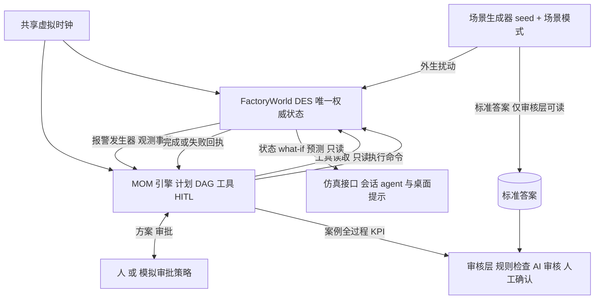

# MOM 车间离散事件仿真（DES）闭环设计

日期：2026-11-17（America/Vancouver）。状态：阶段①（DES 内核与场景生成器，开环）与阶段②（工具读取、what-if、只读仿真接口）已实现，见 `crates/runtime/src/mom/des/` 与 `crates/server/src/mom_sim.rs`；阶段③～⑤仅设计。本文是后续实施的基线；实施时按 §15 分阶段提交，每阶段先写用例和失败测试，再改实现。

相关文档：[DESIGN.md](DESIGN.md)（MOM 主架构）、[MOCK_REGISTER.md](MOCK_REGISTER.md)（Mock 台账）、[TEST_PLAN.md](TEST_PLAN.md)、[UI_UX_PRINCIPLES.md](UI_UX_PRINCIPLES.md)、[SPC_TASK_WORKSPACE.md](SPC_TASK_WORKSPACE.md)、[测试指南](../testing/README.md)。

## 0. 决策记录

| 编号 | 决定 | 来源 |
|---|---|---|
| R1 | 不集成外部仿真框架（prodsys、SimPy、NeXosim 等），在现有 `crates/runtime/src/mom/` 内自写 Rust DES 内核；只借鉴 prodsys 的产品/工艺/资源建模、SimPy 的资源排队语义、ManPy 的制造对象划分，不拷贝代码 | 用户 |
| R2 | 两种用途共用一个内核：产品演示（界面实时播放，人在环）和论文实验（无界面批量运行，多 seed） | 用户 |
| R3 | 需要完整闭环：agent 和人的决策会改变后续事件 | 用户 |
| R4 | 测试目标不是固定时间点，而是在随机出现的多个混合事件中，检验系统和 agent 的响应机制、人与 agent 的协作机制；现有 `s1` 例子保留为一个固定场景 | 用户（Q1） |
| R5 | 场景生成器要有逻辑设计，事件服从设备损坏等规律，不能是单纯随机 | 用户 |
| R6 | 处理结果需要审核：先规则检查，再由 AI 审核，报告交人确认 | 用户（Q1） |
| R7 | 直接使用 `master` 上的 MOM 服务和界面；仿真能力要能在人与 agent 的会话中被调用和报告，将来作为制造桌面提示的一部分 | 用户（Q2） |
| D1 | 支持多方案：`schedule.simulate` 返回 2～3 个方案，主管选择其中一个后审批 | 用户采纳推荐 |
| D2 | 执行后由同一原因产生的复检观测作为核验证据挂到原案例，不触发计划失效；新扰动仍触发重新规划 | 用户采纳推荐 |
| D3 | 批量实验中的"人"使用可配置的模拟审批策略（延迟分布 + 选择规则） | 用户采纳推荐 |
| D4 | "传统 MOM"对照组作为一种策略，在同一个 DES、同一组 seed 上运行 | 用户采纳推荐 |
| D5 | 实施顺序：DES 内核和场景生成器（开环）→ 工具读取和 what-if → 执行与核验闭环 → 审核层和批量实验 → 车间视图 | 用户采纳推荐 |
| D6 | 保留现有按键归并案例的规则，另增"关联案例"，跨案例关联由 DES 拓扑和 RelOS 关系给出 | 用户采纳推荐 |
| D7 | 阶段 ① 只用现有三类事件（插单、振动、质量），但时间、设备、强度、数量都由场景生成器决定；新事件类型以后和 SPC 模板机制统一实现 | 用户采纳推荐 |
| A1 | 批准：Mock 台账新增条目（见 §14），并相应修改 `crates/runtime/tests/mom.rs` 中台账条目数为 24 的断言。这是需求变更，不是为了让测试通过而改测试；实施 PR 必须单独说明 | 用户批准 |
| A2 | 批准：新增仿真和审核 HTTP 接口；MOM 快照新增字段；`config.toml` 新增可选角色 `mom_reviewer` | 用户批准 |
| M1 | AI 审核模型：新增可选角色 `mom_reviewer`；没有配置时依次降级到 MOM 主 agent 模型、`[llm]` 默认模型；都不可用时只做规则检查 | 用户选择 |
| M2 | 审核模型与被审核的主 agent 是同一个模型时允许审核，但报告标注"非独立审核"，批量统计单独分组 | 用户选择 |

## 1. 目标与非目标

**目标**
1. 让车间状态随时间演化，事件由状态和规律产生，而不是写死的时间表。
2. 让执行动作真正改变仿真世界（维修使磨损复位、调拨使刀具到位、改排产改变派工），使响应结果可以被客观评价。
3. 为每个场景给出由因果结构导出的标准答案，用来审核系统的响应是否合理。
4. 用同一套内核支撑演示、批量实验，以及会话和桌面的只读查询。

**非目标**
- 不控制真实设备，不接入真实 MES/QMS/EAM/WMS。仿真结果不是工程能力结论，所有输出都标注为仿真。
- 不做全厂最优排产求解器。what-if 只比较有限个候选方案。
- 不替代 RelOS 的关系推理，也不让 DES 直接告诉 agent 根因。
- 不改变脚本模式（`mode=scripted`）的任何现有行为。

## 2. 与现有实现的关系

### 2.1 现状（以 2026-11-17 的 `origin/master` 为准）

| 位置 | 现有行为 | 对闭环的影响 |
|---|---|---|
| `simulation.rs` | 按 seed 生成固定时间的事件队列（start+6 振动、start+14 Cpk=1.1，之后 Cpk 在 0.85～1.35 之间随机），按虚拟分钟投递；有播放/暂停 | 保留为脚本模式；DES 模式另走新路径 |
| `engine.rs` `ingest` | 已有计划时，任何新观测都触发 `PlanInvalidated` 并重置节点；已有执行动作时，案例进入 `BLOCKED` | 闭环下复检数据会让案例卡住，需按 D2 区分 |
| `engine.rs` `execute` / `tick` | 执行只写动作记录，`complete_at = now + 2`，到时自动标为已核验 | DES 模式下改为由仿真事件决定完成或失败 |
| `tools.rs` `schedule.simulate` | 判断 `capacity_xy + capacity_xz >= quantity` 加上几个布尔开关，自述为 "Fixture capacities, not a real solver" | DES 模式下改为 what-if 推演 |
| `Case.world` | 每个案例一份 world | 工厂是共享的；DES 模式下 world 只作为工厂状态的案例投影 |
| `Snapshot` | 整体 JSON 存在 `mom_snapshot.body`；没有 `deny_unknown_fields` | 新增字段带默认值即可，不需要改 SQL 表结构 |
| `server/src/mom.rs` | 一个服务共享一个虚拟时钟，墙钟 1 秒 = 虚拟 1 分钟 | DES 跟随这个时钟推进 |

### 2.2 与其他工作的冲突核对（2026-11-16）
- 除 `master` 外，没有远端分支改动 MOM 代码。`master` 上 MOM 代码最后一次改动是 2026-11-07。
- 用户正在开发真人用户的制造桌面，可能改动的文件不确定。因此本方案把新代码放在新文件里；对 `server/src/mom.rs`、`web/mom/` 这类共享文件只做一两行的注册或挂载改动。
- `SPC_TASK_WORKSPACE.md` 计划新增 `spc_out_of_control` 事件类型，会改 `ingest` 和 `instantiate` 的事件类型判断，与 §6.5 改的是同一段代码。两者谁先实现，后实现的一方负责合并。
- 本地未推送的改动无法核对，实施前要再检查一次。

## 3. 总体架构



约束：
- 标准答案只有审核层可读，不进入 `agent_view`、工具返回、仿真接口和桌面。
- 会话 agent 和桌面只能读仿真状态，或在副本上做 what-if；真正改变世界只能走"方案 → 审批 → 执行"。
- 所有输出带 `provenance`（`simulation` 或 `mock`）、数据截至时间和局限说明。

## 4. 场景生成器：逻辑设计

场景生成器不是"随机掷事件"，而是**先随机生成一个有规律的工厂，再让事件从工厂状态里长出来**。随机性只出现在参数和外生输入上，事件之间的关系由因果结构决定。

### 4.1 分层结构

| 层 | 内容 | 随机性来自哪里 |
|---|---|---|
| L0 结构层 | 设备、工艺路线、产品、刀具、检验站、维修班组、班次日历（来自工厂配置文件） | 不随机，或从少量布局模板中选择 |
| L1 隐状态层 | 主轴磨损量、刀具后刀面磨损量、来料批次特性、设备初始役龄 | 退化过程的随机增量、初始役龄抽样 |
| L2 观测层 | 振动有效值、每件尺寸测量值、节拍、检验结果 | 测量噪声 |
| L3 报警层 | 振动分区越界、Cpk 跌破门槛、SPC 判异规则命中，产生 `EventInput` | 不随机；由 L1/L2 加规则确定 |
| L4 外生事件层 | 插单、（后续阶段）缺料、人员缺勤、检验站故障 | 按到达过程抽样 |
| L5 场景约束层 | 场景模式（§4.4）、难度等级、时间窗口 | 通过约束抽样或拒绝抽样实现 |
| L6 标准答案 | 真实根因、事件间真实关联、应触发 HITL 的节点、各方案在 DES 中的真实结果 | 由 L1～L5 的因果结构**导出**，不手写 |

### 4.2 规律模型（默认值均为建模假设，需标定）

| 对象 | 规律 | 默认做法 | 依据 |
|---|---|---|---|
| 设备寿命 / 故障率 | 浴盆曲线；耗损期失效率随时间上升 | 设备的突发故障按 Weibull 分布抽样；轴承类耗损故障形状参数 β > 1（失效率递增），偶发故障 β = 1（常数失效率） | NIST/SEMATECH 工程统计手册第 8 章 [1]；β 与失效率阶段的对应见 [2] |
| 主轴轴承退化 | 磨损单调累积，增量随机 | 磨损量 h(t) 用 Gamma 过程：每段工作时间的增量服从 Gamma 分布，只增不减，维修后复位 | van Noortwijk 2009 关于 Gamma 过程在维修中应用的综述 [3] |
| 潜在故障到功能故障 | 失效前存在可检测窗口（P-F 间隔） | h 达到可检测阈值 P 后振动开始可见；达到功能失效阈值 F 时设备停机。P-F 间隔由 Gamma 过程参数推出，不单独抽样 | Moubray《RCM II》提出的 P-F 曲线（二手资料 [4]） |
| 振动 | 振动随退化上升，按严重度分区判断 | 振动有效值 = 基线 + k·h + 测量噪声；分区 A/B/C/D 的边界默认取 ISO 20816-3 第 2 组刚性安装的 1.4 / 2.8 / 4.5 mm/s；进入 C 区并持续 N 分钟才报警 | ISO 20816-3 分区（二手资料 [5]，使用前须对照标准原文） |
| 刀具磨损 | 三阶段：磨合、稳定、急剧磨损；寿命与切削速度相关 | 后刀面磨损 VB 随加工件数按三段曲线增长；名义寿命 300 件（以后按 Taylor 公式 VTⁿ = C 由切削参数估算），每把刀的实际寿命按对数正态离散（对数标准差 0.15）；按名义寿命的 75% 预防性换刀，只有磨损偏快的刀会在换刀前进入急剧磨损段并影响尺寸 | Taylor 刀具寿命公式与磨损阶段（教学资料 [6]，参数须对照机加工教材） |
| 尺寸质量 | 设备和刀具状态影响尺寸分布 | 每件尺寸 ~ N(μ, σ)，其中 μ = 名义值 + a·h + b·VB + 来料批次效应，σ = σ₀·(1 + c·h) + 量具噪声；a、b、c 是否为零由因果结构决定（§4.3） | 建模假设 |
| 过程能力 | Cpk = min[(USL − μ)/3σ, (μ − LSL)/3σ] | 阶段①使用由过程参数直接算出的**模型值**（无抽样估计噪声）；基于测量样本的滚动窗口估计放到后续阶段（见下方修订说明）。门槛默认 1.33（与现有夹具一致，是行业惯例而不是普适标准） | NIST 手册 6.1.6 [7]；1.33 惯例见 [8] |
| SPC 判异 | 控制图判异规则 | 后续阶段使用 Nelson / Western Electric 规则的一个子集（规则 1：超出 3σ；连续同侧等）；规则编号和阈值以原始文献为准。阶段①未实现 | Nelson 1984 / Western Electric 1956（二手资料 [9]） |
| 维修时间 | 修复时间右偏 | 维修耗时按对数正态分布抽样；维修期间占用维修班组 | 可维修性预计中常用对数正态修复时间（二手资料 [10]） |
| 订单到达 | 到达率随班次变化 | 插单按非齐次泊松过程（NHPP）抽样，到达率按班次分段；数量和交期按配置分布抽样 | 仿真输入建模的标准做法 [11] |
| 来料批次 | 批次之间的特性差异 | 每个来料批次一个特性偏移（例如硬度），只在因果结构启用"来料 → 尺寸"时影响尺寸 | 建模假设；用作混杂因素 |

### 4.3 因果结构（结构因果模型）

每个场景先抽样决定哪些机制是"开"的，形成一张因果图（Pearl 的结构因果模型 [12]）：

```
主轴磨损 h ──▶ 振动        （总是开）
主轴磨损 h ──▶ 尺寸均值/方差（场景抽样：开或关）
刀具磨损 VB ─▶ 尺寸均值     （场景抽样：开或关）
来料批次   ──▶ 尺寸均值     （场景抽样：开或关）
插单       ──▶ 设备负荷 ──▶ 磨损速度（总是开：负荷越高磨损越快）
```

- 标准答案由因果图和实际运行轨迹**自动导出**。例如"Line-B Cpk 下降"的真实原因可能是主轴磨损、刀具磨损、来料批次，或者几者叠加。
- "振动报警和 Cpk 报警同时出现，但两者没有因果"是一种刻意构造的情况，用来检验系统是否把相关性误判为因果。
- 因果图本身属于标准答案，不暴露给 agent；agent 只能通过工具读取观测数据，并通过 RelOS 获得候选关系。

### 4.4 场景模式和难度

场景模式是对 L1～L4 抽样施加的约束，用来保证实验覆盖论文关心的情形：

| 模式 | 约束 | 检验什么 |
|---|---|---|
| P0 固定剧本 | 复现 `s1`：插单、振动、Cpk=1.1 按原时序出现 | 与现有夹具对照 |
| P1 并发簇 | 时间窗口 W 内至少出现 k 个扰动，且至少一对有真实因果 | 跨域关联识别、统一规划 |
| P2 诱饵 | 振动和 Cpk 报警同时出现，但 Cpk 的真实原因是来料或刀具 | 是否把巧合误判为根因 |
| P3 级联 | 插单提高负荷，加快磨损，最终引发质量报警 | 是否识别间接链条 |
| P4 资源竞争 | 两个案例同时需要同一把刀具或同一维修班组 | 关联案例与预留冲突 |
| P5 安静对照 | 时间窗口内无扰动，或只有低于门槛的波动 | 系统是否过度反应（误报） |

- 难度等级通过 k、W、噪声水平、P-F 间隔长短来调节。
- 实现方式：在 seed 派生的随机流上做拒绝抽样，尝试次数有上限（例如 1000 次）；超过上限就报错，不悄悄放宽约束。同一个 seed 和配置总是得到同一个场景。

> 修订（2026-11-17，阶段①实现）：
> - **Cpk 用模型值。** 用 25～50 件的滚动窗口估计 Cpk 时，正常过程（Cpk≈1.67）的估计值本身就会因抽样波动频繁跌破 1.33，报警将主要由估计噪声而非真实变化引起。阶段①先用过程参数直接算出的模型值；测量样本、估计误差和 SPC 判异规则在后续阶段与报警滞回一起实现。
> - **起点处于受控状态。** 仿真起点时所有设备的 Cpk 不低于门槛、振动不在 C 区：当前来料批次视为已检验合格（偏移为 0），刀具最多用到实际寿命的 85%，初始主轴磨损低于振动报警阈值。起点之前已存在的问题不在仿真范围内。
> - **主要默认参数**（`crates/runtime/src/mom/des/physics.rs`，均为建模假设）：磨损速度 0.0006/分钟（插单积压时 ×1.4），Gamma 形状 0.5/分钟；振动 = 0.9 + 1.6×磨损 + N(0, 0.08) mm/s，进入 C 区（≥2.8）持续 3 分钟报警、回到 1.4 以下解除；主轴磨损超过 1.2 后每单位磨损使尺寸均值偏移 0.01 mm、标准差增加 30%；公差 ±0.020 mm，正常标准差 0.004 mm；功能失效磨损 2.6。按这些参数，主轴磨损约达到 1.19 时出现振动报警，约 1.47 时 Cpk 跌破 1.33，振动报警必然先于主轴原因的质量报警（P-F 关系）。
> - **场景模式的抽样倾向**（`scenario.rs` 中的 `knobs`）：并发簇让全部设备接近振动阈值，并在起点插单、平均每 90 分钟一张；诱饵让一台设备接近振动阈值，同时提高来料偏移或让它的当前刀具寿命偏短；级联让一台设备接近阈值并在起点插单；资源竞争让两台设备接近阈值；安静对照不插单、磨损低。抽样后仍需满足 §4.4 的约束，否则换尝试序号重抽，最多 256 次，且所有尝试累计不超过100,000设备分钟（设备数×每次采样分钟数×尝试数，分钟含起点）；预算不足时返回含constraint的错误，不放宽约束。
> - **P0 固定剧本**是夹具：事件按 S1 时序直接给出（批次 B77、客户 A），不由仿真产生；遥测取同一工厂的安静运行作背景。

### 4.5 随机数流和可复现
- 每个随机源（每台设备的退化、每台设备的测量噪声、订单到达、来料批次、维修时间）各自一条随机流，由 `seed + 实体 ID + 用途` 派生。增加一台设备或一个随机源，不会改变其他随机流的序列。
- 一次运行的全部输入 = seed + 工厂配置 + 场景模式 + 外部输入日志（人的审批、模型意图，各带虚拟时间）。相同输入必须得到逐字节相同的事件流、标准答案和 KPI。
- 接入真实大模型时，记录模型意图作为输入日志；重放时回放日志，不再调用模型。

### 4.6 参数来源和标定
- 首版所有参数取自上表的文献惯例或人为设定，统一放在场景配置文件中，并在报告里标为"建模假设"。
- 以后用工厂样本数据标定（例如由历史维修记录拟合 Weibull 参数），作为 Mock 台账中的关闭条件（§14），不能把未标定的参数说成真实工厂特性。

### 4.7 阶段 ① 的事件类型范围（D7）
只产生现有三类事件：`order`、`vibration`、`quality`，并沿用现有 `EventInput` 结构（来源分别为 MES、EAM、QMS）。缺料、人员缺勤、检验站故障在 DES 内部可以先建模（影响产能），但不作为新事件类型上报，等与 SPC 模板机制统一后再开放。

## 5. FactoryWorld（DES 内核）

### 5.1 状态
- 设备：状态（运行、空闲、换型、故障、维修中、停机待修）、节拍、认证工艺、所需刀具、主轴磨损 h、当前刀具 VB。
- 工艺路线和在制品：订单 → 工序 → 设备队列；每件的测量值进入质量窗口。
- 资源：刀具库存（含位置和调拨在途）、维修班组、检验站。
- 订单：既有订单和插单，交期、优先级、完成数量。
- 报警锁存状态：每个报警源当前是否已报警，用于去重（§5.4）。

### 5.2 时间
- DES 内部以秒为单位；引擎时钟以分钟为单位。引擎每推进 1 分钟，DES 运行到这一分钟结束，然后再投递本分钟到期的事件。
- 事件队列按（时间, 序号）排序，同一时刻的事件顺序确定。
- 演示时仍是墙钟 1 秒 = 虚拟 1 分钟；批量实验不使用墙钟。

### 5.3 持久化
- `Snapshot` 新增一个全工厂共享的字段（带 `#[serde(default)]`），存 DES 状态和待处理事件。旧快照读入时该字段为空，行为与现在相同。
- 旧版本程序读取新快照时会忽略这个字段（`Snapshot` 没有 `deny_unknown_fields`），DES 状态丢失但不会报错；回滚说明见 §12。
- 控制大小：测量值只保留滚动窗口，历史只保留汇总，避免快照随运行时间无限增长。`PRAGMA user_version` 保持为 1。

### 5.4 报警发生器（防刷屏）
- 振动：进入 C 区并持续 N 分钟才报警；报警后锁存，直到维修完成且振动回到 B 区以下才解除。
- 质量：Cpk 从 ≥ 门槛变为 < 门槛时报警一次；持续低于门槛不重复报警；回到门槛 + 0.05 以上并保持 30 分钟后解除锁存。
- 每个案例每小时的观测数量有上限，超出时合并为一条汇总观测，并在事件里注明被合并的数量。这条依赖引擎的案例归并，放到阶段③与核验观测一起实现并补用例；阶段①只要求报警锁存（RT-DES-03）。

## 6. 闭环接入引擎

### 6.1 模式选择
DES 仿真使用独立的配置和入口：`DesSimulationConfig` 与 `Engine::create_des_simulation`，标准答案只能经 `Engine::des_review_truth` 读取。脚本模式的 `SimulationConfig` 保持不变。

> 修订（2026-11-17，阶段①写用例时）：原方案是在 `SimulationConfig` 上新增 `mode` 字段。但现有测试 `crates/runtime/tests/mom.rs` 用完整的结构体字面量构造 `SimulationConfig`，加字段会让现有测试无法编译，只能修改现有测试。改为独立入口后，脚本模式的接口和现有测试都不需要改动。HTTP 层以后（阶段②）可以在同一路由上按请求体中的 `mode` 分发，或另设路由，届时再定。

脚本模式下的投递、计划、执行、2 分钟自动核验等全部保持原样，现有测试一律不修改（§14 的台账条目数断言除外）。

### 6.2 时钟同步
`advance` 每推进一分钟，依次执行：DES 运行到本分钟结束 → 报警发生器把新事件交给 `ingest` → 投递脚本队列中到期的事件（脚本模式）→ 引擎 `tick`。

### 6.3 工具读取（只读）
| 工具 | DES 模式下的数据来源 |
|---|---|
| `maintenance.assess` | 振动趋势、分区、报警历史；不返回磨损量本身（隐状态） |
| `quality.assess` | 测量窗口、Cpk、判异规则命中；不返回真实原因 |
| `resources.check` | 刀具库存与在途、设备认证、维修班组可用性 |
| `schedule.simulate` | what-if 推演（§6.4） |
| `verification.collect` | 维修后首件结果、后续 Cpk 窗口、订单完成情况 |

返回格式沿用 `ToolResponse`；`provenance` 为 `simulation`，`mock_ids` 包含对应的台账编号。

### 6.4 what-if 和多方案（D1）
- 复制当前 DES 状态，对每个候选方案分别运行到交期，输出交付时间、各订单延期情况、预计不良件数、违反的硬约束。
- 候选方案由模板生成，首版固定三类：A 继续在原设备生产；B 本批完成后停机维修，由其他设备分担；C 立即停机维修。不可行的方案保留在结果里，注明违反的约束。
- 推演期间真实状态不变（RT-DES-06 校验状态哈希）。推演有时长和事件数上限（§13）。
- 提案结构从单一方案扩展为方案列表加推荐项；审批时必须指明所选方案的编号，并沿用现有的计划版本和资源版本检查。

> 修订（2026-11-17，阶段②写用例时）：
> - **what-if 只用可观测状态。** 原文"复制当前 DES 状态推演"会让 what-if 读到主轴磨损等隐状态并复跑带随机数的仿真，相当于预知未来，用于实验会高估 agent 与系统的表现。改为计划模型：输入设备运行状态、观测振动与 Cpk、刀具计数、资源配置（认证、缺刀、备件、调拨与维修时长、维修班组），按设备产能计算各方案的完成时间、是否按期、风险件数（在报警设备上继续加工的件数）和违反的硬约束，不含随机数，结果标注 `basis: observable_state`。
> - **趋势预测**同样只用观测：最近 60 分钟振动与 Cpk 的线性趋势外推到阈值，注明方法 `linear_trend`。
> - **资源配置**加在 `FactoryConfig.resources`（带默认值），默认取自 S1 夹具：CNC-XZ 缺 φ32 刀具，仓库 1 把备件，调拨 45 分钟；维修 240 分钟，1 个班组；完成当前批次 30 分钟；检验 20 分钟；插单可占用设备全部产能。
> - **HTTP 路由**放在新文件 `crates/server/src/mom_sim.rs`：`POST /api/mom/des/simulations`（创建）、`GET /api/mom/factory?simulation=`、`GET /api/mom/factory/forecast?simulation=`、`POST /api/mom/factory/whatif`。审核接口放到阶段④。
> - DES 案例的工具结果由引擎每分钟写入案例的可观测快照提供，`tools.rs` 按快照读取；脚本案例不受影响。
> - 工厂设备数上限 32 台。

### 6.5 执行（DES 模式）
| 动作 | 对 DES 的影响 | 完成条件 |
|---|---|---|
| `eam.maintenance` | 设备进入维修，占用维修班组 | 维修耗时到期，磨损复位；可能因班组不可用而延迟 |
| `mro.transfer` | 刀具进入调拨在途 | 调拨耗时到期，目标设备的刀具库存增加 |
| `mes.reschedule` | 修改派工规则或工艺路线 | 立即生效，从下一件开始执行 |

- 动作的完成或失败由 DES 事件决定，替代 `complete_at = now + 2`。
- 现有故障开关映射为 DES 故障：`dispatch_failure` 表示改排产被拒绝；`lost_receipt` 表示动作已经生效但回执丢失，动作状态为 `UNKNOWN`，需要通过 `action.status` 对账。

### 6.6 核验证据和计划失效（D2）
- DES 生成的观测带上来源标签：如果它是由某个已执行动作的对象（同一设备、同一报警源）在动作之后产生的，就标为"核验观测"。
- 核验观测挂到原案例的证据中，不触发 `PlanInvalidated`，也不让案例进入 `BLOCKED`。
- 其他观测按现有规则处理。
- 这是本方案中唯一修改 `ingest` 判断逻辑的地方，按高风险改动处理：单独提交，单独测试（RT-DES-09、RT-DES-10）。

### 6.7 案例归并和关联案例（D6）
- 保留现有的归并键（场景、批次、客户、设备）。
- 新增"关联案例"：当两个案例共享设备、刀具、维修班组或工艺路线（来自 DES 拓扑），或 RelOS 给出两者之间的关系时，在双方案例上记录关联，附上来源和理由。
- 关联只用于展示和规划参考，不自动合并案例。共享资源的冲突仍由现有的预留机制处理。
- 审核层检查系统是否发现了标准答案中真实存在的关联，以及是否把不存在的关联当成了依据。

## 7. 人在环和策略

### 7.1 演示模式
人在界面上选择方案并审批，审批耗时就是实际操作时间。等待审批时间不计入模型活动时间（与 DESIGN.md §7 一致）。

### 7.2 模拟审批策略（D3）
用于批量实验，作为可配置策略：
- 延迟：从配置的分布中抽样（例如对数正态），使用独立随机流。
- 选择规则：例如"选推荐方案""选交付最早且无硬约束违反的方案""风险超过阈值时驳回"。
- 策略本身登记为 Mock（§14），实验报告必须注明使用了哪个策略。

### 7.3 "传统 MOM"对照策略（D4）
- 三个部门（计划、维修、质量）各自处理自己的事件，不共享上下文，不做跨域关联。
- 信息汇总和跨部门沟通各加一段延迟；决策顺序是串行的。
- 延迟参数是**建模假设**，必须在报告中标出；如有文献或现场数据，替换后注明来源。
- 两组策略使用同一个工厂配置、同一组 seed，只有决策方不同。

## 8. 审核层

### 8.1 流程
1. **规则检查（确定性）**，依据标准答案和 DES 结果：
   - 风险超过阈值时是否触发了 HITL；是否存在未经批准的写操作；
   - 所选方案的实际结果：是否按期交付、不良件数、硬约束违反情况；
   - 是否把巧合事件判为根因，是否遗漏真实关联；
   - 各阶段耗时：事件发生 → 提出方案 → 审批 → 执行完成 → 核验。
2. **AI 审核**：输入是案例全过程（事件、证据、方案、审批、执行、DES 结果）、标准答案和规则检查结果。输出结构化结论：每条结论包含判断、理由和引用的证据编号；没有证据的结论不接受。AI 审核只评价，不改变任何状态。
3. **人工确认**：报告在界面展示；人选择"同意"或"推翻"并填写理由。AI 与人的分歧单独记录，用于评估 AI 审核本身的可靠性。

### 8.2 审核模型配置（M1、M2）
- `config.toml` 新增可选角色 `mom_reviewer`：在 `[models]` 中写模型名，在 `[routing]` 中选择后端，写法与现有的 `reviewer`、`general` 等角色一致。密钥仍只能通过 `api_key_env` 从环境变量读取。
- 降级顺序：`mom_reviewer` → MOM 主 agent 使用的模型 → `[llm]` 默认模型 → 只做规则检查。报告中记录实际使用的模型和降级原因。
- 审核模型与被审核的主 agent 是同一个模型时：照常审核，但报告标注"非独立审核：与被审对象同模型"，批量统计中单独分组。理由：已有研究表明 LLM 评审者会偏爱自己生成的内容 [13][14]。
- 测试中使用脚本替身（与 ScriptedMaster 做法相同）；真实模型接入是单独的里程碑，不能用替身通过的结果说明真实审核质量。

### 8.3 安全和隔离
- 标准答案只在审核层可读，存储上与案例数据分开，不进入 agent 视图、工具返回和仿真接口（RT-DES-04）。
- 案例内容（事件载荷、证据、模型输出）对审核模型是**不可信数据**，提示词中明确只能作为数据，不能作为指令。实施时按 `7-fence-review.md` 第 4 节检查外部内容进入模型上下文的路径。
- 审核调用有超时和预算上限，最多重试一次；失败时报告标为"AI 审核不可用"，规则检查结果照常交给人。

## 9. 会话和桌面可调用的仿真接口

新代码放在新文件（例如 `crates/server/src/mom_sim.rs`，参照 `mom_relos.rs` 的做法），在 `mom.rs` 的路由中只增加注册。接口均为只读：

| 接口（拟议） | 返回 |
|---|---|
| `GET /api/mom/factory` | 设备状态、在制品、刀具库存、振动和 Cpk 趋势（不含隐状态和标准答案） |
| `POST /api/mom/factory/whatif` | 在副本上比较给定方案，返回交付、延期、不良、约束违反 |
| `GET /api/mom/factory/forecast` | 趋势预测，例如"按当前趋势，某设备约 X 分钟后 Cpk 跌破 1.33" |
| `GET /api/mom/reviews/{case_id}` | 规则检查、AI 审核和人工结论 |
| `POST /api/mom/reviews/{case_id}/decision` | 人工确认或推翻（这是唯一的写接口，只写审核记录，不改变仿真世界） |

- 所有返回带 `provenance=simulation`、`observed_at`、`limitations`。桌面上必须显示为"仿真估计"。
- 会话 agent 不能通过这些接口改变仿真世界。
- 以后需要 MCP 形式时，在这组 HTTP 接口外包一层适配。

## 10. 批量实验
- 入口：无界面的运行器（测试二进制或 CLI），使用内存数据库，不依赖墙钟。
- 输入：工厂配置、场景模式、seed 列表、决策策略（AI-Native 或传统对照）、审批策略、审核配置。
- 输出 CSV/JSON，每个 seed 每种策略一行：按期交付率、延期订单数、不良件数、误报和漏报次数、根因判断是否正确、关联识别的准确率和召回率、各阶段耗时、HITL 次数、模型和工具调用次数、审核结论、是否为非独立审核。
- 报告必须列出使用的全部 Mock 编号和建模假设。

## 11. 产品演示
- 沿用现有播放控制和共享时钟。
- 车间视图作为 `web/mom/` 的新标签页，代码放在新模块中，入口只增加挂载：工厂布局（SVG）、设备状态、队列长度、刀具库存、订单甘特图、振动和 Cpk 趋势、审核报告。
- 界面改动按 `UI_UX_PRINCIPLES.md` 评审，满足 UI16（桌面、Pad、手机和键盘）。

## 12. 改动范围、风险和回滚

| 文件 | 改动 | 风险 |
|---|---|---|
| 新增 `crates/runtime/src/mom/des/` | 内核、工厂模型、退化和质量模型、报警发生器、场景生成器、标准答案 | 低（新代码） |
| `mom/simulation.rs` | `mode` 字段、DES 模式创建、时钟同步 | 低 |
| `mom/tools.rs` | 按模式分支读取 | 中 |
| `mom/engine.rs` | `advance` 驱动 DES；`execute` 下发命令；动作完成由 DES 决定；`ingest` 识别核验观测；关联案例 | **高**：MOM 核心状态机。不在 `AGENTS.md` 高风险清单中，但按高风险处理 |
| `mom/model.rs` | 快照新字段、多方案提案结构、关联案例字段 | 中 |
| 新增 `crates/server/src/mom_sim.rs`，`mom.rs` 只增加注册 | 仿真和审核接口 | 中（公开接口，已批准） |
| `config.example.toml` 及配置加载 | 可选角色 `mom_reviewer` | 中（配置字段，已批准） |
| `web/mom/` 新模块 | 车间视图 | 中 |
| `docs/mom/MOCK_REGISTER.md`、`docs/testing/` | 台账条目、用例、功能地图 | 低 |

不修改 `crates/runtime/src/orchestrator.rs`、`store.rs`、`registry.rs`、`crates/agents/src/acp.rs`、`util.rs`、`AgentAdapter`。

**回滚**
- DES 是叠加的新模式，默认关闭。出问题时不创建 `des` 模式的仿真即可；代码层面按阶段分 PR，每个 PR 可以单独回退。
- 回退到旧版本后，快照中的 DES 字段会被忽略，DES 案例的工厂状态丢失，案例本身仍可读。需要保留实验数据时，回退前先导出批量实验结果。

## 13. 超时、取消和清理

- 阶段② DES HTTP 创建和只读调用在 `spawn_blocking` 中等待引擎锁并执行；不占用 Tokio 异步工作线程。场景拒绝抽样采用上文确定性设备分钟预算（最多256次），不是墙钟定时器，32×2880场景至多完整尝试一次；预算耗尽在写入仿真前返回400 constraint，保留可重复性。已有快照选定轨迹的重放不重新抽样。
- 阻塞闭包不可通过取消 HTTP future 强制中断；连接断开后已开始的有界创建可以正常完成。没有先返回超时错误后仍后台提交的路径。闭包结束释放锁，拒绝创建不写状态；既有高负载请求排队不保证全局2秒SLA。RT-DES-24验证本次报告的单创建加并发读取在2秒内完成。
- 不涉及子进程。
- what-if：限制推演时长（例如 ≤ 48 虚拟小时）和事件数（例如 ≤ 10⁶），在阻塞任务中执行并设墙钟超时；超时返回明确错误，丢弃副本。
- 批量实验：每个 seed 有虚拟时长上限和墙钟超时；超时的 seed 在结果中标为失败，不重试也不静默丢弃。
- AI 审核：超时、预算上限、最多重试一次；失败时降级为规则检查。
- 服务重启：DES 状态在快照里，按现有逻辑暂停播放；进行中的 what-if 和审核调用不持久化，直接丢弃，审核标为未完成。

## 14. Mock 台账变更（A1）

实施时新增以下条目，状态均为 MOCK。`SPC_TASK_WORKSPACE.md` 已预留 M25、M26，本方案从 M27 起编；实际编号以实施时台账为准，两条线谁先落地都不得重号：

| 拟议编号 | 名称 | 替代件 | 关闭条件 |
|---|---|---|---|
| M27 | 车间 DES 世界 | 自写 DES 与建模假设参数 | 用工厂样本数据标定参数并做模型验证（与历史记录比对） |
| M28 | 场景生成器与标准答案 | 规律模型 + 因果图 + 场景模式 | 标准答案经领域专家抽查确认；场景分布与现场扰动统计相符 |
| M29 | AI 审核 | 脚本替身 | 真实模型在保留集上与人工结论的一致率达到约定标准 |
| M30 | 模拟审批策略与传统 MOM 对照 | 可配置延迟与选择规则 | 延迟参数有现场数据或文献依据 |

同时：
- M06（排产仿真）、M09～M12（执行与核验）在 DES 模式下的实现描述更新为"DES 推演/回执"，仍为 MOCK，不勾选。
- `crates/runtime/tests/mom.rs` 中台账条目数为 24 的断言随台账更新为新数量（若 SPC 的 M25、M26 先落地，基数相应变化）。这是经批准的需求变更，PR 中单独说明，不与其他断言修改混在一起。

## 15. 分阶段实施与验收用例（草案）

每个阶段一个 PR；先在 `docs/testing/CASES.md`、`features.json`、功能地图中登记用例，提交失败测试（Red），再实现（Green）。

| 阶段 | 内容 | 验收用例 |
|---|---|---|
| ① DES 内核与场景生成器（开环） | §4、§5、§6.1、§6.2 | RT-DES-01 同一输入运行两次，事件流和标准答案逐字节一致<br>RT-DES-02 启用"主轴磨损 → 尺寸"时振动报警先于 Cpk 报警；关闭该机制后 Cpk 不随磨损下降<br>RT-DES-03 持续越限不重复报警（报警锁存）<br>RT-DES-04 标准答案不出现在 agent 视图、人类视图和仿真列表中<br>RT-DES-05 同时存在 DES 仿真时，脚本仿真的案例和队列完全不变；现有 MOM 测试不修改、全部通过<br>RT-DES-16 场景模式 P1～P5 各自满足约束；约束无法满足时报错而不是放宽<br>RT-DES-17 增加一台设备后，其他设备的退化序列不变 |
| ② 工具读取、what-if、仿真接口 | §6.3、§6.4、§9 | RT-DES-06 what-if 前后真实状态哈希不变<br>RT-DES-07 缺刀或未认证的方案被判为不可行并列出违反项<br>HTTP-DES-01 仿真接口返回 `provenance=simulation` 和截至时间，不含隐状态<br>HTTP-DES-02 what-if 超出上限时返回明确错误，服务仍可响应 |
| ③ 执行与核验闭环 | §6.5～§6.7 | RT-DES-08 选择方案 B 并执行后磨损复位，后续 Cpk 窗口恢复，核验通过<br>RT-DES-09 执行后的同源复检观测不使计划失效<br>RT-DES-10 新的无关扰动仍触发重新规划<br>RT-DES-11 调拨耗时由 DES 决定；失败产生补偿事件<br>RT-DES-18 共享刀具的两个案例被标为关联案例，并遵守预留冲突<br>E2E-DES-01 界面显示多个方案，主管选择 B 后审批，可看到执行进度 |
| ④ 审核层与批量实验 | §7、§8、§10 | RT-DES-12 规则检查能检出构造的错误处理（未审批执行、把巧合判为根因）<br>RT-DES-13 AI 审核结论都引用证据；审核失败时报告标为不可用，规则结果照常交人<br>RT-DES-14 人推翻 AI 结论时分歧被记录<br>RT-DES-15 100 个 seed 的批量运行可复现，两种策略使用同一组 seed，导出 CSV<br>RT-DES-19 审核模型降级顺序正确；同模型审核被标注为非独立审核 |
| ⑤ 车间视图 | §11 | E2E-DES-02 桌面、Pad、手机三种尺寸下无横向溢出，键盘可完成关键路径（UI16） |

每个阶段都要运行 `AGENTS.md` 中"完成的定义"列出的命令，并在 PR 中贴出实际输出。

## 16. 未决事项
1. ~~工厂配置的默认规模~~：阶段 ① 定为 Line-B 上的 CNC-XX、CNC-XY、CNC-XZ，节拍 90 秒（建模假设，`FactoryConfig::line_b_default`）；产品、班次等参数在实现中作为可配置假设。
2. "传统 MOM"对照策略的延迟参数是否有文献或现场数据——阶段 ④ 前确定；没有则标为假设。
3. 真实审核模型的选型与评测集——阶段 ④ 之后单独里程碑。
4. 与 SPC 模板机制的合并顺序（§2.2）。
5. 制造桌面调用仿真接口的方式（HTTP 直接调用或 MCP 适配）——由桌面开发进度决定。

## 17. 参考文献

说明：标注"二手资料"的条目只核对了转述来源，参数和定义在实施前须对照原始文献或标准原文。

1. NIST/SEMATECH e-Handbook of Statistical Methods, Chapter 8: Assessing Product Reliability（含浴盆曲线、失效率、Weibull 等寿命分布）。https://itl.nist.gov/div898/handbook/toolaids/pff/apr.pdf
2. Weibull 形状参数与失效率阶段的对应：TIBCO Data Science 文档 "Weibull and Reliability/Failure Time Analysis"。https://docs.tibco.com/data-science/GUID-E94B660B-73EC-47E7-A4B2-A084AFBC09D5.html
3. J. M. van Noortwijk, "A survey of the application of gamma processes in maintenance," *Reliability Engineering and System Safety*, 94(1):2–21, 2009. DOI: 10.1016/j.ress.2007.03.019. https://ideas.repec.org/a/eee/reensy/v94y2009i1p2-21.html
4. P-F 间隔与 Moubray《RCM II》（二手资料）：Assetivity, "Is the PF Interval relevant in the world of big data?" https://www.assetivity.com.au/articles/reliability-improvement/the-pf-interval-is-it-relevant-in-the-world-of-big-data/
5. ISO 20816-3 振动严重度分区（二手资料，边界值须对照标准原文）：https://www.fabrico.io/blog/iso-20816-vibration-severity-zones/
6. Taylor 刀具寿命公式与刀具磨损阶段（教学资料）：https://mtrc.utk.edu/wp-content/uploads/sites/45/2019/09/spindle_speed_tool_life.pdf
7. NIST/SEMATECH e-Handbook, Section 6.1.6 Process Capability。https://itl.nist.gov/div898/handbook/pmc/section1/pmc16.htm
8. Process capability index（Cpk 公式与 1.33 惯例的讨论）：https://www.wikipedia.org/wiki/Process_capability_index
9. Nelson rules（Nelson 1984, *Journal of Quality Technology*；与 Western Electric 规则的关系，二手资料）：https://en.wikipedia.com/wiki/Nelson_rules
10. 对数正态修复时间与 MIL-HDBK-472（二手资料）：https://reliabilityanalyticstoolkit.appspot.com/maintainability_analysis ；DTIC 修复时间分布模型报告 https://apps.dtic.mil/sti/pdfs/ADA045756.pdf
11. 仿真输入建模与非齐次泊松过程：A. M. Law, W. D. Kelton, *Simulation Modeling and Analysis*（输入建模的标准教材；具体章节未核对）。另见 L. Leemis 在 Winter Simulation Conference 发表的输入建模教程，其中将非齐次泊松过程归入非平稳到达过程。
12. J. Pearl, *Causality: Models, Reasoning, and Inference*, 2nd ed., Cambridge University Press, 2009. ISBN 978-0-521-89560-6.
13. L. Zheng et al., "Judging LLM-as-a-Judge with MT-Bench and Chatbot Arena," NeurIPS 2023 Datasets and Benchmarks. https://arxiv.org/abs/2306.05685
14. A. Panickssery, S. R. Bowman, S. Feng, "LLM Evaluators Recognize and Favor Their Own Generations," NeurIPS 2024. https://arxiv.org/abs/2404.13076
