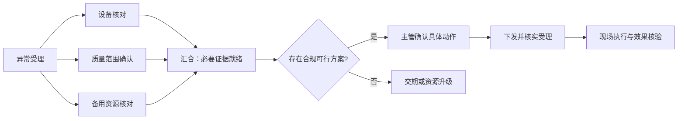

# MOM 人类公告板、个人工作台与 DAG 运行可视化方案

日期：2026-11-07（America/Vancouver）。状态：评估与设计，未实施。本文不修改运行时，不合并 PR49。配套低保真示意：[human-board-wireframe.html](human-board-wireframe.html)。示意内容均为设计样例，不是实际生产状态。

## 1. 本轮基线与证据

| 范围 | 基线 | 结论 |
|---|---|---|
| 最新 master | `31c8227a3edbcc395af04d20b7127dabd1539d64` | 已同步并读取 |
| PR49 | `82069aea05ff2fa8a4000eff0cfb3b2da294bac2`，OPEN、非草稿 | 单独读取 PR 源码，未当作已合并功能 |
| 实际界面 | 最新 master 构建的 an-mom，隔离 `/tmp/mom-ux-assessment.db` | Chromium 打开 S1，截图 `/tmp/mom-current-ux.png` |
| 本次检查边界 | 源码、PR说明/组件、构建、浏览器观察 | 没有重跑 PR49 或全仓测试，不据 PR 描述宣称本轮已验证 |

主要源码依据：

- [当前 MOM 页面](../../web/mom/index.html)：card 使用 pre 输出对象，DAG 按条目列出，演练控制与业务操作同屏。
- [MOM 模型](../../crates/runtime/src/mom/model.rs)：Case/Node/Child/Approval/Action，没有人类任务的身份、班组、交接、评论及可见性模型。
- [MOM 引擎](../../crates/runtime/src/mom/engine.rs)：human_view/agent_view、pump、execute、事件游标。
- [专家绑定](EXPERT_BINDING.md)：human/agent/system/agent_then_human 等绑定语义；编译和校验尚未接入执行。
- [RelOS 适配器](../../crates/server/src/mom_relos.rs)：候选原因、来源、超时降级；关系证据不能等同根因证明。
- [模板校验](../../crates/runtime/src/template.rs)：固定独立分支及汇合校验，不是通用条件 DAG 执行引擎。
- PR49：[ApprovalInfo](https://github.com/Grant-Huang/multi-agent-conv-mvp/blob/82069aea05ff2fa8a4000eff0cfb3b2da294bac2/web/src/components/ApprovalInfo.tsx)、[AssignmentLine](https://github.com/Grant-Huang/multi-agent-conv-mvp/blob/82069aea05ff2fa8a4000eff0cfb3b2da294bac2/web/src/components/AssignmentLine.tsx)、[Assignment](https://github.com/Grant-Huang/multi-agent-conv-mvp/blob/82069aea05ff2fa8a4000eff0cfb3b2da294bac2/web/src/bindings/Assignment.ts)。

S1 当前实测：人类视图15个pre块、19个按钮；1440×1000视口中页面高4234px。这只是该夹具的界面观察，不代表全部场景或可用性研究结果。

## 2. 重新定位：给懂生产、不懂软件内部机制的人使用

目标用户熟悉订单、班次、质量、设备与交付，不应被要求理解 Router、Lease、JSON、节点ID、token预算。

默认页面必须回答：发生什么、影响谁、谁负责、我现在做什么、何时完成、哪里还没确认。聊天用于解释与补充，不作为唯一入口；重要承诺、批准和现场回执必须成为结构化记录。

当前产品可以继续承担沙盘与工程验证，但尚不具备团队协作产品完整能力。不能把换皮或PR49合并当作多人公告板、企业审批或个人工作台已实现。

### 当前评估

| 优先级 | 现状 | 使用风险 | 设计建议 |
|---|---|---|---|
| P0 | 英文stage、case_id、工具名直接出现 | 管理人员不知道该做什么 | 业务标题与中文状态、明确下一步 |
| P0 | approve/execute按scope循环展示 | 不知道自己批准了哪些实际动作 | 展示业务动作清单、影响和批准边界 |
| P0 | actor=supervisor 为测试身份 | 界面换头像不构成身份与职责隔离 | 真实身份/审批资格接入前保持演练标识 |
| P0 | 没有人类责任、交接、可见性模型 | 无法真正形成个人待办或团队承诺 | 新增独立人类工作项及协作事件 |
| P1 | 长页JSON与技术信息混排 | 关键信息埋没，记忆负担大 | 摘要、分层详情、证据按需查看 |
| P1 | 普通刷新与播放时局部轮询 | 等人处理时其他窗口可能陈旧 | 增量订阅/补拉、同步状态与过期提示 |
| P1 | DAG只有节点列表 | 无法辨别并行、汇合和阻塞传播 | 业务泳道与依赖图联动 |
| P1 | 固定capacity与粗粒度跨案例预留阻断 | 不能说明真正的资源冲突或优化顺序 | 显式资源、需求、可用时段与队列 |
| P2 | 沙盘参数、故障注入和gap同屏 | 业务操作与试验操作混淆 | 分离业务工作区、沙盘、诊断 |

## 3. PR49 的采用方式与边界

保留其原则：执行可追溯；批准前告知执行者、工具预估、规则与复核要求。

但有四项必须修正到业务语义：

1. Assignment 是 agent 执行分配，不是生产任务的责任人。应同时展示“业务负责人：计划员王某”“系统处理：排产助手”。未落实到具体人的岗位任务显示“待计划组认领”，不能假装已有人负责。
2. candidates 是候选/组内顺序，不是实际已经分配；工具列表只是 Router 预估，不是权限白名单。“尚未分配”“预计核对MES/WMS”“批准的业务动作”分别展示。
3. Assignment 在当前方案中最近一轮覆盖之前记录。人类页面需要独立的交接与尝试历史，不能仅靠最新字段还原全部责任链。
4. PR49 针对通用 TaskRecord/PolicyVerdict；MOM Case/Node/Child 是另一套模型。必须通过读模型适配对齐概念，不能直接假定组件可无损套用或两套ID能互换。

其附带的 DAG/RelOS/data-collection 报告是架构建议：草稿→约束图→可执行模板。业务界面须区分“流程草稿”“待专家补充”“可运行”“当前运行”，不能把画得完整的图误当已授权自动化。

## 4. 产品结构：共享事实，按职责组织工作

一级导航建议：我的工作、车间公告板、事项与流程、交接记录。流程管理/知识/沙盘与系统诊断放在相应角色的扩展导航，不让主管每天经过配置页。

| 页面 | 默认内容 | 主操作 |
|---|---|---|
| 我的工作 | 待我决定、待我现场处理、等待他人、我关注的承诺 | 认领、确认计划、提交回执、催办/升级 |
| 车间公告板 | 本班目标、重大异常、交付风险、已生效决定、交接重点 | 发布情况、关注事项、查看影响、分派 |
| 事项详情 | 事实与影响、当前方案、责任与进度、相关证据 | 执行业务动作，不操作任意底层状态 |
| 交接记录 | 未完事项、风险边界、下次承诺、交班人与接班人 | 逐项接收、补充说明、退回澄清 |
| 流程视图 | 当前步骤/并行工作/分支/汇合/审批 | 看阻塞、进入需要处理的节点 |
| 资源协调 | 跨事项的设备、人、检验、工具与系统容量竞争 | 评估调整，按权限批准调度建议 |

默认进入“我的工作”，顶部保留工厂/车间/班次、演练标识、数据截至时间。大屏以共享态势为主；桌面支持处置与对比；工业Pad保留大触控目标，弱网时明确未提交与待同步。

## 5. 人类公告板的信息契约

公告板包括：异常事项、重要决定、通知、待协同请求、交接项。不是所有后台事件都成为一张卡。普通进度合并，安全联锁/新风险/需要人决定才提高注意级别。

每张主卡固定显示：业务标题；产线/设备/订单/批次；影响；事实/假设/待核实；负责人；截止或下次更新时间；最新有意义变化；一个主动作。标题例如“B线设备异常，500件插单存在交付风险”，不用CASE-s1-1作标题。

同一事项在团队板和个人板使用同一个ID与版本。个人板是受权限限制的投影，不复制一份可独立变化的业务事实。

区别这些动作：

- 已读：只表示看过；认领：表示接手；同意方案：批准列明动作；提交完成：申请核验；核验通过：才允许业务完成。
- 关注：个人订阅，不向全组广播；置顶：必须有权限与有效期；私有便签：仅本人可见；发布到班组：明确选择可见范围。
- 普通评论即使写“放行”，也不构成批准。Agent可整理评论，但不能把它升级为执行授权。
- 现场人员的回执、系统观测、模型假设分别标来源；冲突和缺失不能被摘要器抹平。

## 6. 个人工作台与人机协同

任务条目展示“我要做什么、为何找我、输入材料、需要提交什么、何时截止、影响谁”。业务负责人、执行人、审查/批准人、协作人及系统执行者分别记录，角色相同也不混为同一字段。

状态为：待认领、待我处理、处理中、等待他人、待核验、已完成；这是人类工作项状态，不直接覆盖既有Agent任务状态机。

物理工作支持扫码/批次/设备定位、照片、测量结果和完成说明。报告“维修完成”后进入待核验，不能自动证明设备已恢复能力；缺必需材料时给出具体缺项。

专家绑定报告的9条样本中，114个工作节点有53个人工节点、18个agent_then_human节点，且29个节点需补充。这是小样本，不是全厂比例，但足以说明界面必须把现场执行与专业补充当作核心路径。专家补充卡问“用哪个系统/谁签字/按哪条标准”，不要求专家填 executor/gate JSON。

## 7. 两条场景的操作体验

### S1 多扰动生产恢复

主管看到：受影响订单、已确认的隔离范围、未知原因、交期风险、正在并行核对的三项工作。系统调查不要求人持续盯屏。

方案对比至少显示：交付目标能否满足、设备停机范围、其他订单影响、刀具/人员/工艺资格/检验条件、证据时间与剩余未知。违反安全/质量约束的方案标为不可选，不放进可批准按钮组。

主按钮用“确认停机并采用备用产能方案”等业务措辞。展开列出具体授权动作；当前 production 一次批准覆盖三项模拟动作，生产替换前必须拆分授权或明确可审核的批量授权清单，不能伪装已经逐动作审批。

批准与操作受理、现场执行、效果核验分开显示。资源或相关事实改变时，旧方案标“已失效，需重新核对”，不能让旧按钮继续有效。

### S2 重大客户投诉

顶部固定显示“初复截止”“8D报告截止”，同时显示绝对时间、剩余时间与时区。初复、根因调查、遏制和长期措施是不同工作流分支；不以一个总进度百分比掩盖差异。

质量人员核对关键质量特性与证据；生产补现场过程；仓库反馈实际冻结范围；销售维护客户承诺。初复不等全部根因查清；发送前显示收件对象、内容版本、未知项及审批资格。

24小时报告交付不等于8D全部完成；D4/D6缺验证时明确“进展报告，根因/效果未验证”。RelOS线索显示“候选原因/关联证据”，不把关系置信度直接画成根因正确率。

## 8. DAG 可视化审查结论

当前“DAG / 任务与并行调查”是节点列表，没有图布局、条件边、汇合类型、时间轴或跨案例资源图。pump 按依赖检查并最多启动3个节点，是模拟调度；BTreeMap顺序不是业务优先级。部分 UNKNOWN 可继续的现有行为也不是完整的通用降级契约。

当前跨案例检查采用“其他case有预留即阻断”的粗粒度机制，不是按具体设备/时间段计算竞争，不能直接将其包装成已实现的APS或最优调度。

存在三套相关但不等价的模型：MOM固定deps；M4.3独立分支/信封汇合校验；专家工作流条件边/节点绑定。后两者文档明确未接入统一执行器。可视化必须标出图的来源与能力等级，不能把不同模型拼成一个看似可运行的流程。

## 9. DAG 界面：三层展开，四种图形分工

| 层/视图 | 回答什么 | 表达 |
|---|---|---|
| 阶段摘要（默认） | 现在到哪、哪一步要我做 | 调查→制定方案→待决定→执行→核验；并行显示“3项核对中” |
| 业务泳道 | 谁在做、交接卡在哪 | 生产/质量/设备/仓储/主管，明确人/系统/助手 |
| 依赖图（按需） | 为何不能开始、分支/汇合怎么走 | 从左到右分层图，选节点高亮上游和受影响下游 |
| 时间与资源视图 | 多任务何时交叉、谁占用资源 | 按事项/资源切换泳道和时间轴，计划与实际分开 |

流程图不是流程编辑器。运行中的图默认只读；修改形成新版本并重新校验，不允许拖动节点直接改变在线执行。

节点内容：业务动作名、执行类型、当前负责人/系统执行者、状态、时间、阻塞原因。模板节点、运行实例、重试attempt、审批decision版本分别标识。布局稳定，不因每次事件跳动；自动聚焦只在首次打开，后续显示“有更新”保持用户视线。

### 并行与条件分支的明确语义

| 结构 | 执行语义 | 视觉与文案 |
|---|---|---|
| 串行依赖 | 所需输入满足后开始 | 实线箭头，“等待首件检验结果” |
| AND并行 | 独立工作可并发，仍受配额/资源限制 | “同时核对”分叉，“等待全部必要结果”汇合 |
| XOR条件 | 已确定条件只选一条 | 菱形+业务问题，边上写条件；未走路径淡化标“不适用”，不是失败 |
| OR包含分支 | 选择一组满足条件的路径 | 标出本次激活集合，汇合只等待激活的必要路径 |
| 审批关卡 | 有资格的人对当前版本批准 | 人工关卡图标，显示批准范围/到期/失效原因 |
| 可选调查 | 不阻断主路径，除非输出被声明为必需 | 独立“补充调查”泳道及明确依赖，不使用模糊箭头 |

条件未知显示“待判定”，不能同时启动所有互斥方案。SKIPPED/NOT_SELECTED、FAILED、UNKNOWN、CANCELLED、SUPERSEDED必须区分。汇合策略需要显式声明required/optional、all-required/activated-set、超时与降级；不能把任何一路UNKNOWN都视作满足依赖。

“首个成功即继续”只用于事先授权的无副作用冗余查询，不能用于生产写动作；败选分支取消不等于已发生副作用被回滚。

此图是拟议业务表达，不声称当前运行时支持全部网关。返工/重规划生成新attempt/plan revision，历史轮次折叠，不能在DAG里直接引入任意循环。

## 10. 多个 DAG 并行交叉：组合视图与调度契约

不要把全车间所有节点叠成一张大图。默认每个事项一行，显示阶段、交期风险、人工待办与关键阻塞；选择一项后展开本图。按资源切换时，同一设备/检验员/刀具/系统接口的相关任务并列，只有选中冲突时显示跨事项连线。

关联分三类：业务依赖、共享证据、资源竞争。不能全部画成同一种箭头。

- 订单A与订单B引用同一维修工单，可展示一个共享工作及两个受益事项；不复制创建两次维修。仅有同设备/相似描述不够，须验证动作语义、范围、版本、权限与业务操作标识。
- 同一个设备被占用不表示两个事项有业务依赖；显示“等待CNC-XY，当前由订单B占用”。没有释放时间证据时显示未知，不编造预计时间。
- 同一份批次观测可以共享引用，但确认其适用范围、新鲜度与权限；不据此合并两个不同客户的案例。
- 取消一个事项不能自动终止其他事项仍需的共享动作；已执行物理动作不能靠图上删除撤销。
- 各DAG无环不保证跨DAG无环。新增跨事项依赖需要全局环检查；资源等待还需要死锁检测/统一获取顺序等机制。

### “最优”的定义与现实边界

制造多资源排程一般是受约束优化问题，不能靠图布局或更多agent承诺全局最优。建议目标按顺序：安全/质量/权限硬约束→关键交期风险→等待与换型成本→吞吐与计算费用。优先级与插单规则由团队配置，重要调整须展示受影响订单并按权限批准。

执行规则建议：只对就绪节点调度；按风险、交期余量与等待老化选择；同时检查全局/案例/模型并发、设备容量、人员班次、工装/检验资源与系统限流。人工等待释放计算槽位；物理资源是否保留由业务租约和到期规则决定。长物理工序不可随意抢占。

关键路径仅对当前依赖和估计时长有效；在资源受限时属于下界/估计，不画成保证交期。先提供可解释启发式和仿真对照；需要APS/求解器时另行接入、验证与登记gap。

## 11. 拟议读模型与后端缺口

| 能力 | 当前可复用 | 必须补充 |
|---|---|---|
| 事项摘要 | Case、期限、观测、动作、证据、版本 | 业务标题、影响与数量单位、紧急级别、范围 |
| 个人工作 | 无真实个人归属 | 身份/班组/班次、HumanWorkItem、认领与转交、职责权限 |
| 团队共享 | 持久事件、分页 | BoardPost、评论/确认、可见范围、订阅与未读 |
| 交接 | 事件可追溯 | Handover、接班确认、承诺时间与责任变更 |
| 执行透明 | PR49候选与最新Assignment | 区分候选与实际、attempt历史；适配MOM模型 |
| DAG运行 | deps、节点状态和时间 | 网关类型、条件结果、激活路径集合、汇合策略、typed blocker |
| 多DAG资源 | 粗粒度预留 | ResourceClaim、容量/时段/日历、等待原因与释放、跨案例关联 |
| 可执行图治理 | 绑定校验、晋升统计 | 流程版本与运行版本分离、专家确认、发布权限与执行接线 |

这些是拟议模型，不在本轮建立表或API。个人页的过滤不构成访问控制；私有便签不得默认进入团队搜索或Agent上下文。人类已读确认与现有事件消费cursor不是同一概念。

## 12. 实施顺序与验收

1. 先把现有固定场景做成业务可读的摘要、方案对比、动作/回执/核验页面；保留演练标识，技术数据移到详情。PR49用作执行透明的适配参考。
2. 补真实人类任务、责任、可见性和交接。无企业身份时只能做明确标注的角色演练，不宣称多人系统上线。
3. 针对已支持的DAG做阶段/泳道/依赖图。再增加明确网关与汇合契约及测试，随后开放相应图形；不先画出尚不能执行的通用分支。
4. 建资源协调和跨事项读模型，先可解释调度与冲突演练，再评估优化求解器。
5. 专家流程补充、关系线索与模板晋升独立作为受控管理流程；不让普通生产用户操作JSON图编辑器。

拟议验收场景：

| ID | 业务断言 |
|---|---|
| UX01 | 无讲解时，用户能找到自己的待办、截止与责任人 |
| UX02 | 能区分假设/已验证、演练/真实、申请冻结/已冻结 |
| UX03 | 批准前能说清具体动作、影响、执行者及未确认条件 |
| UX04 | 能辨别三路并行、必需汇合、未选分支与失败分支 |
| UX05 | 条件未知时不执行互斥分支；optional超时与required失败行为不同 |
| UX06 | 两事项争同一设备可见等待理由；独立资源不被无故阻断 |
| UX07 | 私有便签不进入团队板；看过不等于认领/批准/验收 |
| UX08 | 批准后方案/资源变化，旧批准失效并给出下一步 |
| UX09 | 接班人员能找到未完事项、风险边界与下一次承诺 |
| UX10 | 24小时报告到期不误显示8D全部关闭；现场任务无回执不完成 |
| UX11 | 跨DAG环被拒；共享工单不重复下发；取消不误伤其他事项 |
| UX12 | 草稿图、待补充、已注册模板与运行实例不混淆 |

先邀请5–8名不同岗位用户做形成性测试：无引导完成S1/S2及交接、资源冲突任务，记录完成率、误批、返回次数、耗时与口述理解。该规模用于找问题，不足以证明统计上的生产可用性；验收门槛需与团队约定。

本轮交付是源代码评估和设计方案，不声称已实现上述能力。后续编码前应将选定场景加入 CASES/features 与可执行测试，保持 Red→Green 和安全回归。

本轮检查记录：当前master的`an-mom`离线构建通过；以独立临时数据库运行S1，观察到现有页面包含15个pre块、19个按钮、约4234px页面高度（1000px视口），用于判断信息密度。低保真原型的五个视图通过浏览器切换检查，无脚本错误。本轮未修改业务实现、未运行全量业务回归、未合并PR49或发布。
