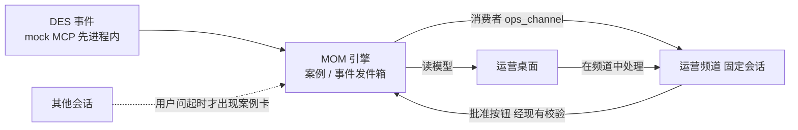

# 制造运营桌面与运营频道（设计草案）

状态：草案（助手建议），待用户确认。依据：`docs/DECISIONS.md` 第 56、57、58 条，`docs/mom/UI_UX_PRINCIPLES.md`（下称“原则”），`docs/INTEGRATION_PLAN.md` 的 WP1。

本文只设计，不含实现。运营桌面是**接 DES 事件、供运营人员日常盯盘的投影**，不是新的业务系统。

## 1. 定位

| 部件 | 是什么 | 不是什么 |
|---|---|---|
| 运营桌面 | 主 Web 里的一个页面。读 MOM 引擎的案例和事件，回答“现在哪些事值得我关注”。 | 不存业务状态，不重复做一套工作流，不替代 MOM 工作台。 |
| 运营频道 | 一个**固定的专属会话**，DES 的重要事件以案例卡的形式发到这里，可在这里追问、批准。 | 不是个人主窗口（第 53 条），不是“当前会话”，不触发模型自动回复。 |
| MOM 引擎 | 案例状态的唯一来源。 | —— |

三者关系：DES 事件 → MOM 引擎（唯一状态）→ 桌面（读）和运营频道（发卡片）。批准只走卡片这一条路（第 56、57 条）。



## 2. 与原则的对应

- 按业务组织，不按 Agent 分工（原则 §2）：桌面上不出现“维护 Agent、排产 Agent”。
- 同一事项同一 ID：桌面一行、频道一张卡、案例详情，用的都是同一个 `case_id`（原则 §3、§5）。
- 不另造业务状态：桌面全部读自引擎；频道里的卡片是引擎状态的快照，状态变化时更新原卡片。
- 重要异常、超期、批准变化才进看板和频道，普通状态跳动不刷屏（原则 §5）。
- 已读、认领、批准、执行、核验分别记录；事件消费游标不等于人已读（原则 §5）。
- 全部来自 DES 的数据，在记录和动作级标“模拟”（原则 §13）。
- 刷新不丢阅读位置、不重置筛选（原则 §3.1、§13）。

“看板 / 任务 / 资源”三入口（原则 §3）本期只做**看板**这一个入口，任务和资源见第 8 节分期。

## 3. 桌面界面设计

### 3.1 版面（桌面宽屏，示意）

```
┌ 运营桌面                                   [模拟数据] 范围: 与我相关 ▾ ┐
│ 厂况条:  待批准 2 · 受阻 1 · 超期 0 · 风险 3     产线 A 运行 / B 停机       │
├───────────────────────────────────────────────────────────────────────┤
│ 筛选: 全部 | 待我批准 | 受阻/需协助 | 风险提示 | 已完成(折叠)            │
│                                                                         │
│ ▌待批准  XZ 缺刀具，插单 A 无法开工            影响: 订单 A 延期 4h     │
│ ▌        责任: 调度 · 时限 14:30 · 下次反馈 14:10     [在频道中处理]    │
│                                                                         │
│ ▌受阻    B 线质检设备待校准 ...                                          │
│ ▌风险    ...                                                             │
└───────────────────────────────────────────────────────────────────────┘
```

- **厂况条**：几个数字 + 产线运行状态，数据读自 DES 视图；数字可点，等价于筛选。
- **事项行**：回答原则 §2 的六个问题里最关键的几个——发生了什么与影响、谁负责、时限和下一次反馈、当前阶段；只有**一个主操作**。
- **排序**：按风险和时限，不是纯时间倒序（原则 §5）。待批准、受阻、超期置顶；已完成默认折叠，保留总数。
- **主操作**：
  - 待批准：“在频道中处理”→ 跳到运营频道里该案例的卡片（卡片已在则定位，不新发）。
  - 其他：“查看详情”→ 右侧抽屉。
- **详情抽屉**（统一事项工作区，原则 §8）：六个问题依次折叠展示——发生了什么/影响、责任、方案与前提、缺什么、进展与下次反馈、凭什么算解决；证据和 DES 原始数据默认折叠。
- **不设批准入口**：桌面不放批准按钮，避免两套入口（第 57 条）。
- 状态要明确区分：加载中、无数据、未知、过期、错误，分别呈现；“没有异常记录”不写成“正常”。
- 手机：事项行单列，抽屉改为全屏；不出现横向溢出（原则 §13）。

### 3.2 与现有 Web 的关系

现有 `web/src/App.tsx` 是会话 + 任务面板结构。桌面作为一个新的页签，页签位置待定（建议与“会话”并列，不放进任务面板）。桌面组件放新文件，不改 `ChatView.tsx` 与 `TaskPanel.tsx` 的现有逻辑。

## 4. 运营频道设计

- **固定且唯一**：用一个固定的会话 id（如 `ops-channel`）。现有 `conversations` 表只有 id、标题、创建时间，会话 id 是文本，因此**不需要加列**；首次需要时按固定 id 创建。不能被删除或被“新建会话”替代。
- **谁往里发**：只有“运营频道发布器”，它是 MOM 事件发件箱的一个**消费者**（引擎里已有按消费者命名的游标：`pending_events`、`acknowledge`、`cursor`）。其他代码不直接往里写。
- **发什么**：见第 5 节的分级。每个案例一张卡，案例变化时**更新同一张卡**，不重复发。
- **不做什么**：发卡片不触发一轮模型回复，不创建任务，卡片内容不当指令，也不抽取进个人记忆（与第 52 条对内省消息的处理一致）。
- **用户在频道里追问**：和普通会话一样走前台和路由；案例卡信息作为“数据”进入上下文。
- **未读**：频道页签挂未读数。未读 = 该频道里用户没看过的新卡或卡片更新数；和发件箱游标分开记。
- **批准**：卡片上的批准按钮走现有批准链路（版本号、范围、批准人校验）；批准人暂用本机测试身份并显示在卡片上（第 56 条）。

## 5. 事件分级：什么进桌面、什么进频道

| 级别 | 例子 | 桌面 | 运营频道 |
|---|---|---|---|
| P0 需要人决定或有安全质量风险 | 案例待批准、质量/安全异常、超期 | 置顶，计入厂况条 | 发卡片（或更新），计入未读 |
| P1 案例状态有实质变化 | 新建案例、方案版本变化、受阻、执行完成待核验、已关闭 | 显示 | 该案例**已有卡片**则更新；没有卡片的新案例只在受阻或待批准时才发 |
| P2 过程数据与指标 | 产能、设备读数、普通状态跳动 | 只进厂况条或详情，不单独成行 | 不发 |

规则（助手建议，阈值可配置）：

1. 同一案例只一张卡；合并窗口内（默认 60 秒）的多次变化合并成一次更新。
2. 频道每小时新卡片上限（默认 10 张）；超限时合并成一张“另有 N 条”汇总卡，并在桌面可见全部，不静默丢弃。
3. **每次“没发”的判断也记原因**（与第 50 条的做法一致），便于回看漏发。
4. 级别判定集中在**一个函数**，由规则决定；模型不参与判定。

## 6. 数据与接口

### 6.1 新增的状态（只有这些，且都不是业务状态）

| 数据 | 存哪里 | 作用 |
|---|---|---|
| 运营频道会话 id | 固定常量 | 发布器的目标 |
| `case_id → 频道消息 id` 对应表 | MOM 自己的数据库（`<db_path>.mom.db`，补建表） | 更新同一张卡 |
| 发布器游标 | 引擎已有消费者游标，消费者名 `ops_channel` | 不重复发、重启不丢 |
| 人已读位置 | 同一对应表里的字段，单独记 | 未读数，不等于游标 |

这样**不改 `store.rs`、`orchestrator.rs`、`registry.rs`**。如实现时发现必须改，先单独提方案（`AGENTS.md` 高风险）。

### 6.2 接口（拟）

| 接口 | 作用 |
|---|---|
| `GET /api/mom/desk` | 桌面读模型：厂况条、事项行（已按风险/时限排序）、每行的来源标识（模拟）。只读。 |
| `GET /api/mom/desk/cases/{id}` | 抽屉详情，复用现有案例人类视图 `human_view`，不另造字段。 |
| `POST /api/mom/desk/cases/{id}/open-in-channel` | 确保频道里有这个案例的卡片，返回会话 id 和消息 id，供前端跳转。幂等。 |
| `POST /api/mom/desk/read` | 记录频道已读位置。 |

响应格式沿用项目既有的 JSON 结构。新增接口属于“公开接口变化”，实现前先在 `docs/DESIGN.md` 登记。

### 6.3 开关

拟新增 `[mom] chat_bridge`，默认关闭；关闭时桌面页签和频道发布器都不启用，现有行为不变。配置字段属于公开接口，加之前再确认。

## 7. 验收用例草案（定稿后才冻结）

用例名遵守 `check-map` 规则：浏览器类 `E2E-[A-Z]+`（名字里不能有数字和连字符）；Rust 类 `rt_xxx_NN_`。

| 用例 | 断言 |
|---|---|
| E2E-OPSDESK | 启动后注入 DES 事件，桌面出现对应事项行，按风险/时限排序；待批准置顶；已完成默认折叠；“模拟”标识可见 |
| E2E-OPSCHANNEL | P0 事件在运营频道出现一张卡；同案例再次变化只更新这张卡；频道未读数增加，打开后清零 |
| E2E-OPSAPPROVE | 桌面点“在频道中处理”定位到卡；在卡上批准后，引擎状态变化，桌面和卡同步；桌面没有批准按钮 |
| E2E-OPSNOISE | 大量 P2 数据不产生频道消息；超过小时上限时出现汇总卡，桌面仍可见全部 |
| RT-OPSDESK-01 | 分级函数：同一输入得同一级别，不依赖模型 |
| RT-OPSDESK-02 | 发布器重启后不重复发卡、不漏发（游标） |
| RT-OPSDESK-03 | 频道消息不触发模型回复、不创建任务、不进入记忆抽取 |
| RT-OPSDESK-04 | 开关关闭时无桌面接口、无发布器，现有会话行为不变 |
| RT-OPSDESK-05 | 没发的判断记录了原因 |

## 8. 分期（每期单独确认后才做）

| 期 | 内容 | 依赖 |
|---|---|---|
| D0 | 固定频道 + 发布器 + 对应表；分级函数；开关 | 第 56、57、58 条已定 |
| D1 | 桌面看板：厂况条、事项行、抽屉、筛选、未读角标 | D0 |
| D2 | “在频道中处理”和卡片批准的联动（依赖 WP1 的 L2 案例卡） | WP1 L2 |
| D3 | 任务、资源两个入口；DES 换成 MCP 连接器后的接入回归 | WP1 L4 |

## 9. 待用户确认

1. 桌面页签位置：与“会话”并列（建议）还是放进别处？
2. 第 5 节的 P0/P1/P2 划分、默认的合并窗口（60 秒）和小时上限（10 张）是否合适？
3. 桌面“范围”选择（与我相关/本班组/本车间）本期是否只做占位？单用户部署下它们结果相同，建议只显示“全部”。
4. 运营频道里，用户是否可以直接用自然语言发起处置（例如“批准这个案例”）？建议：不可以，只认卡片按钮；自然语言只用于解释和追问（原则 §10：会话动作须走同一授权链路）。
