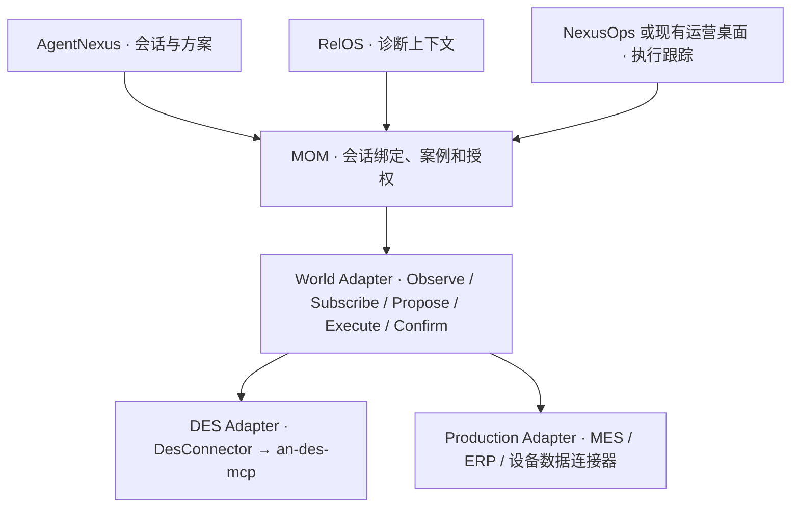

# AgentNexus World Adapter 协议设计

| 项目 | 内容 |
|---|---|
| 协议版本 | V1 |
| 状态 | 设计方向已确认，本文按源码修订，协议待实施 |
| 核对基线 | 远端 `master` 的 `6a99206` |
| 首次交付 | 从产品会话经 MOM 进入远程 DES，完成观察、续读、方案选定、人工审批、执行和确认 |

采用完整前端先行，各里程碑用同一前端完成全流程。详见 [实施计划与 Mock 替换](WORLD_ADAPTER_PLAN.md) 和 [Playwright Feature Map](../feature-map/features/world-adapter.md)。

[DES 实验与运营入口拆分](DES_EXPERIMENT_OPS_SPLIT.md) 定义实验人员和运营人员的产品路径（决定 62）。实验控制经独立入口授权，正式运行的可处置事项由 MOM 发布到 AI 桌面。

与现行计划的关系（2026-11-20）：DES 内核闭环与⑤a 远程工厂基线仍以 [DES_CLOSED_LOOP.md](DES_CLOSED_LOOP.md) 为准；原阶段⑤「车间视图」、WP1 GS1 产品前门与运营桌面 D3 按 DES-31 并入本文 M0～M2；交付硬约束见 DES-32。系统打通总表见 [INTEGRATION_PLAN.md](../INTEGRATION_PLAN.md)，进度入口见 [PLAN.md](../PLAN.md)。

## 1. 目标与架构

World Adapter 让 AgentNexus、审批服务和运营界面通过同一契约访问一个明确的世界。DES 复用现有 MCP 连接器和干预内核。生产侧按站点接入 MES、ERP 和设备数据源，先开放观测，再开放一个可查证的业务写动作。



MOM 是现有案例、方案修订、审批和动作记录的权威来源。World Adapter 在服务层统一绑定、契约、执行跟踪和错误语义，复用 MOM 的领域校验。MOM 引擎保持同步，MCP 和生产网络调用在服务层进行。RelOS 在当前仓库提供诊断上下文。NexusOps 对应运营跟踪角色，首版复用现有运营入口，审批由 MOM 和案例卡处理。生产身份和角色映射需在开放生产写入前完成。

## 2. 源码校准与实现入口

| 已核对行为 | 实现含义 |
|---|---|
| [`mom_sim.rs`](../../crates/server/src/mom_sim.rs) 在配置连接器时通过 MCP 创建仿真，否则通过进程内入口创建。已有工厂视图、预测、what-if、审核与观测工具路由 | 公共协议叠加在服务层。现代会话入口选定远程世界后，连接不可用时返回错误 |
| [`engine.rs`](../../crates/runtime/src/mom/engine.rs) 的 `approve` 目前只接受夹具身份 `supervisor`，用 MOM 虚拟分钟计算有效期，并绑定案例方案修订与资源版本。 `execute` 先提交案例动作，再调用 `des_after_execute` | 现有审批继续供仿真使用。案例动作已受理与工厂已提交是不同事实。生产必须验证真实身份与动作授权 |
| [`engine_link.rs`](../../crates/runtime/src/mom/des/engine_link.rs) 处理选定或推荐方案。进程内路径直接重推演，远程分支交给 [`remote.rs`](../../crates/runtime/src/mom/des/remote.rs) 产生待发写操作。远程幂等键由案例、方案修订、范围、工具和可选设备组成 | 首版远程执行沿用这条路径。一个 MOM 方案可能产生多条写入，执行记录须跟踪子动作各自回执 |
| [`mom_des_connector.rs`](../../crates/server/src/mom_des_connector.rs) 推进时逐分钟调用 `simulation_advance`、`events_poll`、`equipment_status`，交给 MOM 投递。写入经 MCP 后回写回执，再单独从管理工具同步标准答案 | 工厂发生与 MOM 投递是两个边界。标准答案在工厂内随干预更新，MOM 审核副本存在独立同步窗口 |
| [`mom.rs`](../../crates/server/src/mom.rs) 的现有命令路由在 MOM 命令提交后尝试发送远程写入，出错响应可带 `applied: true` | 此字段表示 MOM 命令已生效，协议只能根据底层业务证据判定工厂动作的结果 |
| [`service.rs`](../../crates/des/src/service.rs) 按 `occurred_at <= now` 冻结已发生事件前缀。维修和调拨调用 `Sim::intervene`，替换之后的事件和标准答案。排产工具只记录计划回执 | 维修、调拨与排产各自声明效果。当前的有序事件前缀可用作 DES 续读来源 |
| 同一文件中工单、干预、事件及幂等映射保存在 `Sim` 内存。连接器只跟踪本实例创建的仿真 | 同一存活实例内可以重放。MCP 子进程重启后，旧世界进入不可用状态。跨重启恢复能力需要独立实现持久化 |
| [`scenario.rs`](../../crates/des/src/scenario.rs) 的 `rerun` 复用场景 seed、选中的 attempt、命名随机流和干预历史。 `Pattern::Script` 也调用模型生成遥测，输入事件锚点固定 | P0 是固定事件锚点且可执行干预的夹具。动态场景另测干预对未来事件的影响 |
| [`main.rs`](../../crates/server/src/main.rs) 在主应用的本地入口创建 scripted MOM，按配置挂运营频道。[`an-mom.rs`](../../crates/server/src/bin/an-mom.rs) 可挂载 DES MCP。[`mom_relos.rs`](../../crates/server/src/mom_relos.rs) 只提供 RelOS 诊断上下文 | 首次交付将现有远程连接器接入承载产品会话的 MOM 实例，并共享案例状态。保留本地夹具的访问范围 |
| [`DECISIONS.md`](../DECISIONS.md) 第 56～58、60 条描述案例卡、运营频道及批准入口 | 会话中的工具、案例卡和运营频道复用现有设计。World Adapter 增加显式世界绑定、协议状态和证据 |

## 3. 世界绑定、身份和能力

MOM 在普通会话选定工厂或从运营入口进入案例时解析服务端绑定。绑定记录包含 `binding_id`、`tenant_id`、会话 ID、`world_id`、`mode`、`scope`、`adapter_id` 和可选后端实例代号。DES 的 `world_id` 指向一轮仿真，内部映射到 `simulation_id` 与工厂实例。生产的 `world_id` 指向注册的站点配置。 `scope` 至少限制车间、产线、对象和操作权限。

调用方提供已认证会话或服务身份。MOM 加载绑定并解析请求中的对象。如果客户端附带 `world_id`，服务端验证它与绑定匹配。提案、游标、执行详情和审批都按同一授权分区查询。切换世界时创建新绑定。运营频道的混合列表可以展示多世界卡片，卡片操作由服务端按案例重新解析绑定后执行。已存在的案例卡仍按案例更新。

在会话绑定结果中返回 `capabilities`：

| 字段 | 用途 |
|---|---|
| `observations`、`event_kinds` | 支持的观测对象和事件 |
| `snapshot_consistency` | `consistent` 或 `per_source` |
| `actions` | 每个动作的类型、参数 schema 版本、目标类型、确认条件和效果 |
| `recovery` | `instance_only` 或 `durable` |
| `mode` | 建议取 `des_dynamic`、`des_fixture` 或 `production` |

能力只用于发现，服务端每次重新验证授权。会话 Agent 可以观察、续读、形成方案以及查询可见执行结果。人工从授权入口作出审批决定，可信服务执行批准动作。MCP 写入、推进、故障注入和标准答案留在内部入口。现有 DES MCP 的 `approval_ref` 是回执关联字段，授权由上游校验。

## 4. 公共契约

V1 先在服务层实现共享 Rust 请求、响应和错误类型。下列 JSON 约定用于类型序列化和契约测试。新 HTTP 或 Agent 工具入口按产品实施阶段接入。已有路由继续按原合同服务原调用方。响应附 `protocol_version: 1`、`request_id` 和 `world_id`。输入 schema 拒绝未知字段。兼容扩展采用可选响应字段。

`object_ref` 为 `{type, id}`。对象和游标在世界内解析。执行和提案 ID 由服务端生成。时间戳用 RFC 3339 UTC。DES 用 `simulation_minute` 表示内核绝对虚拟分钟，另返回 `start_minute`，UI 可据两者显示运行时长。源系统发生时间与服务端接收时间分别记录。客户端将版本和游标视为不透明值。

### 4.1 Observe

请求字段为 `selection`，包含对象类型与可选对象 ID。响应包含 `objects[]`、`as_of`、`cursor` 和 `consistency`。对象包含 `ref`、`source`、`state`、`observed_at` 和可选 `object_version`。只有权威来源能提供可重新校验的版本时才设置该字段。

`consistent` 表示快照与游标在同一发布边界采集。后续公开事件从该游标读取。首版公开流包含订单、报警及登记的执行事件，遥测采样可能随仿真推进变化，客户端通过再次 Observe 刷新这类状态。 `per_source` 返回 `source_watermarks[]`，每个来源记录可续读位置或观测截至时间。只有时间戳的来源标为需要重读，消费者发生断点时重新取该来源快照。多源视图按对象声明权威来源。

### 4.2 Subscribe

请求字段为 `cursor`、`limit`、可选 `wait_ms`。首版用短轮询，`limit` 默认 100，范围 1～1000。首版 `wait_ms` 省略或传 0。响应字段为 `events[]` 和 `next_cursor`。事件包含 `event_id`、`kind`、`subject`、`source`、对应世界时间和经过可见性筛选的 `payload`。

游标绑定租户、世界、流、选择范围及后端实例。读取边界为游标之后，按发布位置升序。只允许跳过不可见事件位置。服务端须先检查选定范围，再按读过的最高位置生成下一游标。空页也返回下一位置。消费者应用事件并保存下一游标。如果两个操作不能在同一事务完成，按 `event_id` 去重。游标过期用 `CURSOR_EXPIRED`，实例失效用 `WORLD_UNAVAILABLE`，跨范围使用用 `ACCESS_DENIED`。游标过期时重新调用 Observe。

### 4.3 Propose

请求字段为 `action_type`、`target`、`parameters` 和可选 `source_event_ids`。服务端验证动作能力、参数和对象映射，返回不可变提案。

| 字段 | 约定 |
|---|---|
| `proposal_id` | 服务端分配，绑定世界与范围 |
| `action_type`、`target`、`parameters` | 经注册 schema 校验及归一化的动作 |
| `preconditions` | 相关对象版本或可重检的业务谓词 |
| `confirmation_policy` | 具体完成条件及所需证据 |
| `action_digest` | 对版本化的规范动作数据计算 SHA-256，覆盖世界、目标、动作、参数、前置条件及确认策略 |
| `expires_at` 或 `expires_at_simulation_minute` | 依世界的审批时钟表示 |

规范摘要由服务端用 RFC 8785 JSON 规范化后计算，编码为 UTF-8。摘要材料包含 `protocol_version` 和动作 schema 版本。审批界面使用服务端保存的提案内容。任何动作内容或前置条件变更都生成新提案，并重新审批。Propose 只登记方案。接入 DES 时将提案与 MOM 案例 ID、选定方案和 `plan_revision` 绑定，选择方案仍经 `select_des_plan`，沿用现有可行性检查和审批失效行为。

### 4.4 Execute

请求字段为 `proposal_id`、`approval_ref` 和 `idempotency_key`。调用方为一次执行意图生成并保存幂等键。返回 `execution_id`、`status`、`confirmation_policy`，以及已知证据或需要等待的阶段。

1. 认证并加载绑定。按 `(tenant_id, world_id, idempotency_key)` 查执行。已有记录且提案与授权标识匹配时返回原执行。键相同但请求不同则报冲突。原记录的读取仍要求调用方有当前访问权限。
2. 对新执行验证当前动作权限、审批有效期、提案摘要、绑定、目标与前置条件。DES 沿用 MOM 的案例修订、资源版本和虚拟时钟。生产授权必须额外绑定实际操作者和职责范围。
3. 在持久事务内登记执行和待处理任务。给幂等范围设唯一约束，同一批准过的提案只允许登记一次。并发竞争时加载已存在记录。已消费的批准以另一幂等键提交时返回 `IDEMPOTENCY_CONFLICT`，供仍有读取权限的调用方找回原执行 ID。
4. 领取任务后在提交边界再次验证前置条件。DES 复用 MOM 校验及连接器的操作顺序。生产支持条件写入时随写入提交对象版本或条件。首次外部提交前若审批已过期且确定未发送，记录拒绝。
5. 首次发送前持久化外部关联键、规范载荷和后端实例代号。收到回执后逐个子动作保存证据，按确认策略汇总状态。网络调用在数据库事务和 MOM 引擎锁外执行。

DES 实现需收敛现有 `Engine::execute` 与 `des_after_execute_remote` 之间的提交窗口。优先让动作登记、待发写和执行引用共享 MOM 的持久提交边界。若现有存储结构要求分两步，则第二步必须能按稳定的案例、方案修订和范围重建，且能区分已排队、已发送、已回执。恢复任务只补缺失步骤。已有命令路由复用同一登记路径，防止老入口与新入口各发送一套动作。

领取待发任务时同时核对案例是否已取消或阻断。尚未发送的子动作停止提交。已经发出的子动作继续保存事实回执，仅更新执行证据，保持案例终态。当前远程派发只按仿真归属筛选，且失败回执可将案例置为 PARTIAL。实现本项时与 [R-20261120-H2](../fix-plans/r-20261120-h2.md) 共用派发与回执守卫。

### 4.5 Confirm

请求字段为 `execution_id`。返回当前状态、状态时间、确认策略、已知证据与子动作列表。重复查询复用同一执行记录。查询可触发权威查证，查证只使用原关联键。执行状态也可发布到订阅流。

DES 执行可包含维修、调拨与排产子动作。写入接受回执证明工单登记或计划已记录。 `order_status` 证明仿真工单随虚拟时钟推进到完成或失败。设备恢复、质量复检等业务条件使用 MOM 的后续观测和既有核验，具体由提案的确认策略指定。

```json
{
  "protocol_version": 1,
  "request_id": "req-521",
  "world_id": "world-des-42",
  "execution_id": "exec-89",
  "status": "applied",
  "confirmation_policy": "maintenance_completed",
  "evidence": [
    {
      "source": "des_mcp",
      "simulation_id": "DES-42",
      "order_id": "example-order-id",
      "status": "accepted",
      "complete_minute": 230
    }
  ]
}
```

## 5. 状态机与错误

| 状态 | 定义 |
|---|---|
| `accepted` | MOM 或协议执行记录已受理，权威写入结果待取得 |
| `applied` | 要求的业务写入已有提交证据，完成条件可能仍待满足 |
| `confirmed` | 动作登记时约定的完成条件已有权威证据 |
| `rejected` | 审批、权限、前置条件或能力未通过，确定没有业务副作用 |
| `failed` | 取得明确失败证据。返回失败子动作和已知成功的子动作 |
| `unknown` | 尚无法判定外部写入或完成结果，保留上次已知阶段、原关联键和恢复原因 |

正常状态顺序为 `accepted → applied → confirmed`。同一份证据满足多个阶段时可以一次推进。等待结果期间可进入 `unknown`，取得证据后恢复到相应已知状态。子动作存在明确失败且其余结果已知时，返回 `failed` 和部分成功证据，同步保留 MOM 的 `PARTIAL` 与 `CompensationRequired`。仍有影响整体结论的未知结果时，保持 `unknown` 并返回已知失败信息。运行独立对账时使用带版本的状态更新，防止晚到的较旧回执覆盖新证据。

错误响应至少包含 `code`、`message`、`request_id` 和可选的可公开详情。

| 错误 | 处理 |
|---|---|
| `INVALID_ARGUMENT`、`ACCESS_DENIED`、`UNSUPPORTED_CAPABILITY` | 修正请求或使用已授权的操作 |
| `CURSOR_EXPIRED` | 同范围重新 Observe |
| `WORLD_UNAVAILABLE` | 检查世界实例。DES 工厂重启后旧运行保持不可用，已登记执行仍可查历史 |
| `APPROVAL_INVALID`、`PRECONDITION_FAILED` | 重新观察、提出方案并审批 |
| `IDEMPOTENCY_CONFLICT` | 检查原请求及已保存的键 |
| `BACKEND_UNAVAILABLE` | 仅在确定本次调用未发送或未受理时提示安全重试 |

客户端调用超时后用原键重试。适配器写入超时后使用原关联键查证，或者在权威后端提供可靠同键去重时重发同载荷。在权威后端缺少可靠去重时，须有权威证据确认原请求无副作用，才允许按动作恢复策略再次提交。单次查询无结果、源系统同步滞后和后端失联应进入 `unknown`。

## 6. 远程 DES 落地步骤

### 6.1 产品前门与公开事件边界

主应用进程内的 MOM 和独立运行的 `an-mom` 目前各自构造服务状态。首版建议在现有主应用 MOM 启动路径复用 `with_des` 和 `DesConnector`，由工厂入口、案例、运营发布器和适配器共用同一个 MOM 引擎。远程运行的推进走 `DesConnector::tick`。同一个运行由一个连接器实例管理。维持现有本地夹具限制，生产部署需另行接通实际身份认证。

首版采用**经 MOM 正式投递的世界观测事件**，产品视图以同一 MOM 视图和公开事件位置为准。MCP `events_poll` 的数字位置只供连接器搬运厂内已发生事件。MOM 写入的 `DesPlanApplied` 等案例事件可以另行映射为执行进展，其业务含义由回执与状态转换确定。

`DesConnector::tick` 当前先推进工厂并取得批次，再依次调用 `des_ingest_remote` 与 `Engine::advance`。实施时在 MOM 完成该分钟交付后才发布新的快照和公开水位。可在现有持久更新单元内记录投递位置和快照引用，或以已提交的发布批次作为唯一读边界。取数、入队或投递中断时继续服务最近一次完整边界。重试时按事件 ID 重用已入队记录。验收覆盖快照发布前中断后续读。工厂和 MOM 两种游标分别存放。

### 6.2 复用远程写入并补齐恢复

远程写入复用现有映射：

| MOM 动作 | MCP 工具 | 权威证据 |
|---|---|---|
| `eam.maintenance` | `maintenance_order_create` | 设备、工单 ID、开始和完成分钟 |
| `mro.transfer` | `tooling_transfer_create` | 目标设备、调拨单号、到达分钟或失败原因 |
| `mes.reschedule` | `production_schedule_apply` | 计划标识和记录回执，效果为登记 |

沿用连接器的异步操作锁与 10 秒握手、30 秒工具调用超时。请求取消后的结果由持久任务查证。MCP 子进程随连接器释放清理。

同一工厂实例内保留现有子动作幂等键，并将它与 World Adapter 执行 ID 持久关联。写入成功、回执丢失时，在工厂实例仍存活的情况下按原键重试获取原回执。回执批次中途失败时恢复每个子动作的状态。受理和权威回执之间的步骤都可重试。工厂实例发生变化时停止对旧运行的提交，以保存的证据决定能否确认，其余进入待查证状态。

`Sim::intervene` 冻结截至当前仿真分钟的前缀，重推演时只替换其后的事件。MOM 进程内分支同样保留已投递事件及当前分钟到期的待投递记录。新契约在同分钟以现有边界为准。若要对外公开 `world_revision`，需先在权威内核增加修订号，在干预、未来事件、标准答案和回执中以同一个修订标识发布。CASE 的 `plan_revision` 继续表示业务方案版本。修订能力就绪前，权威工单和虚拟时刻足以支持首版执行确认。

### 6.3 审核答案

工厂内部通过 `Sim::intervene` 同步更新事件和答案。MOM 在派发并记录回执后调用管理接口刷新其答案副本。基线中回执入账就清除相应待发记录，因此刷新失败后单靠重新派发无法保证补齐答案。实施时给审核侧记录待同步状态，支持独立补偿重试。审核只用与当前已知干预一致的副本。管理调用保留内部凭据。普通会话的 Observe、Subscribe 和 Confirm 只序列化授权可见的字段。

### 6.4 正常路径示例

1. 会话选择 Line B 的远程 DES 运行，MOM 加载世界绑定。
2. Agent 读设备快照，从返回游标收到正式投递的 Cpk 或振动事件。
3. MOM 更新现有案例和方案。用户经既有方案选择能力选择可行方案，在运营频道的 `OpsCase` 卡审批当前修订。
4. 执行入口归档提案与授权，调用 MOM 现有执行路径，发出维修、调拨和排产子操作。
5. 工厂接受维修干预并重推演，同时保留已发生事件。连接器写回回执。
6. Agent 用执行 ID 查询状态。若确认条件要求维修完成，则推进虚拟时钟后查询工单。若还要求复检，通过 MOM 后续观测取得证据。
7. 运营桌面显示同一案例、执行 ID、已知回执和未完成阶段。

## 7. 生产适配器

每个站点配置对象映射、字段权威来源、接入方式、凭据引用、时钟和事件水位。工单由站点配置的 MES 或维修系统提供，库存过账由 ERP 或指定库存系统提供，设备状态与报警来自工业网关、历史库或 MES。先交付观测和续读，每条结果保留来源及截至时间。

首个写动作建议为 `create_maintenance_order`。站点需提供实际审批身份、可靠的业务关联号，以及按该号查证的能力。输入包含设备、故障引用、优先级和维修摘要。业务关联号由 `execution_id` 生成并在首次发送前保存。执行时在权威系统校验目标和站点约束。确认时用原业务号查询工单，核对站点、设备和动作，保存工单编号和状态。动作的完成条件是核实工单创建。设备恢复通过独立的维护阶段确认。PLC 作为设备观测来源，现场联锁与控制由现有系统负责。

站点缺少安全的并发条件或超时查证能力时，能力声明只开放已验证的操作。人工对账使用原关联号，记录操作者、来源、证据和状态转换。

## 8. 持久化与诊断

| 记录 | 最小字段与索引 |
|---|---|
| 绑定 | 租户、会话、世界、范围、模式、适配器实例 |
| 提案和审批 | 绑定、动作、前置条件、摘要、授权人、授予和到期时间、撤销记录 |
| 执行 | 执行 ID、提案和授权 ID、幂等键、状态、状态版本、确认策略、进度和证据 |
| 执行任务与子动作 | 执行 ID、动作键、原外部关联号、规范载荷、领取版本、尝试数、下次查证时间和回执 |
| 可见事件 | 世界、流、发布位置、稳定事件 ID、来源、时间和可见载荷 |
| 审核同步 | 世界、待同步的干预或修订引用、最后成功版本及重试信息 |

现有存储优先承载同一领域记录。新增存储按仓库要求附迁移。日志和运营视图支持用 `request_id`、`proposal_id`、`execution_id` 和外部关联号定位。常规日志只记凭据引用和必要业务信息。工厂实例变更、挂起时间、部分成功和答案同步延迟均保留诊断证据。

## 9. 交付与验收

先写验收用例与可执行测试，按 [测试规范](../testing/README.md) 同步用例、功能地图和证据状态。下列 WA 编号为设计验收编号，实施时分配仓库正式用例 ID。

| 编号 | 验收条件 |
|---|---|
| WA-01 会话路由 | 经现有会话或运营入口进入指定远程世界。跨世界游标、提案、执行和审批请求被拒绝 |
| WA-02 快照续读 | 快照、MOM 投递和公开水位对应同一发布边界。处理中断、重复交付和游标过期可恢复，事件有效应用一次 |
| WA-03 授权与并发 | 参数、方案、资源版本或授权变化导致执行拒绝。同一授权并发提交只产生一次业务执行。取消后待发子动作不发送，迟到回执记录事实且保留案例终态 |
| WA-04 恢复与幂等 | 同一存活工厂中响应丢失后返回原工单。部分回执可补齐。工厂重启后旧运行失败可见且不会误投新实例 |
| WA-05 DES 闭环 | 保留 RT-DES-08～11 及 RT-DESC-01～12 相关覆盖。新增正常会话到 MCP 的动态场景，证明已发生前缀不变、未来事件随干预改变、答案与干预一致。同分钟另有回归断言 |
| WA-06 生产确认 | 完成观测、经真实身份审批的工单创建及关联系统查证。覆盖正常、响应丢失、查询滞后和待人工对账 |
| WA-07 能力与可见性 | P0 显示固定锚点与可用干预能力，动态 DES 显示闭环能力。普通会话无法获取管理工具、未来事件、隐状态或审核答案 |
| WA-08 产品端到端 | 用户从正常会话入口完成查看、方案选择、审批及结果核验。NexusOps 或现有运营视图能找到同一执行证据 |

先交付完整前端与协议 Mock，再依次替换 DES 读、DES 写与确认、生产只读和首个生产写动作。第一阶段验证前门和发布边界，第二阶段用动态 DES 验证协议保留现有物理闭环。跨工厂进程重启持续运行作为独立能力，需先完成可重放的持久检查点或日志，再开放 `durable` 声明。
